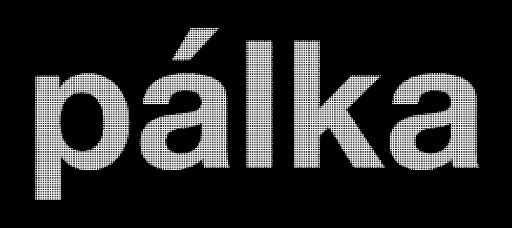
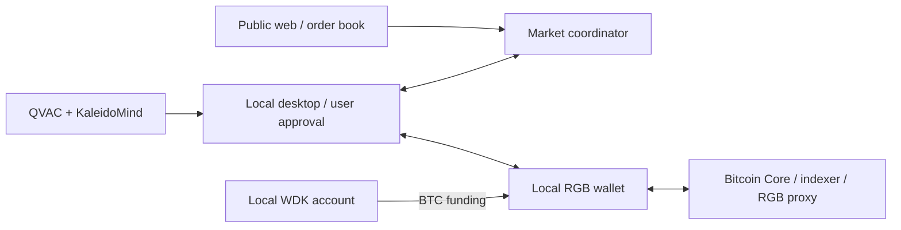

# pálka Protocol

**Turn a circle of compatible orders into one atomic Bitcoin transaction.**

pálka is a non-custodial exchange protocol and marketplace for BTC and RGB assets. It connects traders who cannot find a direct counterparty, lets them describe orders with on-device AI, and settles compatible exchanges with keys and signing on their own computers.

**[Live website](https://owlpeer.com/) · [Public market](https://owlpeer.com/market) · [First wallet setup](#first-wallet-setup) · [API health](https://api.owlpeer.com/health)**

[](https://owlpeer.com/)

## Hackathon stack

| Technology                           | How pálka uses it                                                                                                                                                                    | Working result                                                                                                                |
| ------------------------------------ | ------------------------------------------------------------------------------------------------------------------------------------------------------------------------------------ | ----------------------------------------------------------------------------------------------------------------------------- |
| **RGB on Bitcoin — required**        | Client-side asset validation through `rgb-lib`, a local Rust bridge and Python wallet service. Participants combine BTC inputs and RGB transitions into one cooperative transaction. | Real direct and three-party swaps on regtest; received RGB spent again after restart.                                         |
| **QVAC — required**                  | Local Qwen3.5 4B inference converts natural-language goals into reviewable swap terms. No cloud inference or model API key.                                                          | Real inference checks, including BTC/sats conversion, Russian input and clarification of incomplete orders.                   |
| **KaleidoMind — builder kit**        | `@kaleidorg/mind` supplies the agent engine and typed `review_swap` / `ask_clarification` tools over QVAC.                                                                           | The model maps language; deterministic code checks exact amounts, asset identity and balances.                                |
| **WDK — optional bonus integration** | A separate self-custodial Bitcoin account funds the native RGB wallet after amount/fee review and approval.                                                                          | Real **50,000-sat** regtest top-up, **141-sat** fee and recovery across restart. Full onboarding integration remains planned. |

Versions are pinned in [package.json](package.json) and the [native wallet manifest](packages/wallet/native/Cargo.toml). Original requirements: [materials.md](materials.md).

**Navigate:** [Why pálka](#why-pálka) · [How it works](#how-it-works) · [What is proven](#what-is-proven) · [First wallet setup](#first-wallet-setup) · [Try a swap](#try-a-swap) · [Architecture](#architecture) · [Development](#development) · [MVP boundaries](#mvp-boundaries) · [Roadmap](#roadmap)

## Why pálka

A direct exchange needs two people with opposite wants. In a fragmented asset market, compatible demand can exist across several people without any pair matching:

| Trader | Offers       | Wants at least |
| ------ | ------------ | -------------- |
| Alice  | 100 X        | 100 DUSD       |
| Bob    | 100 DUSD     | 100,000 sats   |
| Carol  | 100,000 sats | 100 X          |

**Alice → X → Carol → BTC → Bob → DUSD → Alice.** No pair matches; together they form an executable ring. All three transfers settle in one Bitcoin transaction. Alice never needs intermediate BTC to buy DUSD. Each participant still needs their offered assets and additional BTC for fees.

The core contribution is to **find exchanges that pairwise matching misses, then execute the complete cycle atomically**. Participants use existing inventory without requiring an AMM pool or an intermediary holding every trading pair. More compatible orders can create more execution opportunities; measuring that improvement at scale is future work.

The graph idea is inspired by [Cycles' introduction to MTCS](https://cycles.money/blog/an-introduction-to-mtcs). MTCS nets existing debts; pálka exchanges owned assets under explicit orders. Our matcher finds feasible cycles and does not claim MTCS's global optimization or measured liquidity savings.

## How it works

1. **Describe.** Enter a local goal: `Sell 10 X for at least 10000 sats of BTC. Maximum fee 1000 sats.` QVAC drafts an order or asks for missing terms. Manual entry is available.
2. **Review and publish.** Deterministic checks validate amounts, contract IDs, network, available funds and fees. Only confirmed public order terms reach the market; the natural-language goal stays local.
3. **Match.** The coordinator finds a compatible direct pair or ring and reserves the orders. AI does not choose prices or decide transaction validity.
4. **Validate and approve.** Wallets cooperate on one shared Bitcoin transaction and its RGB proofs. Each participant reviews exact incoming/outgoing amounts and their fee, then approves signing the immutable package.
5. **Settle and recover.** Completion requires Bitcoin confirmation **and** RGB acceptance by every participant. Durable journals reconcile interrupted operations against the same transaction after restart.

Missing signatures prevent completion. Sequential independent transfers are never presented as an atomic ring. Optional **partial direct fills** use separate atomic two-party transactions, each with its own approval. The entire parent order is not atomic; its fee limit is a total budget allocated across fills.

**Stalled after signing?** The local wallet can review and submit an [on-chain cancellation](docs/cancellation.md) using its own BTC input without spending RGB. Reservations are released only after the conflicting transaction is confirmed. The original swap can still confirm first; cancellation has a separate BTC fee. Verified on regtest for direct and three-party swaps, including restart and subsequent spending.

## What is proven

These are recorded real regtest results, separate from mock UI data and unit tests. Linked reports retain their original dates and scope.

| Capability                                 | Evidence                                                                                                                                                                                                                                       |
| ------------------------------------------ | ---------------------------------------------------------------------------------------------------------------------------------------------------------------------------------------------------------------------------------------------- |
| **Direct + three-party atomic settlement** | [Integration report](docs/integration.md#fresh-real-settlement): one shared transaction per swap, all participant receipts, exact balance changes and independent Bitcoin Core checks.                                                         |
| **Spend received RGB after restart**       | [Reverse direct](scripts/demo/evidence/integration-direct-repeat.json) and [reverse ring](scripts/demo/evidence/integration-ring-repeat.json): received outputs spent in subsequent confirmed swaps.                                           |
| **Real desktop participation**             | [Desktop receipt](scripts/demo/evidence/integration-desktop-direct.json): user-operated Electron Alice and API-operated Bob completed a direct swap.                                                                                           |
| **Partial direct execution**               | [Two-fill evidence](scripts/demo/evidence/service-partial-fill-20261017T175857Z-703b6af6.json): 100 X filled in two 50 X / 500,000-sat trades, with restart between fills and separate approvals.                                              |
| **Local AI + WDK funding**                 | [QVAC report](docs/handoffs/qvac-evidence.md) and [WDK transfer](scripts/demo/evidence/wdk-funding.json). Separate checks, not a claim of one fully automated AI-to-settlement run.                                                            |
| **N-party extension**                      | [Four-party settlement and reverse](docs/n-party-milestone.md), synthetic matching tests for 1,000 participants and an interactive cycle graph. Implemented in `codex/n-party-swaps`; current `main` still supports two or three participants. |

The engineering result spans the marketplace, local AI, wallet validation, cooperative RGB settlement and recovery. A broadcast alone does not count as success; a 1,000-order matching test does not establish 1,000-wallet settlement.

## First wallet setup

**Recommended demo: macOS desktop connected to the deployed shared regtest network.** Browsing the [public market](https://owlpeer.com/market) needs no wallet. Trading needs the local application.

Install **Git, Node 22.21+ (or a newer LTS), uv and rustup**. The launcher installs locked project dependencies, Python dependencies and the pinned Rust 1.94 toolchain. No local Docker or manual sidecar setup is needed for this shared-network path.

```sh
git clone https://github.com/yolki-palki-team/rgb-hackaton.git
cd rgb-hackaton
bash deploy/desktop.sh
```

A fresh profile registers with `https://api.owlpeer.com`, creates an independent local wallet, connects to the shared chain and receives test BTC. New participants receive their own demo RGB asset: **X, DUSD, T000001, T000002, …**, with **1,000 units** issued locally and the public contract shared through the catalog. Existing profiles retain their identity and assets.

The first native build can take time. First AI use downloads approximately **2.7 GB** of public model weights; subsequent inference runs locally. Wait for wallet/model readiness before using their respective actions.

For later launches, run `npm run dev:desktop` from the same checkout. After updating source, close the app, run `git pull --ff-only`, then `bash deploy/desktop.sh`. Keep the same profile and state directories; do not reinitialize or delete a wallet to reconnect. Back up complete private RGB state, not only the seed.

These commands work without RTK. The [desktop guide](deploy/DESKTOP.md) covers prerequisites and manual diagnostics; [shared-network setup](deploy/NETWORK.md) covers funding, contracts and operator configuration. A standalone installer bundling the whole wallet runtime is still planned.

## Try a swap

Use two independently funded wallets for a direct exchange, or three for the ring above. All participants need the same chain and compatible client/native-wallet versions.

1. Check the catalog and balances. Use exact contract identities; symbols alone do not identify an RGB asset.
2. Enter matching terms through QVAC or the manual form. Review direction, quantities, expiry and fee cap before publishing. The form uses **atomic units**: BTC in sats; demo RGB assets have precision 0.
3. Keep each app open while it prepares and validates the shared package. Every participant separately approves signing.
4. Check the transaction ID, Bitcoin confirmation and RGB acceptance. If interrupted, reopen the same wallet and reconcile the existing trade.

**Desktop workspace:** Overview pairs the swap composer with a collapsible wallet sorted by asset quantity, followed by paged open offers and the current running order. Trade contains active orders and expandable past executions. Completed-swap notices can be dismissed permanently for that wallet on this device. Older executions retain market-reported terms and outcomes; local transaction receipts are available for the current trade.

**Top up:** create the separate WDK account in **Top up**, receive its one-time test-BTC allowance, then review and approve a transfer into the RGB wallet. Onboarding already funds the main wallet directly, so WDK is currently an optional extra funding path. It transfers BTC; it does not mint RGB tokens. [Funding details](docs/handoffs/wdk-funding.md).

X, DUSD and generated tokens are test assets. **DUSD is not USDT or a backed dollar.** Local isolated scenarios and recovery: [operations guide](docs/usage.md).

## Architecture



| Component                                                                 | Responsibility                                                                                            |
| ------------------------------------------------------------------------- | --------------------------------------------------------------------------------------------------------- |
| [`apps/web`](apps/web)                                                    | React/Vite public marketplace, order activity and status; no keys or signing.                              |
| [`apps/market`](apps/market)                                              | Node/TypeScript coordinator, deterministic BigInt matching, HTTP/WebSocket events and SQLite persistence. |
| [`apps/local-client`](apps/local-client) + [`apps/desktop`](apps/desktop) | Private wallet UI, local QVAC, approvals, WDK funding, recovery and Electron shell.                       |
| [`packages/contracts`](packages/contracts)                                | Versioned schemas, exact integer quantities and shared validation.                                        |
| [`packages/wallet`](packages/wallet)                                      | Python RPC/journals and native Rust RGB/Bitcoin construction, verification and signing.                   |
| [`deploy`](deploy) + [`infra`](infra)                                     | Public hosting, shared regtest services and isolated local infrastructure.                                |

The coordinator sees published orders and coordinates execution; **keys, seeds, private wallet state and inference stay on participant devices**. Local APIs require authentication. The public web cannot approve trades. Coordination is currently centralized: non-custodial settlement does not make the whole marketplace decentralized.

## Development

For a visibly synthetic UI/matching demo:

```sh
rtk proxy npm ci
rtk proxy npm run dev:mock
```

Open `http://127.0.0.1:5173/market`. The runner prints private pairing-file locations for profiles on ports 4101–4103. Pair only on the local wallet page. **Mock wallets cannot sign or report blockchain settlement.** QVAC still uses real local inference.

For the full development checks, install the prerequisites above and run:

```sh
rtk proxy uv sync --locked
rtk proxy uv run --locked python scripts/demo/bootstrap-native.py
rtk proxy npm run check
```

This runs formatting, linters, type checks, JS/Python/wallet/deployment tests and both UI builds. Live inference (`npm run smoke:qvac`) and real regtest transfers are separate explicit checks. Tools and lockfiles are pinned; private wallet state and generated SDK code stay outside formatting.

**Operator references:** [Public web/API deployment](deploy/README.md) · [HTTPS](deploy/HTTPS.md) · [Shared chain](deploy/NETWORK.md) · [Settlement protocol and reproduction](docs/settlement.md) · [Environment names](.env.example).

## MVP boundaries

- **Regtest is the verified settlement network.** Current scope is precision-0 NIA assets, SegWit v0 and one active trade per wallet. Test blinding/nonces and fixed fee estimates need replacement before production; general reorg handling, fee bumping and a security audit remain open.
- **Main and the N-party extension are separate.** The extension removes the fixed participant cap; real settlement is verified through four participants. Transaction size, fees, search budget and participant availability still bound practical rings. Integration with subsequent main-branch changes remains work.
- **Users retain signing authority.** The model can misunderstand language; every draft needs review. Legacy private-policy features such as protected reserves and BTC-sale bans are currently disabled. Exact order terms, funding checks, fee caps and final approval remain enforced.
- **Verification is scoped.** Service swaps, a user-operated desktop direct swap and shared-network onboarding have evidence. A full multi-computer AI-to-ring journey, large-ring settlement and production distribution are not yet established by those records. Mainnet signing requires explicit user approval.

## Roadmap

- [x] **Arbitrary-hop atomic rings:** remove the fixed two/three-party limit and render larger cycles in the wallet. Completed in `codex/n-party-swaps`; real four-party forward/reverse settlement and 1,000-party synthetic matching are documented in the [milestone report](docs/n-party-milestone.md). “Arbitrary” means no fixed software hop cap, not infinite transaction capacity.
- [ ] **Full WDK top-ups:** make WDK funding a complete onboarding and replenishment flow instead of an optional path alongside direct faucet funding.
- [ ] **A proper installable app:** bundle Python, the native RGB runtime and dependencies into signed releases, with updates that do not require users to rebuild from source.
- [ ] **Testnet → mainnet:** validate public-network paths, implement production fees/privacy/recovery, audit signing and settlement, and retain explicit mainnet approval.
- [ ] **Liquidity and distribution:** onboard asset issuers, wallet integrations and initial trading communities; seed compatible offers and measure additional execution unlocked by rings.
- [ ] **Integrate and measure the extended MVP:** merge N-party work with current fixes, verify independent-computer journeys, and compare pair-only versus ring matching on reproducible order sets, reporting fills, fees, latency and failures.
