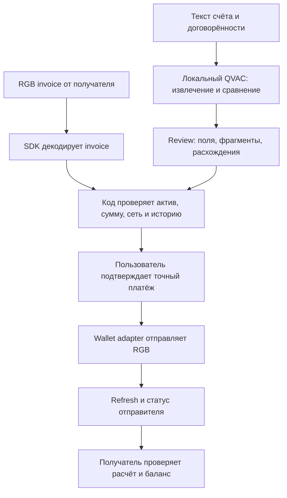

# Agentic Dollars on Bitcoin — информация и исследование идей

Объединены материалы прежних `info.md` и `ideas.md`: правила, ответы менторов, ссылки, исследование экосистемы, варианты идей и полный Telegram-экспорт.

**Текущее направление проекта — RGB P2P Exchange:** прямой обмен и обмен по кольцу из трёх участников, локальный QVAC и подтверждение пользователем. Текущий статус реализации и запуск описаны в [README](README.md). Рекомендации «Колония», AidDesk и другие ниже сохранены как история поиска, а не как новый план разработки. Упоминание Expo также относится к предыдущему этапу; текущий интерфейс находится в `apps/web`.

- [Сведения из Telegram-чата](#сведения-из-telegram-чата).
- [Исследование и идеи](#идеи-для-agentic-dollars-on-bitcoin).
- [Полный исходный экспорт](#приложение-полный-исходный-экспорт).

## Сведения из Telegram-чата

Источник: полный экспорт `tg_chat_info.txt` от 17 октября 2026 года, 809 строк, четыре темы, 70 участников. Время сообщений — GMT+2 (Europe/Rome). Ниже сведения сгруппированы по смыслу; **полный текст экспорта без сокращений** помещён в приложение, включая служебные сообщения, вопросы без ответа и список ссылок.

Этот раздел передаёт только то, что есть в чате. Упомянутый `participant-instructions.pdf` был вложением в Telegram; его содержимое в текстовый экспорт не входит. Ссылки перечислены как в экспорте, без проверки их текущей доступности.

### Главное для участника

- **Обязательный стек:** RGB Protocol on Bitcoin как слой активов и QVAC как локальный AI на устройстве. **WDK необязателен**, даёт бонус по правилам от 15 октября.
- **До пятницы, 16 октября, 23:00 CEST:** выбрать название команды и проекта, создать публичный GitHub-репозиторий, описать в README идею, стек и всё, что было сделано до хакатона, передать название команды/проекта и ссылку организаторам. 16 октября предложена также общая таблица для подачи сведений.
- **Суббота, 17 октября:** быть в BLOX к 08:20 по последнему напоминанию от 17 октября 01:17; kickoff в 08:30, старт хакатона в 09:30. Пришедшим в BLOX сказано пройти в зал внизу.
- **Воскресенье, 18 октября, 13:00:** последний учитываемый коммит должен быть в ветке `main`, вместе с README о запуске. Более поздние коммиты не учитываются. С 13:00 до 14:30 — мини-демо судьям у рабочего места; затем выбирают 10 финалистов. С 16:00 до 17:30 — пятиминутные презентации финалистов; награждение в 18:00.
- Не коммитить API-ключи, `.env`, seed-фразы и приватные ключи. Во время хакатона правило против `force-push`/`rebase` организатор распространила на **весь репозиторий**, включая неосновные ветки: иначе теряется история того, что было до хакатона и сделано на нём. За несоблюдение прозрачности могут снять баллы. После хакатона ограничение снимается.

### Организация и хронология объявлений

| Дата и время | Что объявлено |
| --- | --- |
| 8 октября, 14:39 | Birk (Birkan Kayadibi, COO RGB Protocol Association, организатор) приветствовал отобранных участников: более 400 заявок на 60 мест. Важные новости публикуются в чате; участников попросили включить уведомления и пригласить товарищей по команде. До вторника канал планировали оставить только для чтения; для связи указан Birk либо Mari `@Maryive`. |
| 9 октября, 17:04 | Опубликованы материалы в общей папке: два обзорных RGB-видео, руководства QVAC и WDK, видео по KaleidoSwap builder kit и Excel со ссылками. Опубликованы обязательный стек и возможные пути разработки. |
| 12 октября, 16:19–16:30 | Созданы темы RGB, QVAC и WDK Q&A; вопросы передают менторам, ответы обещали публиковать примерно раз в день вечером. Birk пояснил, что участники группы, подписавшие документы, уже отобраны: массовое благодарственное письмо с формулировкой о неотборе к ним не относится. |
| 15 октября, 09:48–09:49 | Mari опубликовала расписание, порядок подачи проекта, новую подробную шкалу оценивания и приложила официальный `participant-instructions.pdf` (162 KB). Полный текст PDF в экспорте отсутствует. |
| 15 октября, 20:04 | Разрешены форки `rgb-lib` и RGB Lightning Node, если команда работает непосредственно в них и присылает ссылку на форк; прежние правила истории коммитов остаются в силе. |
| 16 октября, 14:47 и 19:22 | Повторное напоминание: название команды/проекта и GitHub-ссылка нужны до 23:00 CEST; можно отправить в личные сообщения, по почте или вписать в общую таблицу. |
| 16 октября, 19:21 | Создан Discord-канал с разработчиком QVAC; график помощи в чате и голосовых встречах указан в `#welcome`, часы CEST. Модели большие — руководство по установке советуют выполнить дома до приезда, чтобы не тратить время на скачивание через Wi‑Fi площадки. |
| 17 октября, 01:17 и 08:16 | Напоминание прийти в BLOX к 08:20 и указание пройти в комнату внизу. |

### Подача проекта, оценка и изменение правил

Публичный GitHub-репозиторий должен содержать README с исходной идеей, стеком и ранее сделанной работой. Название команды, проекта и ссылку можно отправить на `info.rgb@proton.me`, в Telegram `@birk1907`/`@Maryive` или внести в [общую таблицу](https://docs.google.com/spreadsheets/d/1eLS764VXMB_2f8jX8Nj1ItIYDpPL_mUFeHuoGJyHLqQ/edit?usp=sharing). Итоговый README должен объяснять запуск проекта. Вопрос о приватном marketplace-репозитории и подаче отдельного публичного репозитория был задан 12 октября; тогда ответили, что инструкции появятся позднее. Объявление 15 октября уже требует публичный репозиторий.

**Актуальная опубликованная шкала от 15 октября:** каждый критерий оценивается от 1 до 5, итог взвешивается: реальное использование RGB — **25%**, осмысленное локальное применение QVAC — **20%**, работающий live-проект и полнота реализации — **20%**, понятный нетехническому пользователю UX/UI — **15%**, новизна — **10%**, рыночная применимость — **10%**. WDK может добавить **до +1 балла**, максимальный результат — **6**. Судьи оценивают в UX ясность шагов и ошибок выше визуальной полировки.

**Историческое расхождение:** в WDK Q&A 12–13 октября бонус описывали как 0–5 дополнительных баллов, зависящих от реальной пользы WDK, а не от формального подключения. Более позднее общее объявление 15 октября устанавливает `до +1` при максимуме 6; именно оно приведено выше как актуальная опубликованная шкала. Ответ о том, что полезная интеграция ценится выше бессмысленной, остаётся содержательным ориентиром, но численную шкалу 0–5 следует считать старой.

### Материалы и выбор стека

- [Страница хакатона](https://rgbprotocol.org/agentic-dollars-hackathon/).
- [Общая папка материалов](https://drive.google.com/drive/folders/1HqZP4TDRmsvYW6hsW7T6-OoNNZMVFV-X?usp=drive_link): два вводных RGB-видео, tutorial по QVAC, tutorial по WDK, видеообзор KaleidoSwap builder kit, Excel со ссылками по уровню необходимости.
- [RGB Docs](https://docs.rgb.info/) — основной источник концепций RGB. Организатор подчёркивает необходимость понять механику перевода активов.
- [QVAC quickstart](https://docs.qvac.tether.io/quickstart/) — локальный AI.
- [WDK Docs](https://docs.wdk.tether.io/) — необязательный self-custodial wallet toolkit.
- [KaleidoSwap builder kit](https://kaleidoswap.github.io/rgb-hackathon/) — рекомендован новичкам: узел, кошельки и инструменты с QVAC, в том числе создание RGB-инвойса из текстового запроса.
- [RGB assistant в ChatGPT](https://chatgpt.com/g/g-69f31db8cae081918db75cbd969df294-rgb-protocol-on-bitcoin-assistant) обучен на документации RGB; нужен вход в аккаунт, Plus не требуется. Его рекомендуют как средство ориентирования в документации.
- UTEXO предлагает SDK/форки, [адаптер WDK ↔ RGB](https://github.com/UTEXO-Protocol/wdk-wallet-rgb) и React Native-библиотеку для мобильной разработки. Менторы UTEXO и KaleidoSwap должны присутствовать оба дня. Для опытных команд предложены `rgb-lib` для on-chain и RGB Lightning Node для Lightning; упоминались также RGB-Tools. Организаторы советуют выбрать путь в начале и не менять его в середине работы.
- Сторонние инструменты и форки разрешены. В ответе 12 октября просили явно назвать их при открытии pull request; позднее, 15 октября, организаторы разрешили форки `rgb-lib`/RGB Lightning Node при передаче ссылки на форк. Процедуру итоговой подачи следует читать по более позднему объявлению о публичном репозитории и коммите в `main`.

### RGB: ответы менторов и ограничения

#### Сети, кошельки и тестовые активы

- По ответу Arshia 12 октября, **`signet` (`sb:`) и `signetcustom` (`sbc:`) для RGB — разные сети**, хотя используют одну цепь Mutinynet. Сеть фиксируется при выпуске актива. Faucet, maker API и кошельки KaleidoSwap работают в `signetcustom`; адаптер UTEXO WDK и underlying `rgb-sdk` на момент обсуждения поддерживали только обычный `signet`. Поэтому кошелёк WDK не может получить RGB-актив из faucet или кошелька KaleidoSwap.
- Faucet-актив, названный `USDT`, по словам Arshia является **NIA**. Показанное maker API значение `issued_supply: 0` было ошибкой отображения, которую он собирался исправить; причиной несовместимости с WDK остаётся сеть `signetcustom`.
- Команда Fidelity Points предложила выпустить собственные тестовые NIA `USDB` и `MOON` на `signet`/Mutinynet и пользоваться WDK-кошельком. Arshia ответил, что для судейства это не должно быть проблемой при явном описании сетевой несовместимости. Отдельный вопрос той же команды, будет ли **конкретно такой вариант** засчитан для WDK-бонуса, повторили 16 октября; ответа в экспорте нет.
- Можно использовать общедоступный Mutinynet через KaleidoSwap или свой локальный `regtest`; запрета на собственную среду нет. Arshia отдельно советует regtest, если тестовые сети дают несовместимости.
- KaleidoSwap разрешил использовать свой [Esplora](https://esplora.signet.kaleidoswap.com) и [RGB proxy](https://proxy.kaleidoswap.com/json-rpc) весь уикенд. Жёсткого лимита нет, но частый polling мешает maker. [mutinynet.com/api](https://mutinynet.com/api) работает с той же цепью как запасной индексатор, но ограничивает запросы, особенно с общего IP площадки.
- [BTC faucet Mutinynet](https://faucet.mutinynet.com): до **1 млн sats на IP/пользователя/адрес за 24 часа**. [RGB faucet KaleidoSwap](https://faucet.mutinynet.kaleidoswap.com): **100 тестовых USDT за один on-chain claim**, до **5 claims на GitHub-аккаунт в день**. Рекомендовано пополнить кошельки до приезда. Это описание тестовых активов и лимитов из сообщения 12 октября.
- По сообщению организатора, Wi‑Fi площадки должен допускать работу устройств, также проверено наличие Ethernet-кабелей на месте. Это оценка организатора, а не подтверждённый результат работы конкретной команды на площадке.

#### Переводы и Lightning

- **On-chain RGB-платёж с одним подтверждением засчитывается для `Payments and Checkout`.** RGB через Lightning не требуется; Birk подтвердил это 13 октября. Lightning может открыть другие сценарии, но обязательного требования нет.
- Для HODL-инвойсов с `payment_hash`, `claimhodlinvoice` и `cancelhodlinvoice` в RGB Lightning разрешено применять форк UTEXO `UTEXO-Protocol/rgb-lightning-node`, tag `v0.11.0-beta.3`, с `@utexo/wdk-rgb-lightning`, если он решает задачу. Необходимо открыто указать используемый форк.
- На вопрос о Multi-Path Payments Walter ответил 14 октября: RGB MPP технически возможно **без изменения самого RGB-протокола**. Доли 60 и 40 токенов могут идти как отдельные colored HTLC в разных каналах, разделяя payment hash; получатель раскрывает preimage при наборе полной суммы. Нынешняя реализация Lightning не делит RGB-сумму: маршрутизатор требует, чтобы один канал вместил её целиком, а onion переносит одно RGB-значение. Для MPP нужны изменения onion-формата (`total RGB amount`), маршрутизатора, логики получателя и небольшое дополнение спецификации. Цена — дополнительная BTC-ликвидность/комиссии и более сложный поиск маршрута с учётом одновременно BTC и RGB-ёмкости.
- Вопрос о рекомендуемом Electrum/Esplora endpoint для `rgb-lib v0.3.0b7` и переводе в `WAITING_CONFIRMATIONS` был задан 13 октября; автор позже сообщил, что увидел подтверждение через Mutinynet Esplora API. Отдельного ответа с рекомендацией endpoint или инструкцией по refresh в экспорте нет.

#### Известное затруднение WDK

Вопрос Fidelity Points от 12 октября: native binary `wdk-wallet-rgb 2.0.3` с `rgb-lib 0.3.0-beta.8` требует `glibc 2.38` и не работает на Ubuntu 22.04; команда обходила это переопределением `@utexo/rgb-sdk` на `1.0.6` (`native beta.13`). Та же mnemonic затем давала другой кошелёк (`vanillaKeychain 0` вместо `1`). На демо-ноутбуке команды был `glibc 2.39`, поэтому вопрос стал менее срочным. Рекомендации ментора по этому обходу в экспорте нет. Также без прямого ответа остался вопрос Edwin: нужна ли для бонуса именно RGB-транзакция через WDK или достаточно работающих кошельковых операций; Birk ответил общим принципом — ценится реальная работа WDK, бонус масштабируется по пользе.

### QVAC: устройство, модели, ответы и незакрытая ошибка

- **Локальный запуск `qvac serve` на ноутбуке с вызовом из веб-страницы на том же компьютере засчитывается как on-device inference** — прямой ответ Simone от 12 октября.
- Рекомендованная память для desktop: минимум **16 GB RAM**, удобнее **24–32 GB**. CPU-инференс возможен, выделенный GPU назван надёжным вариантом; macOS, по оценке организаторов, работает лучше благодаря железу и оптимизациям. QVAC поддерживает desktop и mobile.
- Для mobile указан минимум **8 GB RAM**, Snapdragon либо Apple silicon. В ответе приведены ориентиры: iPhone 13 Pro и новее, Pixel 6 и новее, Samsung S23 и новее; модели до 2B могут работать в зависимости от устройства.
- Рекомендованы 4-bit `QWEN3-600M`, `QWEN3.5-0.8B`, `QWEN3.5-2B`, `QWEN3.5-4B`, `QWEN3.5-9B`. У всех, кроме 600M, указаны соответствующие projection models для vision. Для узких задач возможны модели до 1B; качество выше предлагают искать от 4B на desktop. Для распознавания речи назван `Parakeet TDT 0.6B Q8`, для синтеза — `Supertonic 3 Q8`.
- План Fidelity Points: короткий schema-constrained JSON-ответ (~400 входных и 80 выходных токенов), расчёты в коде, `QWEN3.5-2B Q4` через `qvac serve --openai`, fallback `0.8B` на Linux-ноутбуке с 32 GB RAM (CPU или Vulkan GPU). Simone назвал выбор хорошим и предложил `/no_think` в system prompt для выключения размышлений, а затем велел убрать `reasoning_budget`.
- **Незакрытое расхождение:** команда протестировала `@qvac/sdk 0.21.0`, `@qvac/cli 0.15.0`, `@qvac/llm-llamacpp 0.55.0`, Windows 11/Vulkan. С `/no_think` и `response_format: json_schema` или `json_object` сервер каждый раз отвечал HTTP 500: `RPCError: Unexpected empty grammar stack after accepting piece: ? (30)`. Без схемы `/no_think` всё равно генерировал `reasoning_content`. С `reasoning_budget: false` либо `0` выходил валидный JSON без reasoning. Simone ответил, что `/no_think` ожидаемо должен работать на Qwen 3/3.5; конкретного исправления в переписке нет. Команда решила оставить работающий `reasoning_budget: false` и проверить ещё на Linux.
- Для QVAC-помощи создан [Discord](https://discord.gg/PaYceGcC); раздел `#welcome` содержит часы поддержки и инструкции для вопросов. Файлы моделей советуют скачать заранее.

### Контакты и ссылки из сообщений

| Назначение | Ссылка или контакт |
| --- | --- |
| Организаторы | [Почта](mailto:info.rgb@proton.me), [Birk](https://t.me/birk1907), [Mari](https://t.me/Maryive) |
| Подача команды и репозитория | [Общая таблица](https://docs.google.com/spreadsheets/d/1eLS764VXMB_2f8jX8Nj1ItIYDpPL_mUFeHuoGJyHLqQ/edit?usp=sharing) |
| QVAC поддержка | [Discord](https://discord.gg/PaYceGcC), Telegram `#welcome` (`tg://search_hashtag?hashtag=welcome`), [@qvac](https://t.me/qvac) |
| UTEXO | [@utexo](https://t.me/utexo), [wdk-wallet-rgb](https://github.com/UTEXO-Protocol/wdk-wallet-rgb) |
| Mutinynet | [Сайт](https://mutinynet.com), [Esplora KaleidoSwap](https://esplora.signet.kaleidoswap.com), [RGB proxy](https://proxy.kaleidoswap.com/json-rpc), [API](https://mutinynet.com/api), [BTC faucet](https://faucet.mutinynet.com), [RGB faucet](https://faucet.mutinynet.kaleidoswap.com) |

Экспорт также содержит Telegram-ссылки на bot commands `tg://bot_command?command=rgb`, `tg://bot_command?command=lninvoice` и `tg://bot_command?command=wdk`. Все повторные вхождения ссылок и привязка к сообщениям сохранены ниже в оригинальном разделе `ALL LINKS (31)`.

---

## Идеи для Agentic Dollars on Bitcoin

Дата исследования: 17 октября 2026. Материалы: локальные README и tg_chat_info.txt (809 строк, все четыре темы), публичные ресурсы по ссылкам, Excel и текст PDF из общей папки, публичная таблица команд и доступные README участников.

### Актуальная подборка: RGB определяет весь сценарий продукта

Обновление 17 октября 2026: после уточнения команды главный фильтр — **активное, видимое использование RGB**. Телефония больше не ограничивает выбор. Ниже три предложения, а не реализованные функции или уже принятое командой решение. Expo остаётся предпочтением для интерфейса; RGB и локальный QVAC обязательны.

В [объявлении организаторов](info.md#подача-проекта-оценка-и-изменение-правил) от 15 октября, 09:48: RGB — **25%**, QVAC — 20%, работающая реализация — 20%, UX/UI — 15%, оригинальность — 10%, рыночная применимость — 10%. Формулировка критерия RGB — реальное использование в продукте. Число транзакций само по себе не гарантирует баллы: каждое движение актива должно менять результат для пользователя.

**Моя рекомендация — «Колония»: три локальных AI-агента должны спасти станцию, реально покупая и передавая RGB-ресурсы.** Это наиболее наглядный из трёх сценариев: жюри наблюдает экономику и проверяет её состояние в кошельках.

#### Как получена подборка

Применены найденные через skills.sh инструкции [brainstorm-ideas-new](https://skills.sh/phuryn/pm-skills/brainstorm-ideas-new) ([SKILL.md](https://github.com/phuryn/pm-skills/blob/main/pm-product-discovery/skills/brainstorm-ideas-new/SKILL.md)) и [creative-thinking-for-research](https://skills.sh/orchestra-research/ai-research-skills/creative-thinking-for-research) ([SKILL.md](https://github.com/Orchestra-Research/AI-Research-SKILLs/blob/main/21-research-ideation/creative-thinking-for-research/SKILL.md)). Использованы продуктовый, дизайнерский и инженерный разбор, инверсия ролей и проверка необходимых ограничений. Несколько агентов независимо проверяли экономические механики и доступные операции SDK. Навыки прочитаны и применены, глобальная установка не выполнялась.

**Граница проверки оригинальности:** изучены публичные материалы экосистемы и доступные проекты участников. Полного совпадения с предложенными сценариями в просмотренных материалах не найдено; это не доказательство мирового первенства. Ниже указаны близкие аналоги и слабые места. Новое название для уже существующего кошелька не считается отличием.

#### 1. «КОЛОНИЯ» — AI-агенты, которые должны заработать на спасение своего мира

**Pitch:** «Мы даём трём локальным AI разные ресурсы и секретные цели. Спасти станцию они могут только через настоящую экономику на RGB».

На станции отключился реактор. Инженеру нужны три ресурса: свои панели, кристалл торговца и механизм другого поселенца. У каждого участника свой инвентарь, бюджет, личная цель и локальный AI-советник. Торговец может завысить цену; инженер может отказаться или изменить план. Написать в чате «у нас теперь есть кристалл» недостаточно: склад миссии должен действительно получить нужный RGB-актив.

**Что делает RGB:** четыре типа активов — панели, кристаллы, механизмы и тестовые деньги — выпускаются как отдельные NIA с известными contract ID. Деньги переходят продавцам; ресурсы переходят в отдельный кошелёк склада. Приложение открывает действие «починить реактор» только после проверки полученных ресурсов. Завершённая миссия приносит отдельную RGB-выплату из заранее подготовленного фонда.

**Что делает QVAC:** локально предлагает план и ведёт переговоры с учётом собственных сведений, цен и бюджета. Решения модели превращаются в ограниченные команды; суммы, идентификаторы активов и разрешения проверяет код. Профили вымышленные. На одном демонстрационном компьютере можно держать отдельные контексты агентов, но это не изоляция секретов от оператора компьютера.

**Полный раунд демо — шесть реальных переводов:**

| Шаг | RGB-перевод | Изменение в продукте |
| --- | --- | --- |
| 1 | Инженер → торговец: тестовые деньги | Оплачен согласованный кристалл; доставка ещё ожидается |
| 2 | Торговец → склад: кристалл | Получена первая покупная часть реактора |
| 3 | Инженер → механик: тестовые деньги | Оплачен механизм; доставка ещё ожидается |
| 4 | Механик → склад: механизм | Получена вторая покупная часть |
| 5 | Инженер → склад: собственные панели | Собран полный набор ресурсов по правилам миссии |
| 6 | Фонд миссии → инженер: награда | Замкнулся экономический цикл; изменился бюджет следующей миссии |

Каждый ресурс продаётся с доставкой прямо на склад; лишняя промежуточная передача инженеру не нужна. Перед выпуском награды склад сверяет ожидаемые contract ID, суммы и завершённые входящие переводы. Приложение учитывает, какие поступления уже использованы миссией, чтобы не выдать награду повторно.

**Момент для жюри:** «AI договорился о покупке — но реактор всё ещё не запускается. Теперь склад подтвердил реальную RGB-передачу последнего ресурса — действие доступно, а награда пришла инженеру». В интерфейсе рядом видны план, движение ресурсов и подтверждённые балансы.

**Три экрана Expo:** станция и цель → переговоры агентов → кошельки, ресурсы и выполнение миссии. Первая версия: одна миссия, фиксированный рецепт, три ресурса, три агента и один кошелёк склада/фонда. Без свободного генерируемого мира.

**Почему это может быть продуктом:** кооперативные игровые вечера с личными AI-союзниками и разными экономическими стратегиями. Продавать можно сценарии. Интересность игры и готовность платить ещё нужно проверить; технически насыщенное демо само по себе не создаёт рынок.

**Отличие и риск:** [Dark Forest](https://blog.zkga.me/announcing-darkforest) уже использует скрытую информацию и криптографию в игре; [AI Dungeon](https://help.aidungeon.com/faq/do-you-support-multiplayer) — совместные AI-приключения. Наш проверяемый вклад — переговоры локальных советников с разными знаниями и полный цикл обмена несколькими RGB-ресурсами, от которого зависят действия игры. Если ресурсы остаются декоративными токенами, отличие пропадает.

**Техническая граница:** правила миссии выполняет приложение. RGB не запускает реактор и не гарантирует, что продавец доставит ресурс после оплаты. Две стороны сделки не атомарны. Передача NIA на склад не является сжиганием; создание нового игрового предмета было бы отдельным действием эмитента, а не автоматически исполнившимся RGB-контрактом.

#### 2. «НЕВИДИМАЯ ФАБРИКА» — завод собирается на время одного заказа

**Pitch:** «У этой фабрики нет своих станков и склада. Локальный AI собирает производство из принадлежащих разным людям RGB-прав на материалы и рабочее время».

Человек просит изготовить необычный предмет, например персональную настольную лампу. Один участник предлагает комплект деталей, другой — час станка, третий собирает изделие. Их локальные агенты знают собственные ограничения и минимальную цену, обмениваются только согласованными предложениями и составляют выполнимый заказ.

**Цикл RGB:** поставщики выпускают ограниченные права на комплект и машинное время → заказчик оплачивает выбранные предложения RGB-деньгами → поставщики передают права в кошелёк сборщика → сборщик предъявляет права поставщикам для исполнения → после подтверждения готовности выпускает право на получение готовой лампы и передаёт его заказчику. Заказчик может передать это последнее право другому получателю. Эмиссия, деньги, производственные права и итоговое право — отдельные проверяемые операции.

**QVAC нужен для:** преобразования описания заказа в план, согласования доступности и выбора совместимых предложений в пределах бюджета. Стоимость и состав заказа подтверждаются кодом и участниками. Модель не определяет безопасность производственного процесса.

**Демо:** один заранее проверенный рецепт, два поставщика, один сборщик, один заказчик; реальные RGB-права и оплаты, физическое изготовление заменено явно обозначенным подтверждением оператора. Показываем, как замена недоступного поставщика меняет план закупки и получателя оплаты. Не обещаем полный цикл за три перевода: у покупки есть денежная и товарная стороны, у погашения — отдельная передача.

**Три экрана Expo:** мой заказ → собранная производственная цепочка → права и результат. Потенциальные пользователи — небольшие мастерские и makerspace. Проверка спроса требует разговора хотя бы с одним реальным производителем.

**Отличие и риск:** [HubWallet](https://github.com/Vittorio-dotcom/hubwallet) уже описывает RGB-права доступа, аренду устройств и закупки между устройствами. Наше предполагаемое отличие — сборка межфирменной производственной цепочки под новый заказ и переход от входных прав к праву на результат. По близости к существующим механикам это более рискованный кандидат, чем «Колония». README HubWallet описывает намерения; успешную реализацию всех этих функций мы не проверяли.

**Граница:** RGB подтверждает передачу права, а поставщик обеспечивает его исполнение. Связь входных материалов с готовой лампой фиксирует приложение и подтверждает сборщик. Автоматического производственного escrow, атомарного обмена и доказательства физического изготовления в MVP нет.

#### 3. «ПОСЫЛКА С БЮДЖЕТОМ» — груз сам собирает себе маршрут

**Pitch:** «Отправитель задаёт посылке адрес, срок и бюджет. Её локальный агент покупает путь из свободных участков маршрута разных людей».

Один человек завтра едет из A в B, другой — из B в C. Каждый выпускает ограниченное право на перевозку одного подходящего груза в определённое время. Агент отправителя находит совместимую цепочку, проверяет бюджет и приобретает права. При изменении планов он предлагает замену участка. “Посылка покупает” — образное название: средствами распоряжается программный агент с полномочиями от отправителя.

**Цикл RGB:** перевозчики выпускают права на участки → отправитель делает две оплаты RGB-деньгами → получает два RGB-права → предъявляет каждое право соответствующему перевозчику передачей в его кошелёк при согласованном погашении. Два участка дают шесть переводов: две оплаты, две доставки прав, два погашения. Все эти движения означают разные изменения заказа; статус физического груза ведётся отдельно.

**QVAC нужен для:** согласования расписаний и ограничений, выбора цепочки и объяснения перепланировки. У каждого перевозчика личное расписание остаётся локально; наружу уходит согласованное предложение, которое всё равно раскрывает часть доступности. Проверка времени, размера груза и сумм детерминирована.

**Демо:** два участка, три стороны и небольшой физический предмет. Люди подтверждают две передачи предмета; RGB-права погашаются отдельно. Замена участка — дополнительная функция после работающего основного маршрута. Возврат денег требует согласия перевозчика и отдельного перевода, его нельзя показывать как автоматическую гарантию протокола.

**Три экрана Expo:** задание и бюджет → маршрут и покупки → права и передача груза. Польза для рынка — использование свободного места на уже запланированных поездках; доверие, ответственность и соблюдение сроков остаются главными непроверенными предпосылками.

**Отличие и риск:** [Rueda](https://github.com/kayyrod21/rueda-hackathon26) уже заявляет local AI + mobility booking + RGB. В просмотренном README действующие платежи обозначены как незавершённые. Здесь предполагаемый новый механизм — составной маршрут для груза из передаваемых прав нескольких независимых перевозчиков. Совпадение транспортной тематики делает этот кандидат менее безопасным по оригинальности; «первый AI для доставки» заявлять нельзя.

**Граница:** владение правом на перевозку не доказывает местоположение или сохранность груза. Самостоятельное истечение срока, штрафы, возвраты и выполнение маршрута не возникают автоматически из выпуска NIA. Это правила приложения и договорённости участников.

#### Что именно показывать жюри

| Критерий | Проверяемый результат в «Колонии» |
| --- | --- |
| RGB, 25% | Четыре типа активов, несколько независимых кошельков, шесть осмысленных переводов, проверка получателем, итоговая награда |
| QVAC, 20% | Локальный план и переговоры меняются после настоящего изменения ресурсов и бюджета |
| Execution, 20% | Один полный раунд от цели до зачисленной награды без ручной правки балансов |
| UX/UI, 15% | Пользователь видит, чего не хватает, что оплачено, что получено и почему миссия ещё недоступна |
| Innovation, 10% | Экономическая кооперация локальных AI с частными целями; готовый wallet UI не выдаётся за новую разработку |
| Marketability, 10% | Понятный формат игрового вечера; гипотеза продажи сценариев, которую ещё предстоит проверить |

Это план доказательств, не прогноз оценки. Если шесть переводов мешают закончить работающий раунд, уменьшаем число ресурсов и честно показываем фактический сценарий.

#### Проверенная техническая основа и границы обещаний

В текущем [React Native SDK](https://github.com/UTEXO-Protocol/rgb-sdk-rn) описаны выпуск NIA, создание invoice, отправка, обновление кошелька, история переводов, балансы и consignment. [Sandbox](https://github.com/UTEXO-Protocol/rgb-sdk-rn-sandbox) показывает подготовку кошелька, выпуск, отправку и обновление после блока. Это документированный путь для прототипа, а не выполненный нами интеграционный тест.

- Готовим отдельные кошельки, BTC для комиссий, подходящие UTXO и тестовые активы заранее. Для уникального права в прототипе можно использовать отдельный NIA с количеством 1 и precision 0; это не новая схема RGB.
- На экране проверки показываем contract ID, количество, баланс до/после у обеих сторон и статус получения. Bitcoin txid или нарисованная надпись «оплачено» недостаточны. Только подтверждённое и проверенное поступление меняет условия миссии.
- В обычном пути RN SDK передаётся один актив за вызов. Несколько разных активов означают последовательные операции. Платёж и доставка товара не становятся атомарными от того, что приложение запускает их подряд.
- NIA не обещаем сжигать. Полученные ресурсы остаются на складе; приложение отдельно учитывает их использование. Новую награду выплачивает кошелёк фонда по правилам приложения.
- Полный раунд на публичной тестовой сети может ждать подтверждений дольше сценического выступления. Организаторы допускают свой regtest: можно демонстрировать реальные RGB-переводы на локальной тестовой цепочке и явно показывать добычу блоков. Это тестовая сеть, а не mainnet и не анимация фиктивных платежей.
- Тестовый денежный NIA не является обеспеченным долларом или USDT Tether. В интерфейсе и питче нужна точная пометка.
- Нативная RGB-библиотека требует совместимой нативной сборки Expo; запуск через Expo Go не считаем проверкой интеграции. Локальный QVAC не означает, что сетевые операции RGB работают без связи.

#### Что не выдаём за свою инновацию

| Проверенный источник | Уже существующий механизм |
| --- | --- |
| [Rate](https://github.com/kaleidoswap/Rate) | Голосовой кошелёк, локальный AI, биометрия, лимиты и подтверждение расходов |
| [RGB SDK](https://github.com/UTEXO-Protocol/rgb-sdk-rn) | Выпуск, invoice, переводы, балансы и резервные копии |
| [RGB Multisig Hub](https://github.com/RGB-Tools/rgb-multisig-hub) | Согласование операций несколькими участниками |
| [ScratchMyPay](https://github.com/ScratchMyPay/ScratchMyPay/blob/main/docs/IMPLEMENTATION_STATUS.md) | Local AI → подтверждение → выплата команде |
| [HubWallet](https://github.com/Vittorio-dotcom/hubwallet) | В README заявлены права доступа и аренды, оплата устройств и закупки |
| [Naibour](https://www.naibour.com/about) | AI-подбор многосторонних бартерных цепочек |
| [Gaka-chu](https://arxiv.org/abs/2203.03411), [Autonomous Art](https://www.autonomousart.org/) | Объекты, которые зарабатывают на собственное существование |

Предыдущие кандидаты «Контрабанда», совместный заказ новой услуги и будущий излишек заменены этой подборкой. Идеи с телефонией исключены из текущего выбора. Исследование ниже сохранено как архив; его прежние рейтинги не являются текущей рекомендацией.

---

### Архивная рекомендация до запроса на более оригинальную идею

**AidDesk — приватный рабочий стол для обработки заявок на адресную помощь и выплаты цифровых долларов на Bitcoin.** Небольшой фонд или университетская служба помощи вставляет заявку и свои правила. QVAC локально сопоставляет текст с правилами, находит недостающие сведения и готовит карточку с исходными фрагментами. Сотрудник принимает решение; код проверяет лимит программы и сумму; фонд отправляет настоящий RGB-платёж получателю.

Это рекомендация **после чтения Telegram и проектов участников**. Первоначальный кандидат PayProof снят с первого места: [WiseLedger](https://github.com/LucaCraft89/WiseLedger) уже заявляет почти тот же invoice → risk checks → confirmation → RGB payment. Одного переименования недостаточно.

**Второй выбор — Reimburse Local:** возмещение командных расходов по внутренней политике; более простой бизнес-процесс, но частично пересекается с обработкой счетов и split bills.

**Третий выбор — Recovery Coach:** более специфичная проблема RGB и меньше прямых пересечений в прочитанных описаниях, но нужно доказать полезность AI и связь с реальными долларами.

Ниже сохранены десять исходных вариантов с техническим разбором, а затем добавлены AidDesk, обновлённый конкурентный анализ и план выбора. PayProof, Agent Tender и PayCrew рассматриваются как запасные направления с высоким риском пересечения.

Названия рабочие; уникальность брендов и наличие конкурентов за пределами предоставленных материалов не проверялись. Спрос и монетизация ниже — гипотезы для проверки, а не доказанные рыночные факты.

### 1. Что определяет выбор идеи

#### Требования хакатона

**Приоритет — более позднее объявление MariJ от 15 октября, 09:48 в `tg_chat_info.txt`, а не расходящаяся с ним публичная страница.** RGB и QVAC обязательны. Каждая категория оценивается от 1 до 5:

| Критерий | Вес |
| --- | --- |
| RGB | 25% |
| QVAC и обоснованность локального AI | 20% |
| Execution: что работает live | 20% |
| UX/UI | 15% |
| Innovation | 10% |
| Marketability | 10% |

Базовый итог — до 5, бонус WDK — до +1, максимум 6. Старые сообщения 12–13 октября говорят о бонусе 0–5, а сайт — о пяти равновесных критериях; для планирования используем свежую инструкцию 15 октября. Вложенный `participant-instructions.pdf` в текстовом экспорте только упомянут: самого PDF в рабочей папке нет, его содержание не прочитано.

**Дедлайны и формат:** main должен содержать финальный commit до 18 октября 13:00 CEST. С 13:00 до 14:30 — мини-демо у столов; выбирают 10 финалистов. Финальный pitch — 5 минут, с 16:00 до 17:30. Поэтому сначала готовим рабочую демонстрацию за столом, затем сценическую подачу. Наш короткий трёхминутный сценарий можно использовать внутри пяти минут.

Регистрация имени проекта/команды и публичного repo была обязательна до 16 октября 23:00 CEST. В этом исследовании регистрация команды не проверялась и сообщения организаторам не отправлялись. Если проект ещё не заявлен, это организационный вопрос для команды; разрешение на позднюю регистрацию из чата не следует. Переписывание Git-истории через force-push/rebase запрещено на всём repo по разъяснению MariJ 15 октября. Community forks разрешены при явном раскрытии; фиксируем предшествовавшую работу и использованные библиотеки.

**Сеть:** Mutinynet — рекомендованный путь, но в RGB Q&A 12 октября организаторы разрешили и свой regtest. On-chain RGB с одним подтверждением засчитывается, Lightning не обязателен. Собственный токен с тикером USDT не становится долларом Tether: показываем contract ID и пометку «тестовый актив без обеспечения».

Источники: локальный `tg_chat_info.txt`, темы General, RGB и WDK; [публичная страница](https://rgbprotocol.org/agentic-dollars-hackathon/) содержит более раннюю версию критериев.

#### Что уже существует и само по себе не будет сильной идеей

| Готовый проект | Что он уже предлагает | Следствие для нас |
| --- | --- | --- |
| [Rate](https://github.com/kaleidoswap/Rate) | Мобильный кошелёк, локальный AI, голос, переводы и swaps | «Скажи голосом, кому перевести» уже есть |
| [Desktop](https://github.com/kaleidoswap/desktop-app) | RGB/Lightning, AI-чат, DCA и limit orders | Новый экран для DCA слабо отличается |
| [KaleidoAgent](https://github.com/kaleidoswap/kaleido-agent) | Ребалансировка, управление каналами, платные API | Общего «агента с кошельком» недостаточно |
| [KaleidoMind](https://github.com/kaleidoswap/kaleido-mind) | Tool calling, рецепты действий и подтверждение расходов | Confirmation gate — необходимая основа, а не самостоятельная инновация |
| [BTCPay RGB plugin](https://github.com/UTEXO-Protocol/rgb-btcpay-plugin) | Приём RGB-платежей и статусы расчётов | Простой checkout тоже уже есть |

Это сравнение с tooling организаторов. Прямые пересечения с командами хакатона разобраны в разделе 12; обзор не является полным исследованием рынка. Отличие стоит искать в задаче пользователя: проверке обязательств, закупке услуг, выплатах или возврате расходов.

#### Технические ограничения, влияющие на продукт

- **RGB — client-side validation.** Bitcoin фиксирует commitment, а данные актива проверяют участники. Публичный explorer не покажет RGB-баланс; доказательство демо включает состояние обоих кошельков. [Архитектура](https://docs.rgb.info/distributed-computing-concepts/client-side-validation.md).
- **Получатель создаёт invoice.** Для on-chain перевода нужны подготовка транзакции, передача consignment, валидация и обновление состояния. Нельзя считать генерацию invoice завершённым платежом. [Переводы](https://docs.rgb.info/annexes/contract-transfers), [invoices](https://docs.rgb.info/annexes/invoices).
- **Тикер не является идентичностью актива.** Разные контракты могут называться одинаково. Используем contract ID и точную precision. [Схемы](https://docs.rgb.info/rgb-contract-implementation/schema/supported-schemas.md).
- **Нужны BTC для комиссий и подходящие UTXO.** Для blinded receive нужны свободные colorable UTXO; witness receive имеет другую механику. [WebRGB](https://github.com/kaleidoswap/webrgb).
- **Lightning требует каналы с нужным активом и ликвидностью.** Для некоторых путей требуется и перенос sats вместе с RGB. Переводы на минимальные доли цента нельзя обещать без измерения ограничений конкретного маршрута. [RGB Lightning](https://docs.rgb.info/rgb-over-lightning-network/lightning-network-compatibility.md), [MCP](https://github.com/kaleidoswap/kaleido-mcp).
- **Seed недостаточно для восстановления RGB.** Нужен backup состояния. Один wallet не запускаем параллельно в разных директориях или устройствах. [rgb-lib](https://github.com/RGB-Tools/rgb-lib), PDF организаторов.
- **Локальным является inference.** Indexer, proxy и Bitcoin/Lightning-сеть могут требовать интернет. «Финансы не уходят в облачную LLM» — корректнее, чем «всё работает offline».
- **QVAC и KaleidoAgent — разные вещи.** README KaleidoAgent описывает Claude/OpenAI как reasoning provider. Для зачётного локального сценария явно выбираем QVAC, а не запускаем reference app с облачной моделью. [QVAC](https://github.com/tetherto/qvac), [KaleidoAgent](https://github.com/kaleidoswap/kaleido-agent).
- **Документы и репозитории обновляются независимо.** Builder kit рекомендует команды и версии, местами отличающиеся от свежих README. Перед реализацией фиксируем совместимые версии. Наличие метода в README ещё не доказывает, что выбранная сборка его поддерживает.

### 2. Сравнение идей

**Таблица ниже — исходный список до проверки участников, не актуальный приоритет.** После конкурентного анализа: AidDesk → Reimburse Local → Recovery Coach. PayProof почти повторяет WiseLedger; Agent Tender пересекается с Satoshelf, PayCrew — со ScratchMyPay.

Оценки — моя инженерная оценка при условии команды из 2–4 человек, одного пригодного ноутбука и помощи менторов. Это не прогноз баллов жюри. «Новизна» означает отличие от примеров выше.

| Место | Идея | Пользователь | Задача QVAC | RGB в MVP | Выполнимость | Новизна |
| --- | --- | --- | --- | --- | --- | --- |
| 1 | PayProof | Фрилансер, маленькое агентство | Сопоставить счёт и договорённость | Одна проверенная оплата | Высокая | Средняя/высокая |
| 2 | Agent Tender | Разработчик платного агента | Выбрать предложение по смыслу задачи | Оплата одной услуги | Средняя | Высокая |
| 3 | PayCrew | Руководитель небольшой команды | Сверить отчёты и условия выплат | Две последовательные выплаты | Средняя/высокая | Средняя |
| 4 | Reimburse Local | Команда с общими расходами | Разобрать основание возмещения | Перевод сотруднику | Высокая при текстовом вводе | Средняя |
| 5 | Family Envelope | Семья с долларовым бюджетом | Предложить распределение с учётом обязательств | Подтверждённый перевод | Высокая | Средняя/низкая |
| 6 | Merchant Close | Небольшой продавец | Объяснить расхождения заказов и оплат | Приём платежа | Средняя | Средняя |
| 7 | Safe Remit | Отправитель помощи семье | Разобрать запрос и ограничения | Перевод другому RGB-кошельку | Средняя | Средняя |
| 8 | Research Bounty | Команда, покупающая исследования | Сверить результат с требованиями | Выплата за принятый результат | Средняя | Высокая |
| 9 | Recovery Coach | Пользователь RGB-кошелька | Объяснить состояние и порядок восстановления | Проверочный перевод после restore | Средняя | Средняя/высокая |
| 10 | Private Split | Небольшая группа | Извлечь договорённости о долях | Погашение одного долга | Высокая | Низкая |

### 3. PayProof (снят с первого места: пересечение с WiseLedger) — счёт → проверка → подтверждение → RGB-платёж

**Pitch:** “Your invoices stay on your device. Your dollars stay in your wallet.”

#### Пользователь и проблема

Небольшое агентство получает счета и согласует работу в переписке. Перед оплатой приходится вручную сверять объём, цену, валюту, этап и факт прошлой оплаты. Загрузка договоров и счетов в облачный чат раскрывает коммерческие данные.

#### Сценарий

1. Пользователь добавляет текст договорённости: «Лендинг, этап 1 — 20 тестовых единиц; этап 2 — после приёмки».
2. Добавляет текст счёта и отдельный RGB invoice от получателя.
3. QVAC извлекает поля и сопоставляет счёт с договорённостью. Для каждого вывода показывает фрагмент исходного текста.
4. Приложение независимо декодирует RGB invoice и проверяет актив, сумму, сеть, срок действия, историю и доступный баланс.
5. При расхождении появляется карточка: «В счёте 25, согласовано 20». Неясность переводит документ на ручную проверку.
6. После исправления пользователь видит точные параметры и подтверждает платёж.
7. Приложение отправляет RGB и отслеживает расчёт. Второй кошелёк подтверждает получение.

**Критическая граница:** blinded invoice сам по себе не доказывает личность подрядчика. Нужна предварительно подтверждённая связь контакта с запросом оплаты: например, invoice предоставлен через согласованный канал. Новый invoice ожидаем для каждого платежа; его изменение не является признаком мошенничества само по себе. Без аутентификации нельзя обещать выявление подмены получателя.

#### MVP

- Локальный web UI и процесс QVAC на ноутбуке пользователя.
- Текстовый счёт, текст договорённости и отдельное поле RGB invoice.
- Извлечение: номер счёта, контрагент, сумма, валюта, назначение и этап.
- Три проверки: повтор, расхождение суммы/условий, несоответствие asset ID.
- Экран review с исходными фрагментами и декодированными платёжными параметрами.
- Один sender и один receiver; один реальный on-chain перевод в Mutinynet.
- История с состояниями «на проверке / готов / отправлен / подтверждён / ошибка / результат неизвестен».

Извлечённые моделью поля всегда проверяем. Расчёт итогов, сравнение asset ID, арифметика и право на отправку выполняются кодом. Документ считается данными: инструкции внутри счёта не дают модели дополнительных полномочий.

#### Демо на 3 минуты

- Открыть согласованный заказ и нормальный счёт; показать локальное сравнение.
- Открыть счёт с изменённой суммой — получить конкретное расхождение.
- Исправить, подтвердить и отправить настоящий RGB-платёж.
- Пока идёт расчёт, показать попытку повторной оплаты — она блокируется по журналу.
- Показать settled/spendable у получателя и соответствующую запись у отправителя.

Для live inference взять короткие документы и заранее прогреть модель. Время ответа измерить на нашей машине. В builder kit прямо предупреждают о возможных десятках секунд или минутах на запрос.

#### Отличие и бизнес-гипотеза

Продаём локальную обработку обязательств и контроль выплат, а не чат с кошельком. Возможная модель — лицензия на рабочее место или командный тариф. Проверка спроса: поговорить с 3–5 небольшими агентствами, выяснить, готовы ли они платить за такой процесс и сколько получателей реально готовы принимать RGB.

#### Что не входит

Банковские интеграции, налоговый учёт, гарантированное выявление fraud, универсальный OCR, чтение почты, автоматическая приёмка работ и unattended payments.

#### Главный риск

Парсер выглядит полезным, но RGB-приём пока может оказаться слишком редким для целевого клиента. Позиционирование: инструмент для команд, уже рассчитывающихся цифровыми долларами и желающих Bitcoin settlement. До подтверждения спроса не расширять в полноценную бухгалтерию.

### 4. Agent Tender — агент покупает услугу у агента

**Pitch:** “Give your agent a task and a budget. Approve the purchase, not every API call.”

#### Проблема и сценарий

Агенту нужно купить конкретную цифровую услугу: перевод текста, извлечение таблицы или локальный анализ документа. Он должен выбрать предложение по требованиям задачи, а не просто взять самый дешёвый endpoint.

Пользователь задаёт: «Переведи договор на итальянский, сохрани нумерацию, бюджет до 2 тестовых единиц». Два provider endpoint возвращают описание, цену и ограничения. Локальный QVAC сравнивает предложения с требованиями и объясняет выбор. Код проверяет бюджет, service ID и актив. Пользователь подтверждает одну покупку; приложение оплачивает RGB invoice и получает результат.

#### MVP

- Один buyer и два простых provider endpoint с действительно разными условиями.
- Один заранее выбранный тип услуги, короткий текст, одна оплата.
- JSON-каталог с фиксированными ценами; без сложных переговоров.
- QVAC для смыслового выбора; исполнение услуги тоже можно сделать локальным.
- Получатель выдаёт invoice; result endpoint открывается после проверки расчёта по конкретному заказу.
- Доказательство: выбор → подтверждение → RGB settlement → выдача результата → остаток бюджета.

**Транспорт MVP — наш прикладной протокол.** Наличие L402/MPP в kaleido-mcp не доказывает совместимость произвольного платного API с оплатой именно RGB. Не называем собственный протокол стандартом.

#### Сильное демо

Дешёвый поставщик не умеет сохранять структуру; второй подходит; третий вариант или отдельный запрос превышает лимит. Модель выбирает подходящего, код запрещает перерасход, оплаченная услуга выдаёт результат.

#### Риски и сокращение объёма

Без Lightning оплата медленнее, поэтому первая версия — один on-chain заказ с честным pending. Если каналы готовы рано, добавляем RGB Lightning. Оплата не гарантирует качество результата: это не trustless exchange услуги на деньги. Refund, арбитраж и репутацию оставляем за MVP.

#### Монетизация

Гипотеза: SDK/панель для разработчиков платных агентов и провайдеров. Проверить, зачем им RGB вместо уже используемых способов оплаты. Главное отличие от существующего paid-data примера — сравнение условий предложения, ограничение полномочий и проверяемый заказ.

### 5. PayCrew — приватная подготовка выплат подрядчикам

**Pitch:** “Turn work reports into reviewed dollar payouts without uploading your payroll.”

Руководитель добавляет два коротких отчёта и условия оплаты. QVAC сопоставляет выполненные работы с согласованными этапами и объясняет исключения. Код считает суммы и готовит таблицу выплат. Руководитель подтверждает каждую, приложение последовательно переводит RGB.

**MVP:** два подрядчика, одна валюта/актив, фиксированная цена за этап, текстовый ввод, два отдельных invoice, две выплаты. Один отчёт намеренно не соответствует условиям и требует решения человека. Это выплаты подрядчикам, а не обещание полноценного payroll с налогами.

**Роль QVAC:** понять свободный отчёт и найти относящийся к нему этап. Если всё сводится к умножению часов на ставку, AI не нужен — такой вариант слабее для хакатона.

**Риск:** пакет не атомарен. Первая выплата может завершиться, вторая — нет. Статус и повторный запуск ведём отдельно по каждой строке; неизвестный результат не отправляем заново автоматически. В демо не обязательно оплачивать всю таблицу, но оплаченная часть должна быть настоящей.

**Бизнес-гипотеза:** командный тариф для небольших распределённых агентств. До масштабирования проверить совместимость кошельков получателей и готовность менять расчётный процесс.

### 6. Остальные идеи

#### Reimburse Local — возврат расходов без облачной обработки чеков

**Кому:** небольшая команда, возмещающая расходы сотрудникам.

**Поток:** текст чека + объяснение сотрудника + политика расходов → QVAC определяет цель и спорные позиции → код проверяет лимит и повтор → человек одобряет → RGB-перевод сотруднику.

**MVP:** три текстовых чека, одна политика, один возврат. Изображения и QVAC OCR — расширение после проверки модели на наших образцах. Показываем исключённую личную покупку и допустимую транспортную трату.

**Почему может работать:** конфиденциальность и реальное действие после разбора документа. **Риск:** правиловая проверка может оказаться достаточной без AI; модель должна разбирать смысл обоснования, а не только сумму.

#### Family Envelope — бюджет с учётом текстовых обязательств

**Кому:** семья, хранящая часть средств в цифровых долларах.

**Поток:** обязательства и цели на естественном языке → QVAC предлагает распределение → код считает доступный остаток → подтверждённый перевод на один семейный кошелёк.

**MVP:** один кошелёк, три виртуальных конверта, одна реальная выплата. Конверты — локальный учёт, а не ограничения RGB-контракта. Автоматическое финансовое консультирование и обещания доходности не входят.

**Плюс:** понятный UX. **Минус:** слабее отличается от кошелька с бюджетированием; брать только при сильном продуктовом дизайне.

#### Merchant Close — локальная сверка заказов и RGB-оплат

**Кому:** небольшой продавец цифровых товаров.

**Поток:** заказ и переписка → QVAC извлекает обязательство → код связывает заказ с invoice и статусом оплаты → продавец получает очередь «готово к выдаче / не оплачено / требуется проверка».

**MVP:** три заказа и один реальный входящий RGB-платёж; выдача одного товара после расчёта. Использовать готовый BTCPay plugin только если он уже быстро запускается, иначе узкий receiver backend.

**Отличие:** сверка неструктурированного заказа с оплатой. **Риск:** QVAC окажется декоративным, если заказ уже полностью структурирован. Избыточная инфраструктура BTCPay тоже может съесть выходные.

#### Safe Remit — семейные переводы с разбором запроса

**Кому:** человек, регулярно отправляющий помощь знакомым получателям.

**Поток:** короткий запрос на другом языке → локальный QVAC выделяет сумму, назначение и ограничения → человек проверяет получателя → RGB-перевод.

**MVP:** один языковой сценарий, два кошелька, один подтверждённый перевод. При неясной валюте или противоречивой сумме — уточнение вместо угадывания.

**Плюс:** понятная личная история. **Минус:** RGB-перевод не решает вывод в наличные, банковский off-ramp и курс обмена. Не обещать международный денежный сервис целиком.

#### Research Bounty — оплата принятого результата исследования

**Кому:** команда, покупающая небольшие исследовательские задания.

**Поток:** заказчик задаёт требования → исполнитель приносит результат → QVAC локально сравнивает его с checklist → человек принимает → приложение платит RGB.

**MVP:** один заказ, один результат, один перевод, две явные недостающие части в первом варианте результата. Данные для демонстрации фиксированные и проверяемые.

**Плюс:** AI связан с причиной выплаты. **Риск:** модель не является достоверным судьёй фактов. Решение о приёмке остаётся у человека; приложение не объявляется escrow или trustless marketplace.

#### Recovery Coach — помощник восстановления RGB

**Кому:** новый пользователь, не понимающий, почему seed восстановил BTC, но не RGB.

**Поток:** приложение собирает структурированную диагностику → QVAC объясняет, что отсутствует → пользователь выбирает encrypted backup → штатная библиотека восстанавливает состояние → выполняется небольшой проверочный RGB-перевод.

**MVP:** отдельный тестовый кошелёк, созданный для демонстрации; корректный backup; восстановление при остановленном старом владельце состояния; отправка на другой кошелёк.

**Плюс:** специфичная для RGB и важная проблема. **Риск:** backup/restore уже есть в SDK, поэтому новизна — объяснение и безопасный guided flow. Seed и backup не передаём модели. Нельзя обещать восстановление утерянных consignments из seed или blockchain.

#### Private Split — договорённости группы → погашение долга

**Кому:** группа друзей или организаторы совместного события.

**Поток:** локально вставленный текст «Анна платит за жильё, Борис за билеты…» → QVAC извлекает участников и договорённости → код считает долги → участники проверяют → один долг погашается RGB.

**MVP:** три человека, фиксированная валюта, одна оплата, без банковского импорта. Неоднозначность доли требует ручного выбора.

**Плюс:** легко показать. **Минус:** продукт распространённого типа; RGB и AI могут выглядеть добавленными ради конкурса. Резервный вариант при очень ограниченном времени.

### 7. Какой стек выбирать

#### Рекомендованный путь для PayProof

Локальный web UI → локальный Node.js/TypeScript backend → QVAC для анализа текста; backend отдельно вызывает RGB adapter. Состояние документов и платежей хранится локально. Закрытые ключи и signer не доступны модели.

**Базовый путь: KaleidoSwap builder kit.** KaleidoMind + QVAC, один RLN через kaleido-cli, RGB-операции через SDK или узкий набор MCP tools. Это уменьшает объём собственного agent orchestration. UI для проверки документов строим сами вокруг результата анализа.

**Путь с WDK-бонусом: `@utexo/wdk-wallet-rgb`.** В нём описаны decode invoice, preflight, granular send/sign/sendEnd, transfer и backup. **В обсуждавшихся версиях 12 октября его RGB `signet` (`sb:`) несовместим с `signetcustom` (`sbc:`) KaleidoSwap, хотя Bitcoin-chain одна.** Arshia прямо подтвердил: faucet/maker/wallets KaleidoSwap не передают свой актив в такой WDK wallet. Для этого пути выпускаем собственный NIA на plain signet поверх Mutinynet и используем два совместимых кошелька, а не RGB faucet. Такой вариант ментор допустил для judging; размер WDK-бонуса не обещан. Сообщение относится к указанным в чате версиям: перед реализацией проверяем, изменилась ли поддержка в выбранной сборке. Нужно подтвердить chain, indexer/proxy, precision и совместимость обеих сторон. [Adapter](https://github.com/UTEXO-Protocol/wdk-wallet-rgb).

Выбираем один путь в первый час. Если WDK проходит техническую проверку, используем его для настоящего RGB-перевода. Если нет — остаёмся на builder kit и явно указываем отсутствие бонусной интеграции. Две независимые wallet stacks одновременно в MVP не нужны.

**Важно:** префикс `wdk_*` у MCP tools не является доказательством использования WDK в нашем приложении. В kaleido-mcp эти инструменты могут обращаться к RLN. Для бонуса показываем фактические вызовы WDK и их роль в платеже, а не название инструмента.

#### Поток PayProof



**Модель предлагает; код проверяет; пользователь разрешает; wallet исполняет.** Если LLM недоступна, документы можно проверить вручную, но зачётное демо должно показывать настоящий локальный inference.

### 8. Базовый план реализации документного сценария

Изначально план составлен для PayProof; для выбранного AidDesk заменяем счёт/договорённость на заявку/правила программы. Платёжный pipeline тот же. Это ориентир по времени, а не обещание совместимости SDK. Отсчёт — от начала командной работы; финальная репетиция должна закончиться до дедлайна подачи.

| Время | Результат | Условие продолжения |
| --- | --- | --- |
| 0–1 час | Выбран один wallet stack; QVAC загружен | Inference локальный; сеть подтверждена |
| 1–3 часа | Первый настоящий RGB round trip | У получателя есть подтверждённое состояние |
| 3–6 часов | Договорённость + счёт → структурированные поля и сравнение | Работает на наших коротких образцах |
| 6–10 часов | Review, декодирование invoice, платёж и история | Ни один перевод не идёт без подтверждения |
| 10–14 часов | Повтор, mismatch, нехватка средств, неизвестный результат | Понятные статусы, нет слепого retry |
| Оставшееся время | Упрощение интерфейса, повтор демо, запись доказательств | Сценарий укладывается в питч |

Пока один участник занимается кошельком, второй может делать UI, третий — extraction/evaluation, четвёртый — demo data и pitch. Это варианты распределения работы будущей команды, не отчёт о выполненной реализации.

Если модель ошибается на длинных документах, сокращаем поддерживаемый формат и явно показываем его ограничения. Если OCR отнимает время — сохраняем текстовый ввод. Если каналы не готовы — оставляем on-chain. Если реальный RGB-перевод не работает, сначала устраняем это с ментором: mock не закрывает обязательный критерий.

### 9. Что доказывать на демо

1. QVAC действительно запущен локально: выбранная модель, runtime и наблюдаемый inference. Не подменять его скриптом или облачным ответом.
2. На правильном счёте извлечённые поля подтверждаются исходным текстом. На намеренно изменённом — показано конкретное расхождение. Это отдельная проверка от успешного перевода.
3. Декодированный invoice совпадает с подтверждаемыми суммой, сетью и contract ID. Если поля отсутствуют, они задаются явно и проверяются отдельно.
4. Повтор документа или платежа не приводит к новой отправке. Fingerprint документа дополняем нормализованным номером/контрагентом и платёжным журналом: изменение пробела не должно обходить проверку.
5. У отправки есть transfer ID / txid или payment hash — в зависимости от маршрута. Pending отделён от settled.
6. Получатель видит соответствующий входящий перевод и доступный баланс. Explorer подтверждает Bitcoin-якорь, но не раскрывает RGB-сумму.
7. После timeout приложение показывает «результат неизвестен» и сначала сверяет журнал/кошелёк. Никаких автоматических повторных списаний.
8. При использовании WDK видно, какую часть настоящего денежного потока он выполняет.

Полезные проверки логики: arithmetic/precision, asset mismatch, повтор, отмена пользователем, истёкший invoice и неопределённый результат отправки. Их прохождение отдельно от live Mutinynet-перевода.

### 10. Какие идеи пока отложить

- Универсальный голосовой кошелёк, DCA и ребалансировку: слишком близко к готовым проектам организаторов.
- Собственный RGB smart-contract escrow: сначала доказать поддержку схемы, signer и recovery; не закладывать неизвестную механику в основной сценарий.
- Автономного AI-трейдера с обещаниями прибыли: трудно показать достоверную ценность за выходные.
- Микроплатежи за каждый токен LLM: сначала измерить ограничения и стоимость конкретного RGB Lightning пути.
- Международные переводы «до наличных»: предоставленная RGB-инфраструктура не даёт готовый fiat off-ramp.
- Восстановление RGB только по seed: противоречит модели хранения состояния.
- Выбор актива по строке USDT: нужен contract ID.
- Новую custom RGB schema, собственный bridge или сборку всего мобильного стека с нуля: неоправданный риск для первого end-to-end сценария.

### 11. Что прочитано и где границы исследования

При первом осмотре был один пользовательский файл — `README.md`; весь его содержательный текст прочитан. Затем добавлен `tg_chat_info.txt`: прочитан целиком, все 809 строк; из него найдена таблица проектов и прочитаны доступные README участников. Остальная большая часть файла — пустые строки с табуляцией. Найдены 43 уникальные строки URL, представляющие 42 ресурса: папка Drive повторяется с query-параметром и без него. Все адреса проверены открытием через web или прямой HTTP; для доступных GitHub-репозиториев изучались README и релевантная документация, **не каждый файл исходного кода каждого репозитория**.

Полностью рекурсивно прочитать всё по всем последующим ссылкам означало бы уйти из материалов хакатона в зависимости, социальные сети и весь GitHub. Здесь проверен исходный список README, дополнительно изучены текст Telegram и публичные описания команд, углублены разделы, определяющие выбор и реализуемость идей. Это исследование документации; SDK, faucets, transfers и модели в рамках этой задачи не запускались.

#### Материалы из Drive

[Общая папка](https://drive.google.com/drive/folders/1HqZP4TDRmsvYW6hsW7T6-OoNNZMVFV-X).

| Файл | Что проверено |
| --- | --- |
| [Hackathon-Links.xlsx](https://drive.google.com/file/d/10cAE3DfHGcFfb2xOXwxeOU88Gf5FmHd4/view) | Скачан и прочитан лист, включая текстовые URL; список соответствует таблице в README |
| [RGB Protocol on Bitcoin — slides.pdf](https://drive.google.com/file/d/17wpSu3qu4LpVFPrBKnXhnHafOpj6Ey-F/view) | Скачан, прочитан извлечённый текст всех страниц; иллюстрации отдельно полностью не разобраны |
| [RGB theory](https://drive.google.com/file/d/1uOqOUh2uFMPChwEGyG2T_NS0Mxxiu4aF/view) | Проверена страница видео; полный аудиовизуальный разбор не выполнен |
| [RGB tools](https://drive.google.com/file/d/1hRzjBnqN0lgcbbEBc4ZvYAvO_PeVDLQK/view) | Проверена страница видео; полный аудиовизуальный разбор не выполнен |
| [QVAC tutorial](https://drive.google.com/file/d/1Ibd5XlPYDIMYHihZ1QEphmcIVhs6FGrC/view) | Открыт плеер; transcript и subtitles disabled; содержание не выдаётся за просмотренное |
| [WDK tutorial](https://drive.google.com/file/d/10UFIpuC5pmIKv5EHK6YRPj6OC1PFcmln/view) | Проверена страница видео; полный аудиовизуальный разбор не выполнен |
| [Kaleido builder walkthrough](https://drive.google.com/file/d/19FoSD5JtgwJr1mdttdBZ1hKtc9FgzS8g/view) | Проверена страница видео; прочитан текстовый builder kit; полный просмотр не выполнен |

Чтобы буквально закрыть просьбу «всё внутри ссылок», остаётся полный разбор пяти видео, графики PDF и выбранных исходников. Текстового исследования достаточно для предварительного выбора идей, но оно не заменяет технический spike интеграции.

#### Реестр всех ресурсов README

| Ресурс | Что изучено / ограничение |
| --- | --- |
| [Drive](https://drive.google.com/drive/folders/1HqZP4TDRmsvYW6hsW7T6-OoNNZMVFV-X) | Состав папки, Excel, текст PDF; ограничения видео выше |
| [Builder kit](https://kaleidoswap.github.io/rgb-hackathon/) | Полный текст страницы: stack, wallets, запуск, финансирование, каналы и agent example |
| [RGB docs](https://docs.rgb.info/) | Вводная, индекс; углублены client-side validation, transfers, invoices, Lightning и supported schemas |
| [QVAC quickstart](https://docs.qvac.tether.io/quickstart/) | JS/TS SDK, запуск локальной модели, требования runtime |
| [WDK docs](https://docs.wdk.tether.io/) | Обзор и точки входа; интерфейсы дополнительно проверены по README core и RGB adapter |
| [RGB Assistant](https://chatgpt.com/g/g-69f31db8cae081918db75cbd969df294-rgb-protocol-on-bitcoin-assistant) | Публичная карточка; обучающие материалы и диалог не доступны из карточки, ответы не использовались как источник |
| [BTC faucet](https://faucet.mutinynet.com) | Публичная страница; claim и доступность средств не проверялись |
| [RGB faucet](https://faucet.mutinynet.kaleidoswap.com) | Прямое чтение вернуло 403; описание и условия изучены в builder kit, claim не выполнялся |
| [kaleido-cli](https://github.com/kaleidoswap/kaleido-cli) | README: node setup, Mutinynet, wallet, invoices, payments |
| [kaleido-mind](https://github.com/kaleidoswap/kaleido-mind) | README: QVAC, recipes, tools, confirmation, starter |
| [kaleido-agent](https://github.com/kaleidoswap/kaleido-agent) | README: существующие стратегии, architecture и облачный reasoning по умолчанию |
| [kaleido-mcp](https://github.com/kaleidoswap/kaleido-mcp) | README: инструменты, funding, RGB send/receive, L402/MPP и сети |
| [kaleido-sdk](https://github.com/kaleidoswap/kaleido-sdk) | README: TypeScript/Python, maker и RLN clients |
| [rgb-lib](https://github.com/RGB-Tools/rgb-lib) | README: wallet model, offline/watch-only, single-instance и backup constraints |
| [rgb-lib-wasm](https://github.com/UTEXO-Protocol/rgb-lib-wasm) | README: IndexedDB, WASM, invoices, transfers и persistence |
| [wdk-wallet-rgb](https://github.com/UTEXO-Protocol/wdk-wallet-rgb) | README: account, network, decode, transfer, sign, backup |
| [rgb-sdk-rn](https://github.com/UTEXO-Protocol/rgb-sdk-rn) | Readme.md и API overview; мобильная интеграция не проверена запуском |
| [rgb-sdk-rn-sandbox](https://github.com/UTEXO-Protocol/rgb-sdk-rn-sandbox) | README: flows, инфраструктура, разные сети; virtual trusted_no_broadcast не принимается за обычный settlement |
| [rgb-btcpay-plugin](https://github.com/UTEXO-Protocol/rgb-btcpay-plugin) | README: checkout, NIA, settlement states, pricing по contract ID |
| [thunder-swap](https://github.com/UTEXO-Protocol/thunder-swap) | README: submarine POC, HTLC, refund и ограничения |
| [RGB Lightning Node](https://github.com/RGB-Tools/rgb-lightning-node) | README: REST API, channel liquidity, consignment transport и sync |
| [rgb-sandbox](https://github.com/rgb-protocol/rgb-sandbox) | README: regtest, issuance и manual transfer flow |
| [webrgb](https://github.com/kaleidoswap/webrgb) | README: provider, capabilities, receive, send, tracking, mock |
| [Rate](https://github.com/kaleidoswap/Rate) | README: готовый мобильный AI/voice wallet и требования устройства |
| [desktop-app](https://github.com/kaleidoswap/desktop-app) | README: существующие wallet/trading/AI возможности |
| [QVAC](https://github.com/tetherto/qvac) | README: SDK, локальный server, text, OCR, transcription и runtime |
| [WDK](https://github.com/tetherto/wdk) | README: wallet manager и transaction policies; это уже существующая функциональность |
| [KaleidoSwap docs](https://docs.kaleidoswap.com) | Обзор, карта компонентов и связанные разделы builder kit |
| [rgb-protocol](https://github.com/rgb-protocol) | Страница организации, официальные компоненты и версия протокола |
| [RGB-Tools](https://github.com/RGB-Tools) | Каталог библиотек и tooling |
| [kaleidoswap](https://github.com/kaleidoswap) | Каталог приложений, SDK и agent tooling |
| [UTEXO-Protocol](https://github.com/UTEXO-Protocol) | Каталог forks, adapters и mobile SDK |
| [UTEXO](https://utexo.com) | Публичный обзор продукта; маркетинговые заявления не принимались за live proof |
| [rgb-consensus](https://github.com/rgb-protocol/rgb-consensus) | README: consensus-critical validation |
| [rgb-ops](https://github.com/rgb-protocol/rgb-ops) | README: non-consensus APIs |
| [rgb-api](https://github.com/rgb-protocol/rgb-api) | README: client APIs и development CLI |
| [rgb-schemas](https://github.com/rgb-protocol/rgb-schemas) | README: catalog и ограничения готовности схем |
| [RGB-Documentation](https://github.com/rgb-protocol/RGB-Documentation) | README и исходники ключевых разделов о transfers/invoices/Lightning |
| [Event](https://rgbprotocol.org/agentic-dollars-hackathon/) | Правила, критерии, расписание и обязательные технологии |
| [rgb.info](https://rgb.info/) | Обзор протокола и ecosystem |
| [RGB Association](https://rgbprotocol.org/) | Организатор и контекст протокола |
| [CypherTank](https://www.cyphertank.org/) | Формат startup pitch; связь с наградой подтверждается страницей хакатона |

### 12. Что изменил Telegram и список участников

#### Подтверждённые уточнения

| Тема / сообщение | Вывод для проекта |
| --- | --- |
| General, MariJ, 15 октября 09:48 | Шесть взвешенных критериев и WDK до +1; используем эту более позднюю инструкцию |
| RGB, Arshia, 12 октября 21:36 | Signet и signetcustom — разные RGB сети на одной Bitcoin-chain; несовместимость faucet с обсуждаемым WDK adapter |
| RGB, Arshia, 12 октября 22:31 | Собственные NIA на plain signet поверх Mutinynet допустимы для judging |
| RGB, Arshia и Birk, 12–13 октября | On-chain с одним подтверждением достаточно; свой regtest разрешён |
| RGB, Birk, 12 октября 16:22 | Community forks разрешены с раскрытием; slides не означают абсолютный запрет UTEXO |
| QVAC, Simone, 12 октября 17:12 | Локальный qvac server, вызываемый web UI на том же ноутбуке, засчитывается как on-device |
| QVAC, ответы и тесты 12 октября | `/no_think` и `reasoning_budget` ведут себя неодинаково в конкретных версиях; универсального рабочего рецепта из переписки не следует |
| WDK, вопросы 12 октября | Участники сообщают о glibc 2.38 для одной native сборки и отличиях derivation при override. Не переносить seed между версиями в расчёте получить тот же wallet без проверки |
| RGB, Walter, 14 октября | RGB Multi-Path Payments требуют изменений LN routing/onion/receiver; это не готовая галочка SDK |

**QVAC structured output:** участник воспроизвёл HTTP 500 `Unexpected empty grammar stack` на Windows/Vulkan с `@qvac/sdk 0.21.0`, `@qvac/cli 0.15.0`, `@qvac/llm-llamacpp 0.55.0`: `/no_think` не помог, а `reasoning_budget: false` помог на его setup. Это отчёт участника, а не наша проверка. Для нашего проекта: маленький schema smoke test на точных версиях и железе, затем фиксация конфигурации. Невалидный JSON не превращаем в платёж; при необходимости используем обычный ответ с последующей строгой валидацией и review.

**Инфраструктура по чату:** разрешены [Esplora](https://esplora.signet.kaleidoswap.com) и `rpcs://proxy.kaleidoswap.com/json-rpc`, fallback [Mutinynet API](https://mutinynet.com/api) с rate limits. Избегаем tight polling. У BTC faucet обсуждался лимит 1M sats на IP/user/address за 24 часа; у RGB faucet — 100 тестовых USDT, до пяти claims на GitHub account в день. Это условия из переписки 12 октября; доступность и лимиты live не проверены.

**Два разных MPP:** Multi-Path Payments из RGB Q&A и Machine Payments Protocol из paid-API tooling — разные понятия. Их нельзя считать одной интеграцией.

#### Пересечения с заявленными проектами

[Таблица участников](https://docs.google.com/spreadsheets/d/1eLS764VXMB_2f8jX8Nj1ItIYDpPL_mUFeHuoGJyHLqQ/edit?usp=sharing) прочитана через публичный CSV. На момент чтения в ней 23 непустые строки команд; у 19 указан repo. Изучены доступные README этих 19 проектов. Это заявленные направления и self-reported status, не наш аудит работающего кода.

| Участник / источник | Заявленное направление | Что не стоит повторять |
| --- | --- | --- |
| [WiseLedger](https://github.com/LucaCraft89/WiseLedger) | Локальная проверка счетов, fraud/duplicates, approved RGB payments | PayProof: почти прямое совпадение |
| [MonteKasa](https://github.com/Kalepox/MonteKasa) | Invoicing, reconciliation, локальные финансовые помощники | Merchant Close и invoice-focused варианты |
| [ScratchMyPay](https://github.com/ScratchMyPay/ScratchMyPay) | Выплаты команде мероприятия | PayCrew без отдельного сильного сценария |
| [Freelancer Escrow Agent](https://github.com/bornalesic/Freelancer_Escrow_Agent) | Договорённость → проверка результата → payout/refund | Escrow и AI-приёмка фриланс-задач |
| [PrivateDeal AI](https://github.com/MohammadEghbal2000/privatedeal-ai) | Переговоры и milestone payments | Агент-переговорщик для фриланса |
| [Satoshelf](https://github.com/bitfent/satoshelf_public) | Агенты покупают файлы/знания, RGB-лицензии | Agent Tender для платных данных; лицензии |
| [Satstride](https://github.com/AmirMFarhang/Satstride) | Финансовый AI, риск, approved actions, paid agent collaboration | Широкая платформа agent economy |
| [Moneyfest](https://github.com/kuzeykacar/Moneyfest) | Конверты бюджета, подписки и накопления | Family Envelope |
| [kit+ty](https://github.com/marco-pedron/kit-ty) | Групповые поездки, разбор чека и split payments | Private Split |
| [METEVO](https://github.com/METEVO/metevo-app) | Voice-native wallet | Универсальный голосовой кошелёк |
| [Student Money Copilot](https://github.com/sudegkc/student-money-copilot) | Финансовый помощник для студентов | Ещё один общий budgeting copilot |
| [Fidelity Points](https://github.com/kreamistudio-crypto/fidelity-points) | Loyalty points + NWC + WDK customer wallet | Баллы магазина и рекомендации по их трате |
| [HubWallet](https://github.com/Vittorio-dotcom/hubwallet) | Доступ к устройствам, аренда и machine payments | Смарт-дом и бытовые IoT-платежи |
| [fork2checkbook](https://github.com/fork2checkbook/fork2checkbook) | Переносимые offline RGB notes и hardware handoff | «Цифровая банкнота» с офлайн-передачей |
| [AIR-GB Lightning](https://github.com/ObvAstral/air-gb-lightning) | RGB Multi-Path Payments и custom forks | Protocol-level MPP |
| [LICEX](https://github.com/vvale03/licex) | Рынок software licenses на RGB | Токенизированные лицензии |
| [RGB Explorer](https://github.com/vcastald/RGB-EXPLORER) | Business treasury insights и swaps | Общий treasury dashboard |
| [Rueda Mobility](https://github.com/kayyrod21/rueda-hackathon26) | Mobility concierge и планируемые RGB-платежи | AI-покупка поездки |
| [QVACache](https://github.com/giancpl/rgb-hackaton) | Android RGB wallet как отправная точка; root README мало раскрывает продукт | Нельзя уверенно определить полное пересечение |

У MONEY WITH MEMORY, BOUNTY HUNTERS, EETEE и KNOTS repo в прочитанной таблице не указан. Из названия не выводим функциональность. Для AidDesk не найден прямой аналог **среди прочитанных описаний**, но уникальность не гарантирована.

Ссылки на личные Telegram-профили — контакты, а `tg://bot_command` и `tg://search_hashtag` — служебные артефакты экспорта; они не содержат дополнительных технических материалов. [Discord поддержки](https://discord.gg/PaYceGcC) упомянут и проверен по ссылке, но история каналов и новый setup guide не прочитаны. В сервер не вступали. `participant-instructions.pdf` остаётся недостающим первоисточником.

### 13. AidDesk — рекомендуемая идея после проверки конкурентов

**Pitch:** “Private aid requests. Human decisions. Dollar payouts on Bitcoin.”

#### Кому и зачем

Маленький благотворительный фонд, университетская emergency-grant программа или локальный фонд взаимопомощи получает свободные текстовые заявки и подтверждающие документы. Сотрудник вручную сопоставляет их с правилами программы, уточняет недостающие сведения и отдельно оформляет выплату.

Гипотеза ценности: меньше ручного переноса данных и меньше раскрытия личных обстоятельств облачному AI. Это пока не подтверждённый customer demand; на площадке полезно проверить хотя бы с одним человеком, знакомым с грантовой или благотворительной работой.

#### Что делает модель

QVAC превращает заявку в краткую карточку: запрошенная сумма, назначение, указанные обстоятельства, какие пункты опубликованных правил подтверждаются текстом и каких документов не хватает. Каждый вывод привязан к фрагменту. Модель **не ранжирует людей по «достойности»**, не устанавливает подлинность документов и не определяет самостоятельно право на помощь. Решение принимает сотрудник.

Локальность здесь связана с содержимым заявки, а не с красивым AI-чатом. Арифметика, бюджет и фактическое разрешение перевода — код.

#### Демо

1. Фонд задаёт простую политику: программа компенсации учебных материалов, до 20 тестовых единиц на заявку, документы обязательны. Доступный бюджет 30.
2. Первая заявка просит 15 и содержит все сведения. QVAC составляет карточку и выделяет подтверждение назначения.
3. Вторая просит 12, но не содержит подтверждающего документа. Интерфейс предлагает запросить сведения; модель не придумывает их.
4. Сотрудник одобряет первую. Получатель создаёт настоящий RGB invoice в совместимом кошельке.
5. Код проверяет invoice и budget, показывает точные условия; сотрудник подтверждает. Реальный перевод доходит получателю; бюджет становится 15.
6. Повтор одобренной выплаты не создаёт вторую отправку. Новая заявка на 20 показывает недостаток доступного бюджета, не скрывая существующие резервы и pending.

#### MVP и архитектура

Три экрана: очередь заявок → review с источниками → выплата и её статус. Две синтетические заявки, одна программа, один тестовый актив, два кошелька и один настоящий перевод. Используем выдуманные данные, а не чужие реальные заявки.

Local web UI + QVAC на том же ноутбуке прямо разрешены ментором. Для RGB выбираем один из двух уже разобранных путей: KaleidoSwap signetcustom с его faucet либо WDK plain signet с собственным NIA. Никаких предполагаемых переводов между ними. Основной маршрут — on-chain, одно подтверждение; real-time Lightning не нужен для редкой адресной выплаты.

Состояние выплаты: draft → reviewed → approved → reserved → sending → pending → settled. При отказе до отправки резерв освобождается; при неопределённом результате сохраняется до reconciliation. Изменение суммы, invoice или актива после approval требует повторного подтверждения. Одобренная сумма резервируется атомарно, чтобы две заявки не тратили один доступный остаток.

**Кто держит деньги:** кошелёк фонда принадлежит фонду. Само приложение не получает внешнюю custody, но фонд распоряжается своим бюджетом; нельзя заявлять, что каждый донор сохраняет контроль над пожертвованными средствами. Здесь нет smart-contract charity, escrow или гарантии целевого использования после выплаты.

#### Почему это разумнее исходных кандидатов

- Связаны все обязательные части: локальный разбор конфиденциальной заявки → human review → фактическая выплата RGB.
- В прочитанных README нет такого конкретного пользователя и workflow.
- Для одной выплаты достаточно базовых on-chain возможностей.
- Три экранных шага понятны на мини-демо; ошибка и недостающий документ демонстрируют пользу AI до показа платежа.
- Успех не зависит от собственного protocol extension, аппаратуры или сложной системы лицензий.

#### Главные возражения

**«Почему RGB?»** Нужен конкретный получатель с RGB-кошельком и фонд, желающий хранить/отправлять цифровые доллары на Bitcoin. Без этого rail может быть искусственным. Это главный вопрос customer discovery.

**«Это обычный документооборот?»** Да, платёжная часть без анализа заявки была бы простой формой. Демо должно показать сопоставление разных формулировок с правилами, ссылки на источник и честный запрос недостающих сведений.

**«Кому продавать?»** Гипотеза — лицензия или сопровождение для небольших aid/grant программ. Продажи могут быть медленными; не выдаём направление за заведомо лучший бизнес. Для быстрого B2B-пилота Reimburse Local может быть практичнее.

#### План первого рабочего среза

1. Прогреть Qwen3.5 2B Q4 через QVAC и получить валидную карточку одной короткой заявки.
2. Проверить один реальный RGB round trip на выбранном стеке.
3. Соединить review, budget reservation, confirmation и перевод в один поток.
4. Добавить вторую неполную заявку, duplicate и статус unknown.
5. Подготовить мини-демо и пяти минутный pitch до 18 октября 13:00.

### Архивное решение перед началом разработки

**На предыдущем этапе выбором был AidDesk; эта рекомендация больше не актуальна.** После уточнения пользователя телефония исключена из ограничений, требуется более оригинальный продукт. Актуальная тройка и её ограничения находятся в начале документа. Исходный разбор сохранён как история исследования, а не как утверждённый план реализации.

---

## Приложение: полный исходный экспорт

Ниже побайтово сохранено содержимое `tg_chat_info.txt` на момент создания этого файла, кроме обрамления Markdown.

```text
Telegram group export: "Agentic Dollars on Bitcoin" (70 members)
Exported: 2026-10-17 (via Telegram Web, full history, all 4 topics)
Times are GMT+2 (Europe/Rome).
======================================================================

### TOPIC: General Info & announcements (89 messages)
----------------------------------------------------------------------
[2026-10-07 17:05] MariJ:
MariJ changed the group photo

[2026-10-08 10:39] Bit Fent:
Bit Fent joined the group via invite link

[2026-10-08 10:40] Valentina Giordano:
Valentina Giordano joined the group via invite link

[2026-10-08 10:40] Edoardo:
Edoardo joined the group via invite link

[2026-10-08 10:40] Alp Kale:
Alp Kale joined the group via invite link

[2026-10-08 10:42] Tuna Güvendir:
Tuna Güvendir joined the group via invite link

[2026-10-08 10:42] federico papantuono:
federico papantuono joined the group via invite link

[2026-10-08 10:42] Enrico Danesi:
Enrico Danesi joined the group via invite link

[2026-10-08 10:43] marco:
marco joined the group via invite link

[2026-10-08 10:44] Mert:
Mert joined the group via invite link

[2026-10-08 10:44] Alan ฿imbati:
Alan ฿imbati joined the group via invite link

[2026-10-08 10:47] AndreAI:
AndreAI joined the group via invite link

[2026-10-08 10:49] Silvio:
Silvio joined the group via invite link

[2026-10-08 10:49] Steph:
Steph joined the group via invite link

[2026-10-08 10:50] Martina Pasquinelli:
Martina Pasquinelli joined the group via invite link

[2026-10-08 10:52] S A:
S A joined the group via invite link

[2026-10-08 10:57] Pol:
Pol joined the group via invite link

[2026-10-08 11:00] Jack_:
Jack_ joined the group via invite link

[2026-10-08 11:01] valentino castaldini:
valentino castaldini joined the group via invite link

[2026-10-08 11:26] Leonardo Valentino:
Leonardo Valentino joined the group via invite link

[2026-10-08 11:27] CassiGiuseツ:
CassiGiuseツ joined the group via invite link

[2026-10-08 11:27] Christian:
Christian joined the group via invite link

[2026-10-08 11:28] Andrea:
Andrea joined the group via invite link

[2026-10-08 11:28] Leonardo Sartirana:
Leonardo Sartirana joined the group via invite link

[2026-10-08 11:40] Antonino:
Antonino joined the group via invite link

[2026-10-08 11:43] (service):
joined the group via invite link

[2026-10-08 11:45] Ya:
Ya joined the group via invite link

[2026-10-08 12:06] M M:
M M joined the group via invite link

[2026-10-08 12:19] Davide:
Davide joined the group via invite link

[2026-10-08 13:07] Ege Okyay:
Ege Okyay joined the group via invite link

[2026-10-08 13:07] Birk:
Birk added GIAN

[2026-10-08 14:00] K:
K joined the group via invite link

[2026-10-08 14:25] Borna Lešić:
Borna Lešić joined the group via invite link

[2026-10-08 14:34] Marko Zovko:
Marko Zovko joined the group via invite link

[2026-10-08 14:39] Birk
:
Welcome, and congratulations.

You are in. We received over 400 applications for 60 places, so getting here already means something.

I am Birkan Kayadibi, also known by Birk, COO of the RGB Protocol Association and the organiser of this Hackhathon. Most of you have already spoken with me, or at least one
person from your team has.

This channel is where everything happens: material, schedules, updates, and anything you need to know before and during the weekend.

We are keeping it read-only until Tuesday, so the important messages do not get buried before everyone has seen them. Until then, write to me directly, you should already have my contact from the selection, or to my colleague Mari, @Maryive. From Tuesday the channel opens and you can ask here.

Two things to do now:

Pin this channel or turn notifications on. Everything that matters goes through here.

Send the invite link to your teammates if you have not already. Every
person on your team needs to be in for not missing anything.

Next message will be about the technical material.
edited
  LINK: https://rgbprotocol.org/agentic-dollars-hackathon/
  LINK: https://t.me/Maryive

[2026-10-08 14:43] Vesim .:
Vesim . joined the group via invite link

[2026-10-08 14:53] Y Deniz:
Y Deniz joined the group via invite link

[2026-10-08 15:38] Elif Sude Şahin:
Elif Sude Şahin joined the group via invite link

[2026-10-08 15:59] Zeynep:
Zeynep joined the group via invite link

[2026-10-08 16:14] Alessandro:
Alessandro joined the group via invite link

[2026-10-08 16:19] Lapo:
Lapo joined the group via invite link

[2026-10-08 16:25] Vittorio:
Vittorio joined the group via invite link

[2026-10-08 16:42] Sude:
Sude joined the group via invite link

[2026-10-08 17:28] kuzey kacar:
kuzey kacar joined the group via invite link

[2026-10-08 17:30] Kerem Alp Yıldız:
Kerem Alp Yıldız joined the group via invite link

[2026-10-08 17:32] İrem:
İrem joined the group via invite link

[2026-10-08 17:37] Ege Arca:
Ege Arca joined the group via invite link

[2026-10-08 17:50] Edwin Kestler:
Edwin Kestler joined the group via invite link

[2026-10-08 18:24] domi:
domi joined the group via invite link

[2026-10-08 18:24] Safet:
Safet joined the group via invite link

[2026-10-08 18:24] Luca:
Luca joined the group via invite link

[2026-10-09 06:57] Elnazz:
Elnazz joined the group via invite link

[2026-10-09 12:25] LucaCraft89:
LucaCraft89 joined the group via invite link

[2026-10-09 14:57] Sevgi:
Sevgi joined the group via invite link

[2026-10-09 15:01] Andrea Ballarini:
Andrea Ballarini joined the group via invite link

[2026-10-09 16:54] Addr1000:
Addr1000 joined the group via invite link

[2026-10-09 17:04] Birk
:
MATERIAL

Everything is in the shared folder:https://drive.google.com/drive/folders/1HqZP4TDRmsvYW6hsW7T6-OoNNZMVFV-X?usp=drive_link  .

What you find there:

-Two videos on RGB, high level, to understand what the protocol does
before you touch any code.

-A QVAC tutorial.

-A WDK tutorial.

-A video walkthrough of the KaleidoSwap builder kit, made for you guys, for this hackathon to make life simpler for anyone who has never touched RGB before.
https://kaleidoswap.github.io/rgb-hackathon/

-An Excel file with every link you might need, sorted by whether you
need it to start, to study, or to go deep.


THE STACK

RGB Protocol on Bitcoin. Mandatory. The asset layer. Source of thruth for the concepts:
https://docs.rgb.info/

QVAC. Mandatory. The local AI layer, running on device.
https://docs.qvac.tether.io/quickstart/

WDK. Optional, earns bonus points. Self-custodial wallets.
https://docs.wdk.tether.io/

Read the concepts. Nothing replaces understanding how a transfer
actually works.


RGB ASSISTANT

We trained a GPT on the RGB documentation, so you can ask it things
instead of digging through the docs.

https://chatgpt.com/g/g-69f31db8cae081918db75cbd969df294-rgb-protocol-on-bitcoin-assistant

You do not need ChatGPT Plus, a free account is enough, you just have
to be logged in.

Very cool to speed your study while your are checking the docs. Use it to get oriented fast: what something is, where to look, which
library does what. For anything you are about to build on.


WHICH WAY IN

1) If you have never used RGB before, do not start from the protocol
repos. Use the KaleidoSwap builder kit, or UTEXO's forks and SDKs.
Both exist so that you do not have to assemble the stack yourself:
you get a node, wallets you can build on top of, and in KaleidoSwap's
case tools that already run on QVAC, so a user writes in plain language
and an RGB invoice gets generated. UTEXO also has an adapter that
connects WDK to RGB, and a React Native library if you are going
mobile. Mentors from both are in the room all weekend.

2) If you already know your way around: rgb-lib for on-chain transactions,
and RGB Lightning Node if you want RGB assets over Lightning. More
control, more work. Some people alerady told use they explored RGB-Tools on github and played around with RLN, your choice.

Either way, we recommend you to pick your path at the start and do not switch halfway.
  LINK: https://drive.google.com/drive/folders/1HqZP4TDRmsvYW6hsW7T6-OoNNZMVFV-X?usp=drive_link
  LINK: https://kaleidoswap.github.io/rgb-hackathon/
  LINK: https://docs.rgb.info/
  LINK: https://docs.qvac.tether.io/quickstart/
  LINK: https://docs.wdk.tether.io/
  LINK: https://chatgpt.com/g/g-69f31db8cae081918db75cbd969df294-rgb-protocol-on-bitcoin-assistant

[2026-10-09 17:37] Birk:
Birk added Gianluca

[2026-10-09 17:38] Birk:
Birk added mo_

[2026-10-09 17:38] Birk:
Birk added Luca

[2026-10-09 19:21] Simone:
Simone joined the group via invite link

[2026-10-12 11:28] Birk:
Birk added Arshia

[2026-10-12 11:28] Birk:
Birk added Amir Mohammad

[2026-10-12 14:47] Giuseppe:
Giuseppe joined the group via invite link

[2026-10-12 16:19] Birk:
Birk changed topic name to "General Info & announcements"

[2026-10-12 16:24] Birk
:
Hello Eveybody, we created 3 topics to receive your technical questions in case you might have any. Feel Free to provide your questions and we will try to get back to you with the answere in the shortest time possible. We enabled your messages too the Q&A topics.

[2026-10-12 16:27] Birk:
Birk closed the topic

[2026-10-12 16:30] Birk
:
Quick note, to avoid any confusion.

We just sent a thank you email to everyone who applied, our whole
database, and that includes you. The email explains that whoever is in
this group and signed the documents has already been selected.

So, to be clear: if you are here, you are in. Nothing else for you to
do.

Ignore the part of the email about not being selected, it is not for
you.

[2026-10-12 16:30] Birk:
Birk reopened the topic

[2026-10-12 16:30] Birk:
Birk closed the topic

[2026-10-13 14:25] Birk:
Birk added Walter

[2026-10-13 16:16] Christian:
Christian joined the group via invite link

[2026-10-13 19:24] Luca Pulvirenti:
Luca Pulvirenti joined the group via invite link

[2026-10-14 21:16] Anthony Memon:
Anthony Memon joined the group via invite link

[2026-10-15 09:47] MariJ:
MariJ reopened the topic

[2026-10-15 09:48] MariJ:
Good morning, please read the following messages and document carefully:

Instructions for participants

Here are the main points:

Schedule
- Saturday 17: kickoff at 08:30, the hackathon starts at 09:30
- Sunday 18: submission at 13:00, finalists pitches at 16:00, awards at 18:00

Before Friday at 23:00 (mandatory)

1. Choose a name for your project and team
2. Create a public GitHub repository, with a README declaring your idea, your stack and any work done before the hackathon
3. Send your project and team name and your repository link to info.rgb@proton.me, or on Telegram to @birk1907 or @Maryive

By Sunday at 13:00

Push your final commit to the main branch, with everything you built during the two days and a README explaining how to run the project. Anything pushed after 13:00 is not considered.

    Never commit API keys, .env files, seed phrases or private keys.

Judging

- 13:00–14:30: mini-demos at your desk for the judges, who then choose the 10 finalists.
- 16:00–17:30: the finalists pitch for 5 minutes
  LINK: mailto:info.rgb@proton.me
  LINK: https://t.me/birk1907
  LINK: https://t.me/Maryive

[2026-10-15 09:48] MariJ:
How the judges will score your project:

Every project must use RGB and QVAC (local AI). WDK is optional and gives bonus points.

Each criterion is scored from 1 to 5:
  • RGB: 25%, real use of RGB in the product
  • QVAC: 20%, local AI used for a reason, not as decoration
  • Execution: 20%, what works live, and how complete it is
  • UX/UI: 15%, a non-technical user can understand and use it
  • Innovation: 10%, originality of the idea
  • Marketability: 10%, a real user, a real problem, a life after Sunday
  • WDK bonus: up to +1 point

Maximum score: 6 points.

A note on UX/UI: the judges look at ease of use, not at aesthetics. A clear flow, with understandable steps and errors, counts more than a polished design.
edited

[2026-10-15 09:49] MariJ:
[file: participant-instructions.pdf] pdf
participant-instructions.pdf
162 KB
Here's the official document with the complete instructions. Please read it.

[2026-10-15 14:20] Jay Thor:
Jay Thor joined the group via invite link

[2026-10-15 20:04] MariJ:
Just a clarification, if you need to work directly inside the rgb-lib repo or the RGB Lightning Node repo, feel free to fork them and work from there, as long as you send us the link to the fork.
Same rules above apply (no force-push etc...)

[2026-10-16 14:47] MariJ:
[photo] We remind everyone that it's mandatory to send your project name and Github link today by 11 PM CEST.

You can either send us an e-mail or PM, or insert the information here:

https://docs.google.com/spreadsheets/d/1eLS764VXMB_2f8jX8Nj1ItIYDpPL_mUFeHuoGJyHLqQ/edit?usp=sharing
Google Docs
Shared-Project-List-Agentic-Dollars-on-Bitcoin
edited
  LINK: https://docs.google.com/spreadsheets/d/1eLS764VXMB_2f8jX8Nj1ItIYDpPL_mUFeHuoGJyHLqQ/edit?usp=sharing

[2026-10-16 19:21] MariJ:
Hello everyone! 

Regarding QVAC support: we opened a channel on Discord to talk with a QVAC Dev!

They will join shortly and share the setup guide, links and materials.

In #welcome, you will find there the support hours (live chat and voice office hours, all times CEST) and how to ask your questions.

The QVAC model files are large, so please follow the setup guide at home once it is posted. Downloading them on the venue Wi-Fi tomorrow morning might cost you hours of building time.

https://discord.gg/PaYceGcC
Discord
Join the Agentic Dollars Hackathon — QVAC Support Discord Server!
Check out the Agentic Dollars Hackathon — QVAC Support community on Discord - hang out with 1 other members and enjoy free voice and text chat.
  LINK: tg://search_hashtag?hashtag=welcome
  LINK: https://discord.gg/PaYceGcC

[2026-10-16 19:22] MariJ:
[photo] We remind everyone to send their group name + Github link privately to us or using the embedded excel!

[2026-10-17 01:17] MariJ:
We remind everyone to be ready at BLOX tomorrow morning by 8:20
edited

[2026-10-17 08:16] MariJ:
MariJ reopened the topic

[2026-10-17 08:16] MariJ:
Hello everyone! If you are already at the Blox, please go in the room downstairs, we'll see you there

[2026-10-17 09:08] MariJ:
MariJ added almas

[2026-10-17 09:09] Nikita Lebedev:
Nikita Lebedev joined the group via invite link

[2026-10-17 09:09] руммейт милан:
руммейт милан joined the group via invite link


### TOPIC: WDK Q&A (9 messages)
----------------------------------------------------------------------
[2026-10-12 16:18] (service):
W
WDK Q&A was created

[2026-10-12 16:20] Birk
:
Ask your questions regarding this topic here. We pass them to the mentors and post the answers back in this topic, once a day in the evening. Please try to stay on topic.


[2026-10-12 16:21] Birk:
Some questions already received and answered:

[2026-10-12 16:21] Birk:
Q: Is WDK mandatory?

A: No. RGB Protocol on Bitcoin and QVAC are mandatory, WDK is optional
and adds up to 5 bonus points on top of your score. You will not lose
points for skipping it.

Q: How do we use WDK together with RGB?

A: UTEXO maintains an adapter for exactly this, wdk-wallet-rgb:
https://github.com/UTEXO-Protocol/wdk-wallet-rgb

It is the shortest path between the two. UTEXO mentors are in the room
both days, so if you get stuck on the integration, find them.

The WDK documentation is here: https://docs.wdk.tether.io/
GitHub
GitHub - UTEXO-Protocol/wdk-wallet-rgb
Contribute to UTEXO-Protocol/wdk-wallet-rgb development by creating an account on GitHub.
  LINK: https://github.com/UTEXO-Protocol/wdk-wallet-rgb
  LINK: https://docs.wdk.tether.io/

[2026-10-12 17:01] AndreAI:
Questions from team Fidelity Points (Barattolo): Andrea and Alan

1. UTEXO: is there a build or branch of wdk-wallet-rgb / rgb-sdk that opens Mutinynet as SignetCustom (KaleidoSwap's maker API reports "signetcustom")? If not, is running it as plain "signet" on the Mutinynet chain (KaleidoSwap Esplora over https, our own NIA assets) fine, also for the WDK bonus?
2. The native binary pulled by wdk-wallet-rgb 2.0.3 (rgb-lib 0.3.0-beta.8) needs glibc 2.38 and fails on Ubuntu 22.04. We run it there by overriding @utexo/rgb-sdk to 1.0.6 (native beta.13). Is that the recommended way? We noticed the same mnemonic then gives a different wallet (vanillaKeychain 0 instead of 1).
  LINK: https://t.me/utexo
  LINK: tg://bot_command?command=rgb

[2026-10-12 22:25] AndreAI:
Quick update on our questions: Arshia confirmed in the RGB topic that the UTEXO adapter only supports plain signet, so we’ll run wdk-wallet-rgb as “signet” on Mutinynet with our own NIA assets. The open point for us is only: does that still count for the WDK bonus? Question 2 is less urgent now: our demo laptop has glibc 2.39, so the override is only for our backup machine.

[2026-10-12 23:43] Edwin Kestler:
Does WDK need to execute the actual RGB transaction to qualify for bonus points, or is a functional WDK integration for wallet operations sufficient?

[2026-10-13 13:22] Birk
:
What matters is how much real work WDK does in your project, and the bonus
scales with that, from 0 to 5. So a low and pointless use should be ranked as the lowest.

[2026-10-16 00:49] AndreAI:
Hi! A short follow-up to our question from Oct 12. Since the UTEXO adapter only supports plain signet (thanks Arshia), we run wdk-wallet-rgb as “signet” on the Mutinynet chain, with our own NIA assets, and WDK is the customer wallet in our demo. Does this setup still count for the WDK bonus? Thanks! Team Fidelity Points (Andrea & Alan)


### TOPIC: RGB q&A (23 messages)
----------------------------------------------------------------------
[2026-10-12 16:17] (service):
R
RGB q&A was created

[2026-10-12 16:20] Birk
:
Ask your questions regarding this topic here. We pass them to the mentors and post the answers back in this topic, once a day in the evening. Please try to stay on topic.


[2026-10-12 16:21] Birk:
some questions already received and answered:

[2026-10-12 16:22] Birk:
Q: We need HODL invoices for RGB payments over Lightning, held until
the preimage is revealed (payment_hash, claimhodlinvoice,
cancelhodlinvoice). We cannot find them in RGB-Tools'
rgb-lightning-node, where /lninvoice does not accept payment_hash. We
found them in UTEXO's fork (UTEXO-Protocol/rgb-lightning-node, tag
v0.11.0-beta.3, with the @utexo/wdk-rgb-lightning module), on the same
RGB 0.11.1 line. The slides say to use RGB-Tools and rgb-protocol only.
Can we use the UTEXO fork for this, declaring it openly?

A: Yes. Use UTEXO if that is what unblocks your project.

To make the rule general, since this will come up again: community
forks and third-party tooling are allowed. What we ask is that you say
what you are using when you open your pull request, so it is on the
record rather than discovered later.

Q: Will there be a shared regtest, with bitcoind, electrs and an RGB
proxy, or a test asset provided by the organisers? Or does each team
run its own with Docker? We will probably use two machines on the same
local network, a Linux box running the nodes and a Mac, so we also need
to know whether the venue Wi-Fi allows local traffic between devices.
Otherwise we will bring an Ethernet cable.

A: As we posted earlier, to make your life easier there is Mutinynet
through the KaleidoSwap builder kit, plus an RGB faucet where you can
get test assets without setting up regtest yourself. If you prefer to
run your own, go ahead, there are no constraints.

On the network: the venue Wi-Fi should be fine, and I have checked,
there are Ethernet cables on site if you need them.
  LINK: tg://bot_command?command=lninvoice
  LINK: https://t.me/utexo
  LINK: tg://bot_command?command=wdk

[2026-10-12 17:01] AndreAI:
Questions from team Fidelity Points (Barattolo): Andrea and Alan

1. KaleidoSwap's maker API reports network "signetcustom", and rgb-lib tags those recipient IDs "sbc:". The UTEXO adapter (@utexo/wdk-wallet-rgb 2.0.3) opens "signet", tagged "sb:", and its native binding exposes no SignetCustom. Are these two separate RGB networks on the same chain, so that a WDK wallet cannot receive from the RGB faucet or from a KaleidoSwap wallet?
2. Faucet USDT (rgb:lX~ToKsO-...): is it NIA or IFA? The API shows precision 6 and issued_supply 0. The UTEXO binding supports NIA, CFA and UDA only.
3. If the answer to 1 is "separate": is it acceptable for judging that our test dollar and our loyalty points (NIA, issued by us) live on Mutinynet tagged "signet", with real transfers visible on mutinynet.com, even though KaleidoSwap wallets cannot hold them?
4. May our own rgb-lib wallets use https://esplora.signet.kaleidoswap.com and rpcs://proxy.kaleidoswap.com/json-rpc all weekend? Any rate limits with about 70 teams? Is https://mutinynet.com/api an acceptable fallback indexer?
5. The BTC faucet limit is per IP. Will the venue share one public IP? Should we fund our wallets before arriving?
6. Does a checkout paid in an RGB asset on-chain (direct transfer, one confirmation) count for "Payments and checkout", or do you expect RGB over Lightning?
7. Submission by pull request: to which repository, and by what time? Our marketplace repository is private. We planned a small separate repository with the weekend's dated commits. Is that acceptable, and must it be public?
  LINK: https://t.me/utexo
  LINK: https://mutinynet.com
  LINK: https://esplora.signet.kaleidoswap.com
  LINK: https://proxy.kaleidoswap.com/json-rpc
  LINK: https://mutinynet.com/api

[2026-10-12 21:28] Birk
:
Regarding 7: we will give instructions about the hack time and hackhathon procedure in the following days

[2026-10-12 21:36] Arshia:
Hi Andrea and Alan:

1. Yes, they’re separate. It’s the same Mutinynet chain, but RGB treats signet (sb:) and signetcustom (sbc:) as different networks, and every asset is bound to one of them when it’s issued. Our faucet, maker and wallets all run on signetcustom. The UTEXO WDK adapter (and rgb-sdk under it) only supports plain signet, so a WDK wallet can’t receive from our faucet or our wallets.

2. It's NIA. The issued_supply 0 is a display problem in our maker (which I'll fix tomorrow), not the real supply. UTEXO still can't hold it though, because it's a signetcustom asset (see 1).

4. Yes, use our esplora and proxy all weekend. There's no hard rate limit, but please don't poll in tight loops, since our maker runs on the same esplora. mutinynet.com/api is the same chain and works as a fallback, but it rate-limits, so on a shared venue IP expect some.

5. Funding your wallets before you arrive would be a good aproach. BTC comes from the Mutinynet faucet (https://faucet.mutinynet.com): up to 1M sats per IP/user/address every 24h. RGB assets come from our faucet (https://faucet.mutinynet.kaleidoswap.com): 100 USDT per on-chain claim, up to 5 claims per GitHub account per day. That's more than enough for the whole weekend: Mutinynet fees are tiny, so 1M sats covers plenty of RGB transfers, and a couple of claims give you hundreds of USDT to test checkout with.

6. Yes, an on-chain RGB payment with 1 confirmation counts for Payments and checkout. RGB over Lightning is a bonus, not a requirement.


• Keep in mind you can always test every thing locally by running a local regtest, since in deployed test nets you might face uncompatibilities.
Let me know If I can help further.
  LINK: https://mutinynet.com/api
  LINK: https://faucet.mutinynet.com
  LINK: https://faucet.mutinynet.kaleidoswap.com

[2026-10-12 22:23] AndreAI:
Thanks a lot Arshia, very clear and helpful! Our plan: we issue our own test dollar (USDB) and loyalty points (MOON) as NIA on signet over Mutinynet, use the UTEXO WDK wallet, and fund everything from the Mutinynet faucet before we arrive. Just one confirmation: is it fine for judging that our assets are on signet (sb:) and not interoperable with KaleidoSwap wallets? We’ll state it clearly in our submission.

[2026-10-12 22:23] AndreAI:
Thanks Birk, we’ll wait for the instructions!

[2026-10-12 22:31] Arshia:
Yes, there shouldn't be any problem

[2026-10-12 23:14] AndreAI:
Great, thanks a lot Arshia! See you in Turin

[2026-10-12 23:24] Arshia:
Sure thing

[2026-10-12 23:47] Edwin Kestler:
Hi everyone, our team ffwd is excited to meet you in person,  Does an on-chain RGB asset transfer with one confirmation qualify fully for the Payments & Checkout track, or is RGB Lightning expected?

[2026-10-13 09:59] Birk
:
It depends on your project: we not have any constraints to use lightning at the moment. However, LN unlock new potentials and a lot of payment use cases. So no: no constraints on that so yeah, sufficient.

[2026-10-13 23:25] K:
Hi! Super excited to be part of the hackathon.  I have a quick question. What's the recommended Mutinynet Electrum or Esplora endpoint for rgb-lib v0.3.0b7, and how can I refresh a transfer stuck at WAITING_CONFIRMATIONS despite being confirmed on-chain?

[2026-10-13 23:29] K:
I was able to confirm the transaction through the Mutinynet Esplora API. Thank you for the help!

[2026-10-14 11:02] Leonardo Valentino:
Hi! I have a question about the feasibility of implementing Multi-Path Payments (MPP) for RGB assets.

From what I understand, the current RGB Lightning implementation supports multi-hop payments, while the underlying LDK supports MPP. However, RGB asset amounts are not currently split across multiple payment paths.

Would it be technically possible to extend RGB Lightning to support MPP for RGB assets, or are there fundamental limitations in RGB's protocol architecture that prevent this?

For example, could an RGB payment of 100 tokens be split into two HTLCs carrying 60 and 40 tokens over different routes, while ensuring correct RGB state transitions and atomic settlement?

Essentially, I'd like to understand whether RGB MPP would require changes to the underlying protocol or could be implemented by extending the existing Lightning integration.

Thanks!

[2026-10-14 12:40] Walter:
Hi, yes, RGB MPP is technically possible, and it needs no change to the RGB protocol. The work is all in the Lightning integration.
In RGB Lightning, each channel has its own RGB state, validated client-side. A 60-token HTLC on one route and a 40-token HTLC on another would just be two independent colored HTLC outputs in two different channels. Atomicity works as in normal MPP: all parts share the same payment hash, and the receiver only releases the preimage once the parts add up to the full amount.
Today it doesn't work because of the LN layer:
Routing: the router only keeps channels that can carry the full RGB amount, so the payment can't be split.
Onion: each hop carries a single RGB amount. MPP would also need a "total RGB amount" field (like total_msat), so the receiver can aggregate and validate the parts.
So it's an extension to the onion format, the router and the receiver logic, plus a small spec addition. The trade-offs are higher BTC liquidity and fees, since each part is still a real HTLC with its own BTC amount, and harder pathfinding, since every path has to satisfy BTC and RGB capacity together.

[2026-10-14 16:26] Leonardo Valentino:
Ok thanks

[2026-10-15 17:55] Andrea Ballarini:
Hi! Regarding the guidelines shared in the General Chat, I know this isn't about RGB, sorry, but I have just a quick question. Are we allowed to rebase, amend and force-push commits on non-main branch or is the "no force-push/rebase" rule across all branches?
Thank you in advance!

[2026-10-15 18:28] MariJ:
The rule generally works for the entire repo. The reason is that we want to be sure about what you already have and what you actually build in the hackaton days.
If you force push or rebase, we risk losing the track.

We only require your sincerity about what you have and what you will build, otherwise you will be deducted some points at the end.

[2026-10-15 18:30] MariJ:
When in doubt, you might just work outside of the repo, then only push everything with a big commit on Sunday morning.

After the hackathon you will be free to do whatever you wish with your repo, so you'll be able to fix it however you like.

[2026-10-15 18:31] Andrea Ballarini:
Perfect, thank you!
M


### TOPIC: Qvac q&A (12 messages)
----------------------------------------------------------------------
[2026-10-12 16:17] (service):
Q
Qvac q&A was created

[2026-10-12 16:20] Birk
:
Ask your questions regarding this topic here. We pass them to the mentors and post the answers back in this topic, once a day in the evening. Please try to stay on topic.


[2026-10-12 16:22] Birk
:
Some questions already received and answered:

[2026-10-12 16:22] Birk:
Q: My laptop is not very powerful. Can I still take part, and what are
the realistic minimum specs to run QVAC? Does it need a GPU, or is CPU
enough? Does it change much between Apple Silicon, Windows and Linux?
And which models do you recommend for light tasks like classifying a
transaction, extracting data from a document, or generating a payment
suggestion?

A: Short answer first: in the time you have, modest models are enough
for what we are asking you to build, and a team with more than one
machine can spread the load. Do not drop out over this.

QVAC runs on both desktop and mobile, so it is your call where you run it.

Desktop
16 GB RAM minimum, 24 or 32 GB is more comfortable.
CPU inference works, but a dedicated GPU is the safe bet.
It runs on all platforms. macOS performs best, because of the hardware
and the optimisations for local AI.

Mobile
8 GB RAM minimum.
Snapdragon or Apple silicon.
Any high-end phone from 2024 onwards should be fine. In practice QVAC
runs comfortably on iPhone 13 Pro and later, Pixel 6 and later, Samsung
S23 and later.

Models
We keep our own model repo in the QVAC SDK. These are the ones we
recommend:

QWEN3-600M
QWEN3.5-0.8B
QWEN3.5-2B
QWEN3.5-4B
QWEN3.5-9B

All at 4-bit quantization, and all except QWEN3-600M have matching
projection models for vision.

For narrow, well-defined tasks you can steer even the models under 1B
and get good results. On mobile, anything up to 2B runs depending on
the device, and the phones listed above handle them without trouble.
For better quality go from 4B up, but those are desktop territory.

For transcription use Parakeet TDT 0.6B Q8. For text to speech,
Supertonic 3 Q8.

[2026-10-12 17:01] AndreAI:
Questions from team Fidelity Points (Barattolo): Andrea and Alan

1. Our advisor returns one short schema-constrained JSON answer (about 400 tokens in, 80 out; our code computes all numbers). Plan: QWEN3.5-2B Q4 through qvac serve --openai, QWEN3.5-0.8B as fallback, on a 32 GB Linux laptop (CPU, or GPU through Vulkan). Is that a good choice? Is reasoning_budget: false the right switch for Qwen3.5 together with response_format: json_schema?
2. Does inference in qvac serve on the laptop, called from a web page on the same machine, count as "on device"?

[2026-10-12 17:12] Simone
:
Hello these are the answers to your doubts:

1. This is a good choice, if your goal is to disable thinking of the qwen3/3.5 models you should append to the system prompt /no_think

2. Yes this counts as on-device inference.
edited

[2026-10-12 18:13] AndreAI:
Thanks a lot, very helpful! One note from our tests with Qwen3.5 2B: with response_format: json_schema, if we don’t send reasoning_budget: false the server returns a 500 error (3 out of 3). We’ll try /no_think as you suggest. Is it fine to send both together?

[2026-10-12 18:14] Simone
:
Remove reasoning_budget

[2026-10-12 18:15] AndreAI:
Got it, thanks! We’ll test tonight with only /no_think and no reasoning_budget, and let you know if the 500 error is gone.

[2026-10-12 18:59] AndreAI:
Thanks! We tried it on Qwen3.5 2B and 0.8B (@qvac/sdk 0.21.0, @qvac/cli 0.15.0, @qvac/llm-llamacpp 0.55.0, Windows 11, Vulkan): with reasoning_budget removed and /no_think in the system prompt (start, end, or in the user message), any structured output (response_format json_schema or json_object) returns HTTP 500, every time. Server log: “RPCError: Unexpected empty grammar stack after accepting piece: ? (30)”. Without a schema, /no_think still produces reasoning_content.
With reasoning_budget: false (or 0) it works every time: valid JSON, no reasoning. So we keep reasoning_budget: false. Is /no_think expected to work with the Qwen3.5 template in this build, or is there a newer version we should use?
  LINK: https://t.me/qvac

[2026-10-12 19:01] Simone
:
It is expected to work on both qwen 3 and 3.5

[2026-10-12 19:14] AndreAI:
Thanks! On our setup (Windows 11, Vulkan, @qvac/cli 0.15.0, @qvac/llm-llamacpp 0.55.0) /no_think + response_format always returns 500 with “Unexpected empty grammar stack”. reasoning_budget: false works perfectly, so we’ll keep that for now. Happy to share a minimal repro if useful, and we’ll retest on the Linux laptop we’re bringing on Saturday.
  LINK: https://t.me/qvac

======================================================================
ALL LINKS (31)
----------------------------------------------------------------------
[2026-10-08 14:39] (General Info & announcements) https://rgbprotocol.org/agentic-dollars-hackathon/
[2026-10-08 14:39] (General Info & announcements) https://t.me/Maryive
[2026-10-09 17:04] (General Info & announcements) https://drive.google.com/drive/folders/1HqZP4TDRmsvYW6hsW7T6-OoNNZMVFV-X?usp=drive_link
[2026-10-09 17:04] (General Info & announcements) https://kaleidoswap.github.io/rgb-hackathon/
[2026-10-09 17:04] (General Info & announcements) https://docs.rgb.info/
[2026-10-09 17:04] (General Info & announcements) https://docs.qvac.tether.io/quickstart/
[2026-10-09 17:04] (General Info & announcements) https://docs.wdk.tether.io/
[2026-10-09 17:04] (General Info & announcements) https://chatgpt.com/g/g-69f31db8cae081918db75cbd969df294-rgb-protocol-on-bitcoin-assistant
[2026-10-15 09:48] (General Info & announcements) mailto:info.rgb@proton.me
[2026-10-15 09:48] (General Info & announcements) https://t.me/birk1907
[2026-10-15 09:48] (General Info & announcements) https://t.me/Maryive
[2026-10-16 14:47] (General Info & announcements) https://docs.google.com/spreadsheets/d/1eLS764VXMB_2f8jX8Nj1ItIYDpPL_mUFeHuoGJyHLqQ/edit?usp=sharing
[2026-10-16 19:21] (General Info & announcements) tg://search_hashtag?hashtag=welcome
[2026-10-16 19:21] (General Info & announcements) https://discord.gg/PaYceGcC
[2026-10-12 16:21] (WDK Q&A) https://github.com/UTEXO-Protocol/wdk-wallet-rgb
[2026-10-12 16:21] (WDK Q&A) https://docs.wdk.tether.io/
[2026-10-12 17:01] (WDK Q&A) https://t.me/utexo
[2026-10-12 17:01] (WDK Q&A) tg://bot_command?command=rgb
[2026-10-12 16:22] (RGB q&A) tg://bot_command?command=lninvoice
[2026-10-12 16:22] (RGB q&A) https://t.me/utexo
[2026-10-12 16:22] (RGB q&A) tg://bot_command?command=wdk
[2026-10-12 17:01] (RGB q&A) https://t.me/utexo
[2026-10-12 17:01] (RGB q&A) https://mutinynet.com
[2026-10-12 17:01] (RGB q&A) https://esplora.signet.kaleidoswap.com
[2026-10-12 17:01] (RGB q&A) https://proxy.kaleidoswap.com/json-rpc
[2026-10-12 17:01] (RGB q&A) https://mutinynet.com/api
[2026-10-12 21:36] (RGB q&A) https://mutinynet.com/api
[2026-10-12 21:36] (RGB q&A) https://faucet.mutinynet.com
[2026-10-12 21:36] (RGB q&A) https://faucet.mutinynet.kaleidoswap.com
[2026-10-12 18:59] (Qvac q&A) https://t.me/qvac
[2026-10-12 19:14] (Qvac q&A) https://t.me/qvac
```
