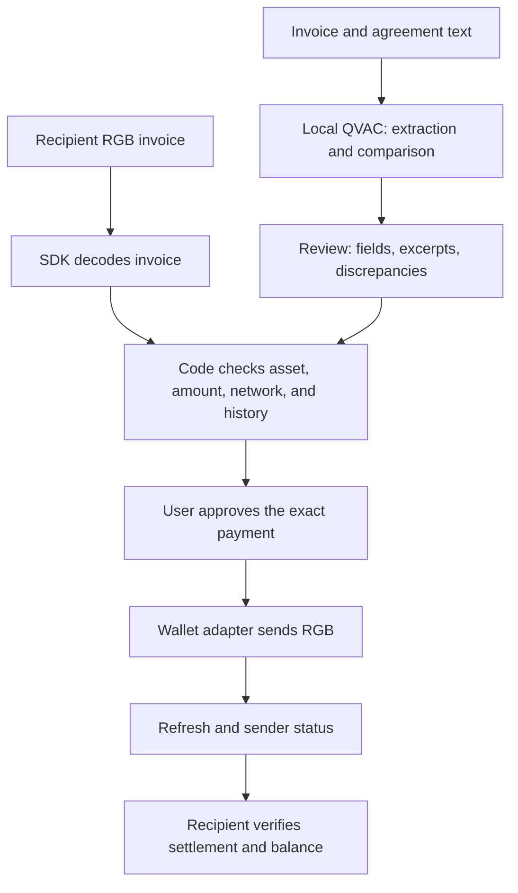

# Agentic Dollars on Bitcoin — information and idea research

Combines the former `info.md` and `ideas.md`: rules, mentor answers, links, ecosystem research, candidate ideas, and the complete Telegram export.

**The current project direction is RGB P2P Exchange:** direct swaps and three-party ring swaps, local QVAC, and user approval. See [README](README.md) for implementation status and startup instructions. Recommendations such as Colony and AidDesk below are retained as research history, not a new development plan. Expo references also belong to an earlier stage; the current UI is in `apps/web`.

- [Information from the Telegram chat](#information-from-the-telegram-chat).
- [Research and ideas](#ideas-for-agentic-dollars-on-bitcoin).
- [Complete source export](#appendix-complete-source-export).

## Information from the Telegram chat

Source: the complete `tg_chat_info.txt` export dated October 17, 2026: 809 lines, four topics, 70 participants. Message times are GMT+2 (Europe/Rome). The information below is grouped by topic; the **complete, unabridged export** is included in the appendix, including service messages, unanswered questions, and links. The appendix notes the translation of one Russian display name.

This section reports only what appears in the chat. The referenced `participant-instructions.pdf` was a Telegram attachment; its contents are not in the text export. Links are listed as exported, without checking their current availability.

### Key information for participants

- **Required stack:** RGB Protocol on Bitcoin as the asset layer and QVAC for local on-device AI. **WDK is optional**, with a bonus under the October 15 rules.
- **By Friday, October 16, 23:00 CEST:** choose team and project names, create a public GitHub repository, describe the idea, stack, and all pre-hackathon work in README, and submit the names and link to organizers. A shared submission spreadsheet was also offered on October 16.
- **Saturday, October 17:** arrive at BLOX by 08:20 according to the latest reminder at 01:17 on October 17; kickoff at 08:30, hackathon start at 09:30. Arriving participants were directed to the downstairs room.
- **Sunday, October 18, 13:00:** the last eligible commit must be on `main`, with a README explaining startup. Later commits do not count. Judges visit workstations for mini-demos from 13:00 to 14:30, then select 10 finalists. Five-minute finalist presentations run from 16:00 to 17:30; awards are at 18:00.
- Do not commit API keys, `.env`, seed phrases, or private keys. During the hackathon, the organizer extended the ban on `force-push`/`rebase` to **the entire repository**, including non-main branches: rewriting history obscures what was built before and during the event. Lack of transparency can cost points. The restriction ends after the hackathon.

### Organization and announcement timeline

| Date and time | Announcement |
| --- | --- |
| October 8, 14:39 | Birk (Birkan Kayadibi, COO of RGB Protocol Association and organizer) welcomed selected participants: more than 400 applications for 60 places. Important news would appear in the chat; participants were asked to enable notifications and invite teammates. The channel was planned to remain read-only until Tuesday; contacts were Birk or Mari `@Maryive`. |
| October 9, 17:04 | Shared materials published: two RGB overview videos, QVAC and WDK guides, a KaleidoSwap builder kit video, and an Excel file of links. Required stack and development paths announced. |
| October 12, 16:19–16:30 | RGB, QVAC, and WDK Q&A topics created; questions would go to mentors, with answers expected roughly once each evening. Birk clarified that group members who had signed documents were already selected: the mass thank-you email saying otherwise did not apply to them. |
| October 15, 09:48–09:49 | Mari published the schedule, submission process, revised detailed scoring criteria, and the official `participant-instructions.pdf` (162 KB). The export does not contain the full PDF text. |
| October 15, 20:04 | Forks of `rgb-lib` and RGB Lightning Node allowed if teams work directly in them and submit the fork link; commit-history rules still apply. |
| October 16, 14:47 and 19:22 | Reminder: team/project names and GitHub links due by 23:00 CEST, via direct message, email, or the shared spreadsheet. |
| October 16, 19:21 | Discord channel created with a QVAC developer; chat and voice support hours listed in `#welcome`, in CEST. Models are large: participants should follow the setup guide at home to avoid downloading over venue Wi-Fi. |
| October 17, 01:17 and 08:16 | Reminder to arrive at BLOX by 08:20 and directions to the downstairs room. |

### Submission, scoring, and rule changes

The public GitHub repository must include a README with the original idea, stack, and prior work. Team/project names and the link can be sent to `info.rgb@proton.me`, Telegram `@birk1907`/`@Maryive`, or entered in the [shared spreadsheet](https://docs.google.com/spreadsheets/d/1eLS764VXMB_2f8jX8Nj1ItIYDpPL_mUFeHuoGJyHLqQ/edit?usp=sharing). The final README must explain how to run the project. A question about a private marketplace repository and a separate public submission repository was asked on October 12; the reply said instructions would follow. The October 15 announcement explicitly requires a public repository.

**Latest published scoring, October 15:** each criterion is scored from 1 to 5, then weighted: real RGB use — **25%**; meaningful local QVAC use — **20%**; a working live project and implementation completeness — **20%**; UX/UI understandable to nontechnical users — **15%**; innovation — **10%**; marketability — **10%**. WDK can add **up to +1 point**, for a maximum of **6**. Judges prioritize clear steps and errors over visual polish in UX.

**Historical discrepancy:** WDK Q&A on October 12–13 described a 0–5-point bonus based on actual usefulness rather than nominal integration. The later October 15 announcement sets `up to +1` with a maximum score of 6; that is the current published scale used above. Meaningful integration remains the guiding principle, but the 0–5 scale is outdated.

### Materials and stack selection

- [Hackathon page](https://rgbprotocol.org/agentic-dollars-hackathon/).
- [Shared materials folder](https://drive.google.com/drive/folders/1HqZP4TDRmsvYW6hsW7T6-OoNNZMVFV-X?usp=drive_link): two introductory RGB videos, a QVAC tutorial, a WDK tutorial, a KaleidoSwap builder kit overview, and an Excel file organizing links by importance.
- [RGB Docs](https://docs.rgb.info/) — primary source for RGB concepts. The organizer emphasizes understanding how asset transfers work.
- [QVAC quickstart](https://docs.qvac.tether.io/quickstart/) — local AI.
- [WDK Docs](https://docs.wdk.tether.io/) — optional self-custodial wallet toolkit.
- [KaleidoSwap builder kit](https://kaleidoswap.github.io/rgb-hackathon/) — recommended for beginners: node, wallets, and QVAC tools, including RGB invoice creation from a text request.
- [RGB assistant in ChatGPT](https://chatgpt.com/g/g-69f31db8cae081918db75cbd969df294-rgb-protocol-on-bitcoin-assistant), trained on RGB documentation; sign-in is required, Plus is not. Recommended for navigating the documentation.
- UTEXO offers SDKs/forks, a [WDK ↔ RGB adapter](https://github.com/UTEXO-Protocol/wdk-wallet-rgb), and a React Native library for mobile development. UTEXO and KaleidoSwap mentors were expected on both days. Experienced teams were directed to `rgb-lib` for on-chain work and RGB Lightning Node for Lightning; RGB-Tools was also mentioned. Organizers recommend choosing a path early and not switching mid-project.
- Third-party tools and forks are allowed. An October 12 reply requested explicit disclosure when opening a pull request; on October 15, organizers allowed `rgb-lib`/RGB Lightning Node forks when their links are submitted. Follow the later public-repository and `main`-commit announcement for final submission.

### RGB: mentor answers and limitations

#### Networks, wallets, and test assets

- According to Arshia on October 12, **`signet` (`sb:`) and `signetcustom` (`sbc:`) are different RGB networks**, although they use the same Mutinynet chain. The network is fixed at asset issuance. KaleidoSwap's faucet, maker API, and wallets use `signetcustom`; the UTEXO WDK adapter and underlying `rgb-sdk` supported only plain `signet` at the time. Consequently, a WDK wallet cannot receive RGB assets from the KaleidoSwap faucet or wallet.
- Arshia described the faucet asset named `USDT` as **NIA**. The maker API's `issued_supply: 0` was a display bug he intended to fix; `signetcustom` remains the cause of WDK incompatibility.
- Fidelity Points proposed issuing its own test NIA assets `USDB` and `MOON` on `signet`/Mutinynet with a WDK wallet. Arshia said this should be acceptable for judging if network incompatibility is clearly explained. The team repeated a separate question on October 16 about whether **that specific arrangement** would qualify for the WDK bonus; the export contains no answer.
- Public Mutinynet through KaleidoSwap or a local `regtest` is allowed; there is no ban on a team's own environment. Arshia specifically recommends regtest when testnet incompatibilities arise.
- KaleidoSwap permitted use of its [Esplora](https://esplora.signet.kaleidoswap.com) and [RGB proxy](https://proxy.kaleidoswap.com/json-rpc) throughout the weekend. There is no hard limit, but frequent polling disrupts the maker. [mutinynet.com/api](https://mutinynet.com/api) indexes the same chain as a fallback, with rate limits, particularly relevant to the venue's shared IP.
- [Mutinynet BTC faucet](https://faucet.mutinynet.com): up to **1 million sats per IP/user/address per 24 hours**. [KaleidoSwap RGB faucet](https://faucet.mutinynet.kaleidoswap.com): **100 test USDT per on-chain claim**, up to **5 claims per GitHub account per day**. Funding before arrival was recommended. These test-asset descriptions and limits come from the October 12 message.
- The organizer said venue Wi-Fi should allow devices to work and confirmed Ethernet cables would be available. This is the organizer's assessment, not evidence from a specific team's operation at the venue.

#### Transfers and Lightning

- **An on-chain RGB payment with one confirmation counts for `Payments and Checkout`.** RGB over Lightning is not required; Birk confirmed this on October 13. Lightning may enable other scenarios but is not mandatory.
- For RGB Lightning HODL invoices using `payment_hash`, `claimhodlinvoice`, and `cancelhodlinvoice`, the UTEXO fork `UTEXO-Protocol/rgb-lightning-node`, tag `v0.11.0-beta.3`, with `@utexo/wdk-rgb-lightning` is allowed if it solves the problem. Disclose the fork explicitly.
- On October 14, Walter explained that RGB Multi-Path Payments are technically possible **without changing RGB itself**. Portions of 60 and 40 tokens could travel as separate colored HTLCs across different channels sharing a payment hash; the receiver reveals the preimage after receiving the full amount. The current Lightning implementation does not split RGB amounts: routing requires a single channel to carry the entire amount, and the onion carries one RGB value. MPP requires changes to the onion format (`total RGB amount`), router, receiver logic, and a small specification addition. Costs include extra BTC liquidity/fees and more complex routing accounting for both BTC and RGB capacity.
- A question about the recommended Electrum/Esplora endpoint for `rgb-lib v0.3.0b7` and a transfer in `WAITING_CONFIRMATIONS` was asked on October 13; its author later reported seeing confirmation through Mutinynet Esplora API. The export has no separate endpoint recommendation or refresh instructions.

#### Known WDK difficulty

Fidelity Points reported on October 12 that the native binary in `wdk-wallet-rgb 2.0.3` with `rgb-lib 0.3.0-beta.8` requires `glibc 2.38` and does not run on Ubuntu 22.04. The team worked around it by overriding `@utexo/rgb-sdk` to `1.0.6` (`native beta.13`). The same mnemonic then produced a different wallet (`vanillaKeychain 0` instead of `1`). Their demo laptop had `glibc 2.39`, reducing the urgency. The export contains no mentor recommendation on this workaround. Edwin's question about whether the bonus specifically requires an RGB transaction through WDK or merely working wallet operations also received no direct answer; Birk gave the general principle that actual WDK use matters and the bonus scales with usefulness.

### QVAC: devices, models, answers, and an unresolved error

- **Running `qvac serve` locally on a laptop and calling it from a web page on that same computer counts as on-device inference**, according to Simone's direct October 12 reply.
- Recommended desktop memory: at least **16 GB RAM**, preferably **24–32 GB**. CPU inference is possible; a dedicated GPU was described as reliable. Organizers considered macOS better due to hardware and optimizations. QVAC supports desktop and mobile.
- Mobile guidance: at least **8 GB RAM**, Snapdragon or Apple silicon. Examples included iPhone 13 Pro or newer, Pixel 6 or newer, Samsung S23 or newer; models up to 2B may work depending on the device.
- Recommended 4-bit models: `QWEN3-600M`, `QWEN3.5-0.8B`, `QWEN3.5-2B`, `QWEN3.5-4B`, `QWEN3.5-9B`. All except 600M have corresponding vision projection models listed. Sub-1B models can handle narrow tasks; 4B+ was suggested for better desktop quality. Speech recognition: `Parakeet TDT 0.6B Q8`; synthesis: `Supertonic 3 Q8`.
- Fidelity Points planned short schema-constrained JSON (~400 input and 80 output tokens), calculations in code, `QWEN3.5-2B Q4` via `qvac serve --openai`, with a `0.8B` fallback on a 32 GB Linux laptop using CPU or Vulkan GPU. Simone endorsed the choice, suggested `/no_think` in the system prompt to disable reasoning, and later instructed them to remove `reasoning_budget`.
- **Unresolved discrepancy:** the team tested `@qvac/sdk 0.21.0`, `@qvac/cli 0.15.0`, and `@qvac/llm-llamacpp 0.55.0` on Windows 11/Vulkan. With `/no_think` and `response_format: json_schema` or `json_object`, the server always returned HTTP 500: `RPCError: Unexpected empty grammar stack after accepting piece: ? (30)`. Without a schema, `/no_think` still generated `reasoning_content`. With `reasoning_budget: false` or `0`, it produced valid JSON without reasoning. Simone said `/no_think` should work on Qwen 3/3.5; no specific fix appears in the discussion. The team chose to retain the working `reasoning_budget: false` and test Linux as well.
- A [Discord](https://discord.gg/PaYceGcC) was created for QVAC support; `#welcome` lists support hours and question instructions. Model files should be downloaded in advance.

### Contacts and links from messages

| Purpose | Link or contact |
| --- | --- |
| Organizers | [Email](mailto:info.rgb@proton.me), [Birk](https://t.me/birk1907), [Mari](https://t.me/Maryive) |
| Team and repository submission | [Shared spreadsheet](https://docs.google.com/spreadsheets/d/1eLS764VXMB_2f8jX8Nj1ItIYDpPL_mUFeHuoGJyHLqQ/edit?usp=sharing) |
| QVAC support | [Discord](https://discord.gg/PaYceGcC), Telegram `#welcome` (`tg://search_hashtag?hashtag=welcome`), [@qvac](https://t.me/qvac) |
| UTEXO | [@utexo](https://t.me/utexo), [wdk-wallet-rgb](https://github.com/UTEXO-Protocol/wdk-wallet-rgb) |
| Mutinynet | [Website](https://mutinynet.com), [KaleidoSwap Esplora](https://esplora.signet.kaleidoswap.com), [RGB proxy](https://proxy.kaleidoswap.com/json-rpc), [API](https://mutinynet.com/api), [BTC faucet](https://faucet.mutinynet.com), [RGB faucet](https://faucet.mutinynet.kaleidoswap.com) |

The export also includes Telegram bot-command links `tg://bot_command?command=rgb`, `tg://bot_command?command=lninvoice`, and `tg://bot_command?command=wdk`. Repeated links and their message associations are preserved below in the original `ALL LINKS (31)` section.

---

## Ideas for Agentic Dollars on Bitcoin

Research date: October 17, 2026. Materials: local READMEs and tg_chat_info.txt (809 lines, all four topics), linked public resources, the Excel file and PDF text from the shared folder, the public team spreadsheet, and available participant READMEs.

### Updated shortlist: RGB drives the entire product scenario

October 17, 2026 update: after team clarification, the main filter is **active, visible RGB use**. Telephony no longer constrains selection. The following are three proposals, not implemented features or an accepted team decision. Expo remains the UI preference at this historical stage; RGB and local QVAC are required.

The [organizers' announcement](info.md#submission-scoring-and-rule-changes) on October 15 at 09:48 assigns RGB **25%**, QVAC 20%, working implementation 20%, UX/UI 15%, originality 10%, and marketability 10%. The RGB criterion concerns actual product use. Transaction count alone does not guarantee points: every asset movement must change the user's outcome.

**My recommendation is Colony: three local AI agents must save a station by actually buying and transferring RGB resources.** It is the most visible of the three scenarios: judges observe an economy and verify its state in wallets.

#### How the shortlist was developed

The instructions found through skills.sh were applied: [brainstorm-ideas-new](https://skills.sh/phuryn/pm-skills/brainstorm-ideas-new) ([SKILL.md](https://github.com/phuryn/pm-skills/blob/main/pm-product-discovery/skills/brainstorm-ideas-new/SKILL.md)) and [creative-thinking-for-research](https://skills.sh/orchestra-research/ai-research-skills/creative-thinking-for-research) ([SKILL.md](https://github.com/Orchestra-Research/AI-Research-SKILLs/blob/main/21-research-ideation/creative-thinking-for-research/SKILL.md)). The research used product, design, and engineering analysis, role inversion, and checks of necessary constraints. Multiple agents independently examined economic mechanisms and available SDK operations. Skills were read and applied without global installation.

**Originality-check boundary:** public ecosystem materials and available participant projects were reviewed. No complete match for these scenarios was found in the reviewed material; this does not prove worldwide novelty. Close analogues and weaknesses are listed below. Renaming an existing wallet is not a differentiator.

#### 1. COLONY — AI agents must earn the resources to save their world

**Pitch:** “We give three local AIs different resources and secret goals. They can save the station only through a real RGB economy.”

The station's reactor has failed. The engineer needs three resources: their own panels, a trader's crystal, and another settler's mechanism. Each participant has inventory, a budget, a private goal, and a local AI adviser. The trader may raise the price; the engineer may refuse or change the plan. Writing “we now have a crystal” in chat is insufficient: the mission warehouse must actually receive the required RGB asset.

**RGB's role:** four asset types — panels, crystals, mechanisms, and test money — are issued as separate NIAs with known contract IDs. Money goes to sellers; resources go to a separate warehouse wallet. The app unlocks “repair reactor” only after verifying received resources. Completing the mission triggers a separate RGB payment from a prepared reward fund.

**QVAC's role:** proposes plans and negotiates locally using its own information, prices, and budget. Model decisions become bounded commands; code checks amounts, asset IDs, and permissions. Profiles are fictional. One demo computer can hold separate agent contexts, but this does not isolate secrets from that computer's operator.

**A complete demo round consists of six real transfers:**

| Step | RGB transfer | Product change |
| --- | --- | --- |
| 1 | Engineer → trader: test money | Agreed crystal paid for; delivery still pending |
| 2 | Trader → warehouse: crystal | First purchased reactor component received |
| 3 | Engineer → mechanic: test money | Mechanism paid for; delivery still pending |
| 4 | Mechanic → warehouse: mechanism | Second purchased component received |
| 5 | Engineer → warehouse: own panels | Full resource set assembled under mission rules |
| 6 | Mission fund → engineer: reward | Economic cycle completed; next mission's budget changed |

Each resource is sold with delivery directly to the warehouse; an intermediate transfer to the engineer is unnecessary. Before paying a reward, the warehouse checks expected contract IDs, amounts, and completed incoming transfers. The app records which receipts a mission has already consumed to prevent duplicate rewards.

**Moment for the judges:** “The AI negotiated a purchase, but the reactor still cannot start. Now the warehouse has confirmed the actual RGB transfer of the final resource: the action is available and the engineer has received the reward.” The UI shows the plan, resource movements, and confirmed balances side by side.

**Three Expo screens:** station and goal → agent negotiations → wallets, resources, and mission execution. First version: one mission, a fixed recipe, three resources, three agents, and one warehouse/fund wallet. No freely generated world.

**Potential product:** cooperative game nights with personal AI allies and different economic strategies. Scenarios could be sold. Enjoyment and willingness to pay still need testing; a technically rich demo does not create a market by itself.

**Differentiation and risk:** [Dark Forest](https://blog.zkga.me/announcing-darkforest) already combines hidden information and cryptography in a game; [AI Dungeon](https://help.aidungeon.com/faq/do-you-support-multiplayer) offers shared AI adventures. Our testable contribution is negotiation among local advisers with different knowledge and a complete exchange cycle involving several RGB resources that determine available game actions. If resources are merely decorative tokens, the differentiation disappears.

**Technical boundary:** the app enforces mission rules. RGB does not start a reactor or guarantee delivery after payment. The two sides of a purchase are not atomic. Sending NIA to a warehouse is not burning it; creating a new game item would be a separate issuer action, not an automatically executed RGB contract.

#### 2. INVISIBLE FACTORY — a factory assembled for a single order

**Pitch:** “This factory owns no machines or warehouse. Local AI assembles production from different people's RGB rights to materials and working time.”

A person requests a custom object, such as a personalized desk lamp. One participant offers a parts kit, another an hour of machine time, and a third assembles the product. Their local agents know their own constraints and minimum prices, exchange only agreed offers, and construct a feasible order.

**RGB cycle:** suppliers issue limited rights to kits and machine time → the customer pays selected offers with RGB money → suppliers transfer rights to the assembler's wallet → the assembler presents the rights to suppliers for fulfillment → after confirming completion, the assembler issues a right to collect the finished lamp and transfers it to the customer. The customer can transfer that final right to another recipient. Issuance, money, production rights, and the final entitlement are separate verifiable operations.

**QVAC's role:** translate the order description into a plan, coordinate availability, and select compatible offers within budget. Code and participants confirm the cost and order contents. The model does not determine manufacturing safety.

**Demo:** one prevalidated recipe, two suppliers, one assembler, and one customer; real RGB rights and payments, with physical manufacturing replaced by clearly labeled operator confirmation. Show how replacing an unavailable supplier changes the purchasing plan and payment recipient. Do not promise a full cycle in three transfers: a purchase has monetary and goods sides, and redemption is a separate transfer.

**Three Expo screens:** my order → assembled production chain → rights and result. Potential users are small workshops and makerspaces. Demand validation requires speaking to at least one actual manufacturer.

**Differentiation and risk:** [HubWallet](https://github.com/Vittorio-dotcom/hubwallet) already describes RGB access rights, device rentals, and device-to-device purchasing. Our proposed difference is assembling an intercompany production chain for a new order and turning input rights into a claim on the result. Its similarity to existing mechanisms makes it riskier than Colony. HubWallet's README describes intentions; we did not verify successful implementation of all those features.

**Boundary:** RGB proves transfer of a right; the supplier fulfills it. The app records the connection between input materials and the finished lamp, confirmed by the assembler. The MVP has no automatic manufacturing escrow, atomic exchange, or proof of physical production.

#### 3. PARCEL WITH A BUDGET — cargo assembles its own route

**Pitch:** “The sender gives a parcel a destination, deadline, and budget. Its local agent buys a route from spare segments of different people's journeys.”

One person travels from A to B tomorrow, another from B to C. Each issues a limited right to transport one suitable parcel at a specified time. The sender's agent finds a compatible chain, checks the budget, and purchases the rights. When plans change, it proposes a replacement segment. “The parcel buys” is figurative: a software agent controls funds under the sender's authorization.

**RGB cycle:** carriers issue segment rights → the sender makes two RGB payments → receives two RGB rights → presents each right to its carrier by transferring it to the carrier's wallet at agreed redemption. Two segments require six transfers: two payments, two rights deliveries, and two redemptions. Each movement represents a different order change; physical cargo status is tracked separately.

**QVAC's role:** reconcile schedules and constraints, select a chain, and explain replanning. Each carrier's private schedule stays local; the agreed offer sent out still reveals some availability. Time, parcel size, and amount checks are deterministic.

**Demo:** two segments, three parties, and a small physical object. People confirm two physical handoffs; RGB rights are redeemed separately. Segment replacement comes after the basic route works. A refund needs carrier consent and a separate transfer; it must not be presented as an automatic protocol guarantee.

**Three Expo screens:** task and budget → route and purchases → rights and cargo handoff. Market value would come from using spare capacity on already planned journeys; trust, liability, and meeting deadlines remain the main unverified assumptions.

**Differentiation and risk:** [Rueda](https://github.com/kayyrod21/rueda-hackathon26) already claims local AI + mobility booking + RGB. The reviewed README marks working payments as unfinished. Our proposed mechanism is a composite cargo route built from transferable rights issued by independent carriers. The shared transport theme weakens the originality claim; do not claim “the first AI for delivery.”

**Boundary:** owning transport rights does not prove cargo location or safety. Expiry, penalties, refunds, and route execution do not arise automatically from issuing NIA. They are app rules and participant agreements.

#### What to show the judges

| Criterion | Verifiable Colony result |
| --- | --- |
| RGB, 25% | Four asset types, multiple independent wallets, six meaningful transfers, recipient validation, final reward |
| QVAC, 20% | Local plans and negotiations change after actual resource and budget changes |
| Execution, 20% | One complete round from goal to received reward without manually editing balances |
| UX/UI, 15% | Users see what is missing, paid, and received, and why the mission is not yet available |
| Innovation, 10% | Economic cooperation among local AIs with private goals; existing wallet UI is not presented as new work |
| Marketability, 10% | A clear game-night format; selling scenarios remains a hypothesis to test |

This is an evidence plan, not a score prediction. If six transfers prevent completing a working round, reduce the number of resources and show the actual scenario honestly.

#### Reviewed technical foundation and limits on claims

The current [React Native SDK](https://github.com/UTEXO-Protocol/rgb-sdk-rn) documents NIA issuance, invoice creation, sending, wallet refresh, transfer history, balances, and consignments. The [Sandbox](https://github.com/UTEXO-Protocol/rgb-sdk-rn-sandbox) demonstrates wallet preparation, issuance, sending, and refresh after a block. This is a documented prototype path, not an integration test we performed.

- Prepare separate wallets, BTC for fees, suitable UTXOs, and test assets in advance. A prototype can model a unique right as a separate NIA with quantity 1 and precision 0; this is not a new RGB schema.
- The verification screen should show contract ID, quantity, both parties' balances before/after, and receipt status. A Bitcoin txid or a displayed “paid” label is insufficient. Only confirmed, validated receipts change mission conditions.
- The ordinary RN SDK path transfers one asset per call. Multiple assets require sequential operations. Running payment and delivery consecutively does not make them atomic.
- Do not promise to burn NIA. Received resources remain in the warehouse; the app tracks their use separately. The fund wallet pays a new reward under app rules.
- A full round on a public test network may take longer to confirm than a stage presentation. Organizers allow local regtest: demonstrate real RGB transfers on a local test chain and explicitly show block mining. This is a test network, not mainnet or an animation of fake payments.
- A test-money NIA is not a backed dollar or Tether USDT. Label it accurately in the UI and pitch.
- The native RGB library needs a compatible native Expo build; Expo Go startup is not integration evidence. Local QVAC does not mean RGB network operations work offline.

#### What we do not claim as our innovation

| Reviewed source | Existing mechanism |
| --- | --- |
| [Rate](https://github.com/kaleidoswap/Rate) | Voice wallet, local AI, biometrics, limits, and spending approval |
| [RGB SDK](https://github.com/UTEXO-Protocol/rgb-sdk-rn) | Issuance, invoices, transfers, balances, and backups |
| [RGB Multisig Hub](https://github.com/RGB-Tools/rgb-multisig-hub) | Coordination among multiple participants |
| [ScratchMyPay](https://github.com/ScratchMyPay/ScratchMyPay/blob/main/docs/IMPLEMENTATION_STATUS.md) | Local AI → approval → team payout |
| [HubWallet](https://github.com/Vittorio-dotcom/hubwallet) | README claims access and rental rights, device payments, and purchasing |
| [Naibour](https://www.naibour.com/about) | AI matching of multilateral barter chains |
| [Gaka-chu](https://arxiv.org/abs/2203.03411), [Autonomous Art](https://www.autonomousart.org/) | Objects earning money to sustain their own existence |

This shortlist replaces the earlier candidates Smuggling, a joint order for a new service, and future surplus. Telephony ideas are excluded from the current selection. The research below is archived; its earlier rankings are not current recommendations.

---

### Archived recommendation before the request for a more original idea

**AidDesk — a private workspace for reviewing targeted-aid applications and paying digital dollars on Bitcoin.** A small fund or university support office enters an application and its rules. QVAC compares the text against the rules locally, identifies missing information, and prepares a card with source excerpts. A staff member decides; code checks the program limit and amount; the fund sends a real RGB payment to the recipient.

This recommendation followed **review of Telegram and participant projects**. The initial leader, PayProof, was demoted: [WiseLedger](https://github.com/LucaCraft89/WiseLedger) already claims almost the same invoice → risk checks → confirmation → RGB payment workflow. Renaming is insufficient.

**Second choice — Reimburse Local:** team expense reimbursement under internal policy; a simpler business process, but partially overlapping invoice processing and bill splitting.

**Third choice — Recovery Coach:** a more RGB-specific problem with fewer direct overlaps in the reviewed descriptions, but AI usefulness and a connection to actual dollars need proving.

The ten original candidates and technical analysis are retained below, followed by AidDesk, updated competitor research, and a selection plan. PayProof, Agent Tender, and PayCrew remain fallback directions with high overlap risk.

Names are provisional; brand uniqueness and competitors outside the supplied materials were not checked. Demand and monetization are hypotheses, not proven market facts.

### 1. What determines idea selection

#### Hackathon requirements

**Prioritize MariJ's later October 15, 09:48 announcement in `tg_chat_info.txt` over the conflicting public page.** RGB and QVAC are required. Each category is scored from 1 to 5:

| Criterion | Weight |
| --- | --- |
| RGB | 25% |
| QVAC and justification for local AI | 20% |
| Execution: what works live | 20% |
| UX/UI | 15% |
| Innovation | 10% |
| Marketability | 10% |

The base score is up to 5, WDK adds up to +1, and the maximum is 6. October 12–13 messages mention a 0–5 bonus, while the website lists five equally weighted criteria; planning uses the newer October 15 instructions. The attached `participant-instructions.pdf` is only referenced in the export: it is absent from the workspace and was not read.

**Deadlines and format:** the final commit must be on main by October 18 at 13:00 CEST. Workstation mini-demos run from 13:00 to 14:30, selecting 10 finalists. Final pitches last five minutes, from 16:00 to 17:30. Prepare a working table demo first, then the stage presentation. Our short three-minute scenario can fit within five minutes.

Project/team names and a public repository had to be registered by October 16 at 23:00 CEST. This research did not verify team registration or message organizers. If the project is not registered, that is an organizational issue for the team; the chat does not grant permission for late registration. MariJ's October 15 clarification prohibits force-push/rebase across the entire repository. Community forks are permitted with explicit disclosure; record prior work and libraries used.

**Network:** Mutinynet is recommended, but organizers also allowed local regtest in RGB Q&A on October 12. An on-chain RGB transfer with one confirmation counts; Lightning is optional. Naming a token USDT does not make it a Tether dollar: show the contract ID and label it “unbacked test asset.”

Sources: local `tg_chat_info.txt`, General/RGB/WDK topics; the [public page](https://rgbprotocol.org/agentic-dollars-hackathon/) contains earlier criteria.

#### Existing products that are not strong ideas by themselves

| Existing project | What it offers | Implication for us |
| --- | --- | --- |
| [Rate](https://github.com/kaleidoswap/Rate) | Mobile wallet, local AI, voice, transfers, and swaps | Voice-directed transfers already exist |
| [Desktop](https://github.com/kaleidoswap/desktop-app) | RGB/Lightning, AI chat, DCA, and limit orders | A new DCA screen is weak differentiation |
| [KaleidoAgent](https://github.com/kaleidoswap/kaleido-agent) | Rebalancing, channel management, paid APIs | A generic “agent with a wallet” is insufficient |
| [KaleidoMind](https://github.com/kaleidoswap/kaleido-mind) | Tool calling, action recipes, and spending approval | Approval gates are necessary foundations, not standalone innovation |
| [BTCPay RGB plugin](https://github.com/UTEXO-Protocol/rgb-btcpay-plugin) | RGB payment acceptance and settlement status | Simple checkout already exists |

This compares organizers' tooling. Direct overlap with hackathon teams is discussed in section 12; this is not comprehensive market research. Seek differentiation in the user's task: checking obligations, purchasing services, payouts, or reimbursements.

#### Technical constraints affecting the product

- **RGB uses client-side validation.** Bitcoin records a commitment; participants validate asset data. A public explorer cannot show RGB balances; demo evidence includes both wallets' state. [Architecture](https://docs.rgb.info/distributed-computing-concepts/client-side-validation.md).
- **The recipient creates the invoice.** On-chain transfers require transaction preparation, consignment delivery, validation, and state refresh. Creating an invoice is not a completed payment. [Transfers](https://docs.rgb.info/annexes/contract-transfers), [invoices](https://docs.rgb.info/annexes/invoices).
- **A ticker is not asset identity.** Different contracts can share a name. Use contract ID and exact precision. [Schemas](https://docs.rgb.info/rgb-contract-implementation/schema/supported-schemas.md).
- **BTC for fees and suitable UTXOs are required.** Blinded receive needs free colorable UTXOs; witness receive works differently. [WebRGB](https://github.com/kaleidoswap/webrgb).
- **Lightning requires channels with the right asset and liquidity.** Some paths also require sats alongside RGB. Do not promise tiny fractional-cent transfers without measuring the chosen route's limits. [RGB Lightning](https://docs.rgb.info/rgb-over-lightning-network/lightning-network-compatibility.md), [MCP](https://github.com/kaleidoswap/kaleido-mcp).
- **A seed is insufficient for RGB recovery.** State backups are required. Do not run one wallet concurrently in different directories or devices. [rgb-lib](https://github.com/RGB-Tools/rgb-lib), organizers' PDF.
- **Inference is local.** Indexers, proxies, and Bitcoin/Lightning networks may need internet access. “Financial data does not go to a cloud LLM” is more accurate than “everything works offline.”
- **QVAC and KaleidoAgent differ.** KaleidoAgent's README describes Claude/OpenAI as reasoning providers. Explicitly choose QVAC for the qualifying local scenario rather than launching a reference app with a cloud model. [QVAC](https://github.com/tetherto/qvac), [KaleidoAgent](https://github.com/kaleidoswap/kaleido-agent).
- **Documentation and repositories evolve independently.** Builder-kit commands and versions sometimes differ from newer READMEs. Pin compatible versions before implementation. A method listed in a README does not prove the selected build supports it.

### 2. Comparing ideas

**The table below is the original list before reviewing participants, not the current priority.** After competitor analysis: AidDesk → Reimburse Local → Recovery Coach. PayProof largely repeats WiseLedger; Agent Tender overlaps Satoshelf, and PayCrew overlaps ScratchMyPay.

Scores are my engineering judgment for a team of 2–4, one suitable laptop, and mentor help. They are not predicted judging scores. “Novelty” means differentiation from the examples above.

| Rank | Idea | User | QVAC task | RGB in MVP | Feasibility | Novelty |
| --- | --- | --- | --- | --- | --- | --- |
| 1 | PayProof | Freelancer, small agency | Compare invoice against agreement | One verified payment | High | Medium/high |
| 2 | Agent Tender | Paid-agent developer | Select an offer based on task meaning | Pay for one service | Medium | High |
| 3 | PayCrew | Small-team lead | Check reports against payout terms | Two sequential payouts | Medium/high | Medium |
| 4 | Reimburse Local | Team sharing expenses | Analyze reimbursement basis | Transfer to employee | High with text input | Medium |
| 5 | Family Envelope | Family with a dollar budget | Propose allocation accounting for obligations | Approved transfer | High | Medium/low |
| 6 | Merchant Close | Small merchant | Explain order/payment discrepancies | Receive payment | Medium | Medium |
| 7 | Safe Remit | Sender supporting family | Interpret request and constraints | Transfer to another RGB wallet | Medium | Medium |
| 8 | Research Bounty | Team purchasing research | Compare result against requirements | Pay for accepted result | Medium | High |
| 9 | Recovery Coach | RGB wallet user | Explain state and recovery steps | Verification transfer after restore | Medium | Medium/high |
| 10 | Private Split | Small group | Extract agreements about shares | Settle one debt | High | Low |

### 3. PayProof (demoted due to WiseLedger overlap) — invoice → checks → approval → RGB payment

**Pitch:** “Your invoices stay on your device. Your dollars stay in your wallet.”

#### User and problem

A small agency receives invoices and agrees on work through messages. Before paying, staff manually compare scope, price, currency, milestone, and previous payment status. Uploading contracts and invoices to a cloud chat exposes commercial information.

#### Scenario

1. Add the agreement text: “Landing page, milestone 1 — 20 test units; milestone 2 — after acceptance.”
2. Add the invoice text and a separate RGB invoice from the recipient.
3. QVAC extracts fields and compares the invoice against the agreement. Every finding includes a source excerpt.
4. The app independently decodes the RGB invoice and checks asset, amount, network, expiry, history, and available balance.
5. A discrepancy produces a card: “Invoice requests 25; agreed amount is 20.” Ambiguity sends the document to manual review.
6. After correction, the user sees exact parameters and approves payment.
7. The app sends RGB and tracks settlement. The second wallet confirms receipt.

**Critical boundary:** a blinded invoice alone does not prove the contractor's identity. The contact must be linked to the payment request through a previously verified channel, for example an agreed communication method. A new invoice is expected for each payment; changing it is not inherently fraud. Without authentication, do not promise to detect recipient substitution.

#### MVP

- Local web UI and QVAC process on the user's laptop.
- Text invoice, agreement text, and a separate RGB invoice field.
- Extract invoice number, counterparty, amount, currency, purpose, and milestone.
- Three checks: duplicate, amount/terms discrepancy, and asset ID mismatch.
- Review screen with source excerpts and decoded payment parameters.
- One sender and one receiver; one real on-chain transfer on Mutinynet.
- History states: “under review / ready / sent / confirmed / error / unknown result.”

Always validate model-extracted fields. Totals, asset ID comparisons, arithmetic, and authorization to send are handled by code. Documents are data: instructions inside an invoice do not grant the model additional authority.

#### Three-minute demo

- Open an agreed order and a normal invoice; show local comparison.
- Open an invoice with a changed amount and show the precise discrepancy.
- Correct, approve, and send a real RGB payment.
- While settlement is pending, attempt a duplicate payment; the journal blocks it.
- Show settled/spendable funds at the recipient and the matching sender record.

Use short documents and preload the model for live inference. Measure response time on our hardware. The builder kit explicitly warns that requests can take tens of seconds or minutes.

#### Differentiation and business hypothesis

Sell local obligation processing and payout controls, not a wallet chat. Possible pricing: a per-seat license or team plan. Validate demand with 3–5 small agencies: would they pay for this workflow, and how many recipients would actually accept RGB?

#### Out of scope

Bank integrations, tax accounting, guaranteed fraud detection, universal OCR, email access, automatic work acceptance, and unattended payments.

#### Main risk

The parser may be useful while RGB acceptance is too rare among target customers. Position it for teams already using digital dollars and seeking Bitcoin settlement. Do not expand into full accounting before validating demand.

### 4. Agent Tender — an agent buys a service from an agent

**Pitch:** “Give your agent a task and a budget. Approve the purchase, not every API call.”

#### Problem and scenario

An agent needs a specific digital service: text translation, table extraction, or local document analysis. It must choose an offer that meets task requirements, not simply the cheapest endpoint.

The user requests: “Translate this contract into Italian, preserve numbering, budget up to 2 test units.” Two provider endpoints return descriptions, prices, and constraints. Local QVAC compares offers against requirements and explains the choice. Code checks budget, service ID, and asset. The user approves one purchase; the app pays the RGB invoice and receives the result.

#### MVP

- One buyer and two simple provider endpoints with genuinely different terms.
- One predetermined service type, a short text, and one payment.
- JSON catalog with fixed prices; no complex negotiation.
- QVAC for semantic selection; service execution can also remain local.
- The recipient issues an invoice; the result endpoint opens after verifying settlement for that order.
- Evidence: selection → approval → RGB settlement → result delivery → remaining budget.

**MVP transport is our application protocol.** L402/MPP support in kaleido-mcp does not prove an arbitrary paid API accepts RGB specifically. Do not call our custom protocol a standard.

#### Strong demo

The cheaper provider cannot preserve structure; the second fits; a third option or separate request exceeds the cap. The model selects the suitable provider, code blocks overspending, and the paid service delivers its result.

#### Risks and scope reduction

Without Lightning, payment is slower, so the first version is one on-chain order with honest pending status. Add RGB Lightning only if channels are ready early. Payment does not guarantee result quality: this is not trustless service-for-money exchange. Refunds, arbitration, and reputation are outside the MVP.

#### Monetization

Hypothesis: an SDK/dashboard for paid-agent developers and providers. Test why they would use RGB instead of existing payment methods. The main difference from existing paid-data examples is comparing offer terms, bounding authority, and maintaining a verifiable order.

### 5. PayCrew — private preparation of contractor payouts

**Pitch:** “Turn work reports into reviewed dollar payouts without uploading your payroll.”

A manager adds two short work reports and payment terms. QVAC compares completed work against agreed milestones and explains exceptions. Code calculates amounts and prepares a payout table. The manager approves each payment; the app transfers RGB sequentially.

**MVP:** two contractors, one currency/asset, a fixed price per milestone, text input, two separate invoices, and two payouts. One report deliberately conflicts with the terms and requires human judgment. These are contractor payments, not a promise of full payroll with tax handling.

**QVAC's role:** interpret a free-form report and identify the relevant milestone. If the task is merely hours multiplied by rate, AI is unnecessary and the hackathon case is weaker.

**Risk:** the batch is not atomic. The first payout may succeed while the second fails. Track status and retries separately per row; never automatically resend an unknown result. The demo need not pay the entire table, but every claimed payment must be real.

**Business hypothesis:** team pricing for small distributed agencies. Before scaling, verify recipient wallet compatibility and willingness to change payment workflows.

### 6. Other ideas

#### Reimburse Local — reimburse expenses without cloud receipt processing

**User:** a small team reimbursing employees.

**Flow:** receipt text + employee explanation + expense policy → QVAC identifies purpose and disputed items → code checks limits and duplicates → a person approves → RGB transfer to the employee.

**MVP:** three text receipts, one policy, one reimbursement. Images and QVAC OCR follow only after testing the model on our samples. Show an excluded personal purchase and an eligible transport expense.

**Potential value:** privacy and a real action after document analysis. **Risk:** rules alone may suffice; the model must understand the justification, not merely extract an amount.

#### Family Envelope — budgeting around written obligations

**User:** a family holding some funds in digital dollars.

**Flow:** natural-language obligations and goals → QVAC proposes allocations → code calculates available funds → approved transfer to one family wallet.

**MVP:** one wallet, three virtual envelopes, one real payout. Envelopes are local accounting, not RGB contract restrictions. Automated financial advice and return promises are excluded.

**Strength:** clear UX. **Weakness:** less distinct from a budgeting wallet; choose only with strong product design.

#### Merchant Close — local reconciliation of orders and RGB payments

**User:** a small digital-goods merchant.

**Flow:** order and messages → QVAC extracts the obligation → code links the order to an invoice and payment status → the merchant sees “ready for delivery / unpaid / needs review.”

**MVP:** three orders and one real incoming RGB payment; release one item after settlement. Use an existing BTCPay plugin only if it starts quickly; otherwise use a narrow receiver backend.

**Difference:** reconciling unstructured orders with payment. **Risk:** QVAC becomes decorative if orders are fully structured. Excessive BTCPay infrastructure could also consume the weekend.

#### Safe Remit — family transfers with request analysis

**User:** someone regularly sending support to known recipients.

**Flow:** a short request in another language → local QVAC extracts amount, purpose, and constraints → the user verifies the recipient → RGB transfer.

**MVP:** one language scenario, two wallets, one confirmed transfer. Ask for clarification instead of guessing ambiguous currencies or conflicting amounts.

**Strength:** a clear personal story. **Weakness:** RGB transfers do not solve cash withdrawal, bank off-ramps, or exchange rates. Do not promise an entire international remittance service.

#### Research Bounty — pay for accepted research results

**User:** a team buying small research tasks.

**Flow:** requester sets requirements → worker submits a result → QVAC compares it locally against a checklist → a person accepts → the app pays RGB.

**MVP:** one request, one result, one transfer, with two clearly missing elements in the first result. Demo data is fixed and verifiable.

**Strength:** AI is tied to the reason for payment. **Risk:** the model is not a reliable judge of facts. Humans retain acceptance decisions; do not call the app escrow or a trustless marketplace.

#### Recovery Coach — RGB recovery assistant

**User:** a new wallet user who does not understand why a seed restored BTC but not RGB.

**Flow:** the app gathers structured diagnostics → QVAC explains what is missing → the user selects an encrypted backup → the standard library restores state → a small verification RGB transfer is performed.

**MVP:** a separate demo test wallet, a valid backup, restoration with the previous state owner stopped, and a transfer to another wallet.

**Strength:** an important RGB-specific problem. **Risk:** SDK backup/restore already exists, so novelty lies in explanation and a safe guided workflow. Do not pass seeds or backups to the model. Do not promise to recover lost consignments from a seed or blockchain.

#### Private Split — group agreements to debt settlement

**User:** friends or organizers of a shared event.

**Flow:** locally pasted text such as “Anna pays for lodging, Boris for tickets…” → QVAC extracts people and agreements → code calculates debts → participants review → one debt is settled with RGB.

**MVP:** three people, a fixed currency, one payment, no bank import. Ambiguous shares require manual selection.

**Strength:** easy to demonstrate. **Weakness:** a common product category; RGB and AI could appear added just for the contest. A fallback for very limited time.

### 7. Choosing a stack

#### Recommended path for PayProof

Local web UI → local Node.js/TypeScript backend → QVAC for text analysis; the backend separately calls an RGB adapter. Document and payment state stay local. The model has no access to private keys or the signer.

**Baseline: KaleidoSwap builder kit.** KaleidoMind + QVAC, one RLN through kaleido-cli, RGB operations through an SDK or narrow MCP tool set. This reduces custom agent orchestration. Build our own document-review UI around the analysis result.

**WDK bonus path: `@utexo/wdk-wallet-rgb`.** It documents invoice decoding, preflight, granular send/sign/sendEnd, transfers, and backups. **In the versions discussed on October 12, its RGB `signet` (`sb:`) is incompatible with KaleidoSwap `signetcustom` (`sbc:`), despite sharing a Bitcoin chain.** Arshia explicitly confirmed KaleidoSwap faucet/maker/wallet assets cannot transfer into that WDK wallet. For this path, issue our own NIA on plain signet over Mutinynet and use two compatible wallets rather than the RGB faucet. The mentor allowed this for judging; no WDK bonus amount was promised. This applies to the chat's versions: verify support in the chosen build before implementation. Confirm chain, indexer/proxy, precision, and compatibility on both sides. [Adapter](https://github.com/UTEXO-Protocol/wdk-wallet-rgb).

Choose one path in the first hour. If WDK passes the technical check, use it for a real RGB transfer. Otherwise stay with the builder kit and explicitly disclose the absence of the bonus integration. The MVP does not need two independent wallet stacks.

**Important:** a `wdk_*` MCP tool prefix does not prove our app uses WDK. In kaleido-mcp, those tools may call RLN. Show actual WDK calls and their payment role for the bonus, not just tool names.

#### PayProof flow



**The model proposes; code validates; the user authorizes; the wallet executes.** If the LLM is unavailable, documents can be reviewed manually, but the qualifying demo must show actual local inference.

### 8. Baseline implementation plan for a document workflow

Originally written for PayProof; for the then-selected AidDesk, replace invoice/agreement with application/program rules. The payment pipeline stays the same. This is a timing guide, not a promise of SDK compatibility. Time starts when team work begins; the final rehearsal must finish before submission.

| Time | Result | Condition for continuing |
| --- | --- | --- |
| Hours 0–1 | One wallet stack selected; QVAC loaded | Inference is local; network verified |
| Hours 1–3 | First real RGB round trip | Recipient has confirmed state |
| Hours 3–6 | Agreement + invoice → structured fields and comparison | Works on our short samples |
| Hours 6–10 | Review, invoice decoding, payment, and history | No transfer without approval |
| Hours 10–14 | Duplicate, mismatch, insufficient funds, unknown result | Clear states, no blind retry |
| Remaining time | Simplify UI, rehearse demo, record evidence | Scenario fits the pitch |

While one teammate handles the wallet, another can build UI, a third can work on extraction/evaluation, and a fourth can prepare demo data and the pitch. These are possible future work assignments, not a report of completed implementation.

If the model fails on long documents, narrow the supported format and show its limits. If OCR consumes time, keep text input. If channels are not ready, stay on-chain. If a real RGB transfer fails, fix it with a mentor first: mock does not satisfy the mandatory criterion.

### 9. What the demo must prove

1. QVAC actually runs locally: selected model, runtime, and observable inference. Do not replace it with a script or cloud response.
2. Extracted fields from a correct invoice are supported by source text. A deliberately altered invoice produces a specific discrepancy. This is a separate check from successful transfer.
3. The decoded invoice matches the approved amount, network, and contract ID. Missing fields must be supplied explicitly and checked separately.
4. Repeating a document or payment does not send again. Supplement document fingerprints with normalized invoice number/counterparty and a payment journal: a whitespace edit must not bypass checks.
5. Sending produces a transfer ID / txid or payment hash, depending on the route. Pending is distinct from settled.
6. The recipient sees the corresponding incoming transfer and available balance. An explorer confirms the Bitcoin anchor, not the RGB amount.
7. After a timeout, the app shows “unknown result” and reconciles journal/wallet state first. No automatic repeat debits.
8. If WDK is used, show its actual role in the monetary flow.

Useful logic checks: arithmetic/precision, asset mismatch, duplicates, user cancellation, expired invoices, and uncertain send outcomes. Passing these is separate from a live Mutinynet transfer.

### 10. Ideas to defer

- Universal voice wallets, DCA, and rebalancing: too close to the organizers' existing products.
- Custom RGB smart-contract escrow: first prove schema, signer, and recovery support; do not base the main scenario on unknown mechanisms.
- Autonomous AI traders promising profit: hard to demonstrate credible value in a weekend.
- Micropayments for every LLM token: first measure limits and costs of the specific RGB Lightning route.
- International remittances “all the way to cash”: the supplied RGB infrastructure does not provide a ready fiat off-ramp.
- RGB recovery from a seed alone: incompatible with the state-storage model.
- Asset selection by the string USDT: a contract ID is required.
- New custom RGB schemas, a custom bridge, or a mobile stack built from scratch: excessive risk for the first end-to-end scenario.

### 11. Sources reviewed and research boundaries

At the initial inspection, there was one user file, `README.md`; all its substantive text was read. `tg_chat_info.txt` was then added and read in full, all 809 lines; it led to the project spreadsheet and available participant READMEs. Much of the remaining file content consisted of blank, tabbed lines. There were 43 unique URL strings representing 42 resources: the Drive folder appeared with and without query parameters. All addresses were checked through the web or direct HTTP; available GitHub repositories were examined through READMEs and relevant documentation, **not every source file in every repository**.

Recursively following every link would expand beyond hackathon materials into dependencies, social networks, and all of GitHub. This research checked the original README list, Telegram text, public team descriptions, and deeper sections affecting idea selection and feasibility. It is documentation research; SDKs, faucets, transfers, and models were not run as part of that task.

#### Drive materials

[Shared folder](https://drive.google.com/drive/folders/1HqZP4TDRmsvYW6hsW7T6-OoNNZMVFV-X).

| File | What was checked |
| --- | --- |
| [Hackathon-Links.xlsx](https://drive.google.com/file/d/10cAE3DfHGcFfb2xOXwxeOU88Gf5FmHd4/view) | Downloaded and read the sheet, including text URLs; the list matches the README table |
| [RGB Protocol on Bitcoin — slides.pdf](https://drive.google.com/file/d/17wpSu3qu4LpVFPrBKnXhnHafOpj6Ey-F/view) | Downloaded and read extracted text from all pages; illustrations were not fully analyzed separately |
| [RGB theory](https://drive.google.com/file/d/1uOqOUh2uFMPChwEGyG2T_NS0Mxxiu4aF/view) | Video page checked; no complete audiovisual review |
| [RGB tools](https://drive.google.com/file/d/1hRzjBnqN0lgcbbEBc4ZvYAvO_PeVDLQK/view) | Video page checked; no complete audiovisual review |
| [QVAC tutorial](https://drive.google.com/file/d/1Ibd5XlPYDIMYHihZ1QEphmcIVhs6FGrC/view) | Player opened; transcript and subtitles disabled; content is not claimed as watched |
| [WDK tutorial](https://drive.google.com/file/d/10UFIpuC5pmIKv5EHK6YRPj6OC1PFcmln/view) | Video page checked; no complete audiovisual review |
| [Kaleido builder walkthrough](https://drive.google.com/file/d/19FoSD5JtgwJr1mdttdBZ1hKtc9FgzS8g/view) | Video page checked and text builder kit read; full video not watched |

Literally completing the request to review “everything inside the links” would still require five complete video reviews, PDF graphics, and selected source code. Text research is sufficient for preliminary idea selection but cannot replace a technical integration spike.

#### Inventory of all README resources

| Resource | Reviewed material / limitation |
| --- | --- |
| [Drive](https://drive.google.com/drive/folders/1HqZP4TDRmsvYW6hsW7T6-OoNNZMVFV-X) | Folder contents, Excel, PDF text; video limits above |
| [Builder kit](https://kaleidoswap.github.io/rgb-hackathon/) | Full page: stack, wallets, startup, funding, channels, and agent example |
| [RGB docs](https://docs.rgb.info/) | Introduction, index; deeper review of client-side validation, transfers, invoices, Lightning, and supported schemas |
| [QVAC quickstart](https://docs.qvac.tether.io/quickstart/) | JS/TS SDK, local model startup, runtime requirements |
| [WDK docs](https://docs.wdk.tether.io/) | Overview and entry points; interfaces additionally checked in core and RGB adapter READMEs |
| [RGB Assistant](https://chatgpt.com/g/g-69f31db8cae081918db75cbd969df294-rgb-protocol-on-bitcoin-assistant) | Public listing; training material and conversation unavailable from the listing; answers not used as sources |
| [BTC faucet](https://faucet.mutinynet.com) | Public page; claims and fund availability not tested |
| [RGB faucet](https://faucet.mutinynet.kaleidoswap.com) | Direct access returned 403; description and terms reviewed in builder kit; no claim made |
| [kaleido-cli](https://github.com/kaleidoswap/kaleido-cli) | README: node setup, Mutinynet, wallet, invoices, payments |
| [kaleido-mind](https://github.com/kaleidoswap/kaleido-mind) | README: QVAC, recipes, tools, confirmation, starter |
| [kaleido-agent](https://github.com/kaleidoswap/kaleido-agent) | README: existing strategies, architecture, cloud reasoning by default |
| [kaleido-mcp](https://github.com/kaleidoswap/kaleido-mcp) | README: tools, funding, RGB send/receive, L402/MPP, networks |
| [kaleido-sdk](https://github.com/kaleidoswap/kaleido-sdk) | README: TypeScript/Python, maker and RLN clients |
| [rgb-lib](https://github.com/RGB-Tools/rgb-lib) | README: wallet model, offline/watch-only, single-instance and backup constraints |
| [rgb-lib-wasm](https://github.com/UTEXO-Protocol/rgb-lib-wasm) | README: IndexedDB, WASM, invoices, transfers, persistence |
| [wdk-wallet-rgb](https://github.com/UTEXO-Protocol/wdk-wallet-rgb) | README: account, network, decode, transfer, sign, backup |
| [rgb-sdk-rn](https://github.com/UTEXO-Protocol/rgb-sdk-rn) | Readme.md and API overview; mobile integration not executed |
| [rgb-sdk-rn-sandbox](https://github.com/UTEXO-Protocol/rgb-sdk-rn-sandbox) | README: flows, infrastructure, different networks; virtual trusted_no_broadcast not treated as ordinary settlement |
| [rgb-btcpay-plugin](https://github.com/UTEXO-Protocol/rgb-btcpay-plugin) | README: checkout, NIA, settlement states, pricing by contract ID |
| [thunder-swap](https://github.com/UTEXO-Protocol/thunder-swap) | README: submarine POC, HTLC, refund, limitations |
| [RGB Lightning Node](https://github.com/RGB-Tools/rgb-lightning-node) | README: REST API, channel liquidity, consignment transport, sync |
| [rgb-sandbox](https://github.com/rgb-protocol/rgb-sandbox) | README: regtest, issuance, manual transfer flow |
| [webrgb](https://github.com/kaleidoswap/webrgb) | README: provider, capabilities, receive, send, tracking, mock |
| [Rate](https://github.com/kaleidoswap/Rate) | README: existing mobile AI/voice wallet and device requirements |
| [desktop-app](https://github.com/kaleidoswap/desktop-app) | README: existing wallet/trading/AI capabilities |
| [QVAC](https://github.com/tetherto/qvac) | README: SDK, local server, text, OCR, transcription, runtime |
| [WDK](https://github.com/tetherto/wdk) | README: wallet manager and transaction policies; these already exist |
| [KaleidoSwap docs](https://docs.kaleidoswap.com) | Overview, component map, linked builder-kit sections |
| [rgb-protocol](https://github.com/rgb-protocol) | Organization page, official components, protocol version |
| [RGB-Tools](https://github.com/RGB-Tools) | Library and tooling catalog |
| [kaleidoswap](https://github.com/kaleidoswap) | Apps, SDKs, and agent tooling catalog |
| [UTEXO-Protocol](https://github.com/UTEXO-Protocol) | Fork, adapter, and mobile SDK catalog |
| [UTEXO](https://utexo.com) | Public product overview; marketing claims not treated as live proof |
| [rgb-consensus](https://github.com/rgb-protocol/rgb-consensus) | README: consensus-critical validation |
| [rgb-ops](https://github.com/rgb-protocol/rgb-ops) | README: non-consensus APIs |
| [rgb-api](https://github.com/rgb-protocol/rgb-api) | README: client APIs and development CLI |
| [rgb-schemas](https://github.com/rgb-protocol/rgb-schemas) | README: catalog and schema readiness limits |
| [RGB-Documentation](https://github.com/rgb-protocol/RGB-Documentation) | README and key source sections on transfers/invoices/Lightning |
| [Event](https://rgbprotocol.org/agentic-dollars-hackathon/) | Rules, criteria, schedule, mandatory technologies |
| [rgb.info](https://rgb.info/) | Protocol and ecosystem overview |
| [RGB Association](https://rgbprotocol.org/) | Organizer and protocol context |
| [CypherTank](https://www.cyphertank.org/) | Startup-pitch format; prize connection confirmed on the hackathon page |

### 12. What Telegram and the participant list changed

#### Confirmed clarifications

| Topic / message | Project implication |
| --- | --- |
| General, MariJ, October 15 09:48 | Six weighted criteria and WDK up to +1; use these later instructions |
| RGB, Arshia, October 12 21:36 | Signet and signetcustom are different RGB networks on one Bitcoin chain; faucet incompatible with the discussed WDK adapter |
| RGB, Arshia, October 12 22:31 | Own NIAs on plain signet over Mutinynet acceptable for judging |
| RGB, Arshia and Birk, October 12–13 | On-chain with one confirmation suffices; local regtest allowed |
| RGB, Birk, October 12 16:22 | Community forks allowed with disclosure; slides are not an absolute ban on UTEXO |
| QVAC, Simone, October 12 17:12 | Local qvac server called by web UI on the same laptop counts as on-device |
| QVAC, replies and tests on October 12 | `/no_think` and `reasoning_budget` behave differently across specific versions; no universal working recipe follows from the discussion |
| WDK, questions on October 12 | Participants report glibc 2.38 for one native build and changed derivation after an override. Do not move seeds between versions expecting the same wallet without verification |
| RGB, Walter, October 14 | RGB Multi-Path Payments require LN routing/onion/receiver changes; not a ready SDK option |

**QVAC structured output:** a participant reproduced HTTP 500 `Unexpected empty grammar stack` on Windows/Vulkan with `@qvac/sdk 0.21.0`, `@qvac/cli 0.15.0`, and `@qvac/llm-llamacpp 0.55.0`: `/no_think` did not help, but `reasoning_budget: false` worked on that setup. This is a participant report, not our own test. For our project, run a small schema smoke test on exact versions and hardware, then pin the configuration. Invalid JSON must never become a payment; if needed, use plain output followed by strict validation and review.

**Infrastructure according to the chat:** [Esplora](https://esplora.signet.kaleidoswap.com) and `rpcs://proxy.kaleidoswap.com/json-rpc` are permitted, with rate-limited [Mutinynet API](https://mutinynet.com/api) as fallback. Avoid tight polling. Discussed faucet limits were 1M sats per IP/user/address per 24 hours for BTC, and 100 test USDT with up to five claims per GitHub account per day for RGB. These terms come from October 12 discussion; live availability and limits were not checked.

**Two different MPPs:** Multi-Path Payments in RGB Q&A and Machine Payments Protocol in paid-API tooling are different concepts. Do not present them as a single integration.

#### Overlap with announced projects

The [participant spreadsheet](https://docs.google.com/spreadsheets/d/1eLS764VXMB_2f8jX8Nj1ItIYDpPL_mUFeHuoGJyHLqQ/edit?usp=sharing) was read through public CSV. At that time it had 23 nonempty team rows, 19 with repositories. Available READMEs for those 19 projects were reviewed. These are announced directions and self-reported status, not our audit of working code.

| Participant / source | Announced direction | What to avoid repeating |
| --- | --- | --- |
| [WiseLedger](https://github.com/LucaCraft89/WiseLedger) | Local invoice checks, fraud/duplicates, approved RGB payments | PayProof: almost a direct match |
| [MonteKasa](https://github.com/Kalepox/MonteKasa) | Invoicing, reconciliation, local financial assistants | Merchant Close and invoice-focused variants |
| [ScratchMyPay](https://github.com/ScratchMyPay/ScratchMyPay) | Event-team payouts | PayCrew without a distinct strong scenario |
| [Freelancer Escrow Agent](https://github.com/bornalesic/Freelancer_Escrow_Agent) | Agreement → result review → payout/refund | Escrow and AI acceptance of freelance work |
| [PrivateDeal AI](https://github.com/MohammadEghbal2000/privatedeal-ai) | Negotiation and milestone payments | Freelance negotiation agent |
| [Satoshelf](https://github.com/bitfent/satoshelf_public) | Agents buying files/knowledge, RGB licenses | Agent Tender for paid data; licensing |
| [Satstride](https://github.com/AmirMFarhang/Satstride) | Financial AI, risk, approved actions, paid agent collaboration | Broad agent-economy platform |
| [Moneyfest](https://github.com/kuzeykacar/Moneyfest) | Budget envelopes, subscriptions, savings | Family Envelope |
| [kit+ty](https://github.com/marco-pedron/kit-ty) | Group trips, receipt analysis, split payments | Private Split |
| [METEVO](https://github.com/METEVO/metevo-app) | Voice-native wallet | Universal voice wallet |
| [Student Money Copilot](https://github.com/sudegkc/student-money-copilot) | Financial assistant for students | Another general budgeting copilot |
| [Fidelity Points](https://github.com/kreamistudio-crypto/fidelity-points) | Loyalty points + NWC + WDK customer wallet | Store points and spending recommendations |
| [HubWallet](https://github.com/Vittorio-dotcom/hubwallet) | Device access, rental, machine payments | Smart-home and consumer IoT payments |
| [fork2checkbook](https://github.com/fork2checkbook/fork2checkbook) | Portable offline RGB notes and hardware handoff | Offline-transferable “digital banknote” |
| [AIR-GB Lightning](https://github.com/ObvAstral/air-gb-lightning) | RGB Multi-Path Payments and custom forks | Protocol-level MPP |
| [LICEX](https://github.com/vvale03/licex) | RGB software-license marketplace | Tokenized licenses |
| [RGB Explorer](https://github.com/vcastald/RGB-EXPLORER) | Business treasury insights and swaps | General treasury dashboard |
| [Rueda Mobility](https://github.com/kayyrod21/rueda-hackathon26) | Mobility concierge and planned RGB payments | AI trip purchasing |
| [QVACache](https://github.com/giancpl/rgb-hackaton) | Android RGB wallet as a starting point; root README reveals little product detail | Full overlap cannot be determined confidently |

MONEY WITH MEMORY, BOUNTY HUNTERS, EETEE, and KNOTS had no repository listed in the reviewed spreadsheet. Do not infer functionality from names. No direct AidDesk analogue was found **among the reviewed descriptions**, but uniqueness is not guaranteed.

Personal Telegram profile links are contacts; `tg://bot_command` and `tg://search_hashtag` are export artifacts without additional technical material. The [support Discord](https://discord.gg/PaYceGcC) link was checked, but channel history and the new setup guide were not read. The server was not joined. `participant-instructions.pdf` remains a missing primary source.

### 13. AidDesk — recommendation after competitor review

**Pitch:** “Private aid requests. Human decisions. Dollar payouts on Bitcoin.”

#### User and purpose

A small charity, university emergency-grant program, or local mutual-aid fund receives free-form applications and supporting documents. A staff member manually compares them against program rules, requests missing information, and processes payment separately.

Value hypothesis: less manual data entry and less disclosure of personal circumstances to cloud AI. Customer demand is not yet confirmed; at the venue, test it with at least one person familiar with grant or charity work.

#### Model responsibilities

QVAC turns an application into a short card: requested amount, purpose, stated circumstances, which published requirements the text supports, and missing documents. Every finding links to an excerpt. The model **does not rank people by “deservingness,”** authenticate documents, or independently decide eligibility. A staff member makes the decision.

Local processing matters because of application content, not because an AI chat looks attractive. Code handles arithmetic, budget, and actual transfer authorization.

#### Demo

1. The fund sets a simple policy: educational-material reimbursement, up to 20 test units per application, supporting documents required. Available budget: 30.
2. The first application requests 15 and contains all required information. QVAC creates a card and highlights evidence of purpose.
3. The second requests 12 but lacks a supporting document. The UI suggests requesting information; the model does not invent it.
4. A staff member approves the first application. The recipient creates a real RGB invoice in a compatible wallet.
5. Code checks invoice and budget and shows exact terms; the staff member confirms. The recipient receives a real transfer; the budget becomes 15.
6. Repeating the approved payout does not send again. A new application for 20 shows insufficient available budget without hiding existing reservations or pending payments.

#### MVP and architecture

Three screens: application queue → review with sources → payout and status. Two synthetic applications, one program, one test asset, two wallets, and one real transfer. Use fictional data, not other people's actual applications.

A local web UI + QVAC on the same laptop is explicitly allowed by the mentor. Choose one of the two RGB paths already analyzed: KaleidoSwap signetcustom with its faucet, or WDK plain signet with our own NIA. Assume no transfers between them. The main route is on-chain with one confirmation; occasional targeted payouts do not require real-time Lightning.

Payout states: draft → reviewed → approved → reserved → sending → pending → settled. Cancellation before sending releases the reservation; an uncertain result retains it until reconciliation. Changing amount, invoice, or asset after approval requires new approval. Reserve the approved amount atomically so two applications cannot spend the same available balance.

**Who holds the money:** the fund owns its wallet. The app does not introduce outside custody, but the fund controls its budget; do not claim each donor retains control over donated funds. There is no smart-contract charity, escrow, or guarantee of how funds are used after payment.

#### Why this is more practical than the original candidates

- Connects all required parts: local analysis of a confidential application → human review → actual RGB payout.
- The reviewed READMEs do not describe this specific user and workflow.
- Basic on-chain capabilities suffice for one payout.
- Three screen steps are clear in a mini-demo; an error and missing document demonstrate AI value before payment.
- Success does not depend on a custom protocol extension, hardware, or complex licensing system.

#### Main objections

**“Why RGB?”** It needs a specific recipient with an RGB wallet and a fund wanting to hold/send digital dollars on Bitcoin. Otherwise the payment rail may be artificial. This is the central customer-discovery question.

**“Is this ordinary document workflow?”** Yes: without application analysis, the payment part would be a simple form. The demo must show different wording mapped to rules, source references, and honest requests for missing information.

**“Who would buy it?”** The hypothesis is licensing or support for small aid/grant programs. Sales may be slow; do not present this as an obviously superior business. Reimburse Local may be more practical for a quick B2B pilot.

#### Plan for the first working slice

1. Preload Qwen3.5 2B Q4 through QVAC and obtain a valid card for one short application.
2. Verify one real RGB round trip on the chosen stack.
3. Connect review, budget reservation, confirmation, and transfer in one flow.
4. Add a second incomplete application, duplicates, and unknown status.
5. Prepare the mini-demo and five-minute pitch before October 18 at 13:00.

### Archived decision before development began

**AidDesk was the previous choice; that recommendation is no longer current.** After user clarification, telephony was removed as a constraint and a more original product was requested. The updated three candidates and their limitations appear at the beginning. The original analysis remains as research history, not an approved implementation plan.

---

## Appendix: complete source export

The following preserves the full `tg_chat_info.txt` content as it was when this file was created, except for Markdown wrapping and the English translation of one Russian display name as `Milan roommate [display name translated from Russian]` in its two occurrences. No messages were omitted. The pre-translation text remains available in Git history.

```text
Telegram group export: "Agentic Dollars on Bitcoin" (70 members)
Exported: 2026-10-17 (via Telegram Web, full history, all 4 topics)
Times are GMT+2 (Europe/Rome).
======================================================================

### TOPIC: General Info & announcements (89 messages)
----------------------------------------------------------------------
[2026-10-07 17:05] MariJ:
MariJ changed the group photo

[2026-10-08 10:39] Bit Fent:
Bit Fent joined the group via invite link

[2026-10-08 10:40] Valentina Giordano:
Valentina Giordano joined the group via invite link

[2026-10-08 10:40] Edoardo:
Edoardo joined the group via invite link

[2026-10-08 10:40] Alp Kale:
Alp Kale joined the group via invite link

[2026-10-08 10:42] Tuna Güvendir:
Tuna Güvendir joined the group via invite link

[2026-10-08 10:42] federico papantuono:
federico papantuono joined the group via invite link

[2026-10-08 10:42] Enrico Danesi:
Enrico Danesi joined the group via invite link

[2026-10-08 10:43] marco:
marco joined the group via invite link

[2026-10-08 10:44] Mert:
Mert joined the group via invite link

[2026-10-08 10:44] Alan ฿imbati:
Alan ฿imbati joined the group via invite link

[2026-10-08 10:47] AndreAI:
AndreAI joined the group via invite link

[2026-10-08 10:49] Silvio:
Silvio joined the group via invite link

[2026-10-08 10:49] Steph:
Steph joined the group via invite link

[2026-10-08 10:50] Martina Pasquinelli:
Martina Pasquinelli joined the group via invite link

[2026-10-08 10:52] S A:
S A joined the group via invite link

[2026-10-08 10:57] Pol:
Pol joined the group via invite link

[2026-10-08 11:00] Jack_:
Jack_ joined the group via invite link

[2026-10-08 11:01] valentino castaldini:
valentino castaldini joined the group via invite link

[2026-10-08 11:26] Leonardo Valentino:
Leonardo Valentino joined the group via invite link

[2026-10-08 11:27] CassiGiuseツ:
CassiGiuseツ joined the group via invite link

[2026-10-08 11:27] Christian:
Christian joined the group via invite link

[2026-10-08 11:28] Andrea:
Andrea joined the group via invite link

[2026-10-08 11:28] Leonardo Sartirana:
Leonardo Sartirana joined the group via invite link

[2026-10-08 11:40] Antonino:
Antonino joined the group via invite link

[2026-10-08 11:43] (service):
joined the group via invite link

[2026-10-08 11:45] Ya:
Ya joined the group via invite link

[2026-10-08 12:06] M M:
M M joined the group via invite link

[2026-10-08 12:19] Davide:
Davide joined the group via invite link

[2026-10-08 13:07] Ege Okyay:
Ege Okyay joined the group via invite link

[2026-10-08 13:07] Birk:
Birk added GIAN

[2026-10-08 14:00] K:
K joined the group via invite link

[2026-10-08 14:25] Borna Lešić:
Borna Lešić joined the group via invite link

[2026-10-08 14:34] Marko Zovko:
Marko Zovko joined the group via invite link

[2026-10-08 14:39] Birk
:
Welcome, and congratulations.

You are in. We received over 400 applications for 60 places, so getting here already means something.

I am Birkan Kayadibi, also known by Birk, COO of the RGB Protocol Association and the organiser of this Hackhathon. Most of you have already spoken with me, or at least one
person from your team has.

This channel is where everything happens: material, schedules, updates, and anything you need to know before and during the weekend.

We are keeping it read-only until Tuesday, so the important messages do not get buried before everyone has seen them. Until then, write to me directly, you should already have my contact from the selection, or to my colleague Mari, @Maryive. From Tuesday the channel opens and you can ask here.

Two things to do now:

Pin this channel or turn notifications on. Everything that matters goes through here.

Send the invite link to your teammates if you have not already. Every
person on your team needs to be in for not missing anything.

Next message will be about the technical material.
edited
  LINK: https://rgbprotocol.org/agentic-dollars-hackathon/
  LINK: https://t.me/Maryive

[2026-10-08 14:43] Vesim .:
Vesim . joined the group via invite link

[2026-10-08 14:53] Y Deniz:
Y Deniz joined the group via invite link

[2026-10-08 15:38] Elif Sude Şahin:
Elif Sude Şahin joined the group via invite link

[2026-10-08 15:59] Zeynep:
Zeynep joined the group via invite link

[2026-10-08 16:14] Alessandro:
Alessandro joined the group via invite link

[2026-10-08 16:19] Lapo:
Lapo joined the group via invite link

[2026-10-08 16:25] Vittorio:
Vittorio joined the group via invite link

[2026-10-08 16:42] Sude:
Sude joined the group via invite link

[2026-10-08 17:28] kuzey kacar:
kuzey kacar joined the group via invite link

[2026-10-08 17:30] Kerem Alp Yıldız:
Kerem Alp Yıldız joined the group via invite link

[2026-10-08 17:32] İrem:
İrem joined the group via invite link

[2026-10-08 17:37] Ege Arca:
Ege Arca joined the group via invite link

[2026-10-08 17:50] Edwin Kestler:
Edwin Kestler joined the group via invite link

[2026-10-08 18:24] domi:
domi joined the group via invite link

[2026-10-08 18:24] Safet:
Safet joined the group via invite link

[2026-10-08 18:24] Luca:
Luca joined the group via invite link

[2026-10-09 06:57] Elnazz:
Elnazz joined the group via invite link

[2026-10-09 12:25] LucaCraft89:
LucaCraft89 joined the group via invite link

[2026-10-09 14:57] Sevgi:
Sevgi joined the group via invite link

[2026-10-09 15:01] Andrea Ballarini:
Andrea Ballarini joined the group via invite link

[2026-10-09 16:54] Addr1000:
Addr1000 joined the group via invite link

[2026-10-09 17:04] Birk
:
MATERIAL

Everything is in the shared folder:https://drive.google.com/drive/folders/1HqZP4TDRmsvYW6hsW7T6-OoNNZMVFV-X?usp=drive_link  .

What you find there:

-Two videos on RGB, high level, to understand what the protocol does
before you touch any code.

-A QVAC tutorial.

-A WDK tutorial.

-A video walkthrough of the KaleidoSwap builder kit, made for you guys, for this hackathon to make life simpler for anyone who has never touched RGB before.
https://kaleidoswap.github.io/rgb-hackathon/

-An Excel file with every link you might need, sorted by whether you
need it to start, to study, or to go deep.


THE STACK

RGB Protocol on Bitcoin. Mandatory. The asset layer. Source of thruth for the concepts:
https://docs.rgb.info/

QVAC. Mandatory. The local AI layer, running on device.
https://docs.qvac.tether.io/quickstart/

WDK. Optional, earns bonus points. Self-custodial wallets.
https://docs.wdk.tether.io/

Read the concepts. Nothing replaces understanding how a transfer
actually works.


RGB ASSISTANT

We trained a GPT on the RGB documentation, so you can ask it things
instead of digging through the docs.

https://chatgpt.com/g/g-69f31db8cae081918db75cbd969df294-rgb-protocol-on-bitcoin-assistant

You do not need ChatGPT Plus, a free account is enough, you just have
to be logged in.

Very cool to speed your study while your are checking the docs. Use it to get oriented fast: what something is, where to look, which
library does what. For anything you are about to build on.


WHICH WAY IN

1) If you have never used RGB before, do not start from the protocol
repos. Use the KaleidoSwap builder kit, or UTEXO's forks and SDKs.
Both exist so that you do not have to assemble the stack yourself:
you get a node, wallets you can build on top of, and in KaleidoSwap's
case tools that already run on QVAC, so a user writes in plain language
and an RGB invoice gets generated. UTEXO also has an adapter that
connects WDK to RGB, and a React Native library if you are going
mobile. Mentors from both are in the room all weekend.

2) If you already know your way around: rgb-lib for on-chain transactions,
and RGB Lightning Node if you want RGB assets over Lightning. More
control, more work. Some people alerady told use they explored RGB-Tools on github and played around with RLN, your choice.

Either way, we recommend you to pick your path at the start and do not switch halfway.
  LINK: https://drive.google.com/drive/folders/1HqZP4TDRmsvYW6hsW7T6-OoNNZMVFV-X?usp=drive_link
  LINK: https://kaleidoswap.github.io/rgb-hackathon/
  LINK: https://docs.rgb.info/
  LINK: https://docs.qvac.tether.io/quickstart/
  LINK: https://docs.wdk.tether.io/
  LINK: https://chatgpt.com/g/g-69f31db8cae081918db75cbd969df294-rgb-protocol-on-bitcoin-assistant

[2026-10-09 17:37] Birk:
Birk added Gianluca

[2026-10-09 17:38] Birk:
Birk added mo_

[2026-10-09 17:38] Birk:
Birk added Luca

[2026-10-09 19:21] Simone:
Simone joined the group via invite link

[2026-10-12 11:28] Birk:
Birk added Arshia

[2026-10-12 11:28] Birk:
Birk added Amir Mohammad

[2026-10-12 14:47] Giuseppe:
Giuseppe joined the group via invite link

[2026-10-12 16:19] Birk:
Birk changed topic name to "General Info & announcements"

[2026-10-12 16:24] Birk
:
Hello Eveybody, we created 3 topics to receive your technical questions in case you might have any. Feel Free to provide your questions and we will try to get back to you with the answere in the shortest time possible. We enabled your messages too the Q&A topics.

[2026-10-12 16:27] Birk:
Birk closed the topic

[2026-10-12 16:30] Birk
:
Quick note, to avoid any confusion.

We just sent a thank you email to everyone who applied, our whole
database, and that includes you. The email explains that whoever is in
this group and signed the documents has already been selected.

So, to be clear: if you are here, you are in. Nothing else for you to
do.

Ignore the part of the email about not being selected, it is not for
you.

[2026-10-12 16:30] Birk:
Birk reopened the topic

[2026-10-12 16:30] Birk:
Birk closed the topic

[2026-10-13 14:25] Birk:
Birk added Walter

[2026-10-13 16:16] Christian:
Christian joined the group via invite link

[2026-10-13 19:24] Luca Pulvirenti:
Luca Pulvirenti joined the group via invite link

[2026-10-14 21:16] Anthony Memon:
Anthony Memon joined the group via invite link

[2026-10-15 09:47] MariJ:
MariJ reopened the topic

[2026-10-15 09:48] MariJ:
Good morning, please read the following messages and document carefully:

Instructions for participants

Here are the main points:

Schedule
- Saturday 17: kickoff at 08:30, the hackathon starts at 09:30
- Sunday 18: submission at 13:00, finalists pitches at 16:00, awards at 18:00

Before Friday at 23:00 (mandatory)

1. Choose a name for your project and team
2. Create a public GitHub repository, with a README declaring your idea, your stack and any work done before the hackathon
3. Send your project and team name and your repository link to info.rgb@proton.me, or on Telegram to @birk1907 or @Maryive

By Sunday at 13:00

Push your final commit to the main branch, with everything you built during the two days and a README explaining how to run the project. Anything pushed after 13:00 is not considered.

    Never commit API keys, .env files, seed phrases or private keys.

Judging

- 13:00–14:30: mini-demos at your desk for the judges, who then choose the 10 finalists.
- 16:00–17:30: the finalists pitch for 5 minutes
  LINK: mailto:info.rgb@proton.me
  LINK: https://t.me/birk1907
  LINK: https://t.me/Maryive

[2026-10-15 09:48] MariJ:
How the judges will score your project:

Every project must use RGB and QVAC (local AI). WDK is optional and gives bonus points.

Each criterion is scored from 1 to 5:
  • RGB: 25%, real use of RGB in the product
  • QVAC: 20%, local AI used for a reason, not as decoration
  • Execution: 20%, what works live, and how complete it is
  • UX/UI: 15%, a non-technical user can understand and use it
  • Innovation: 10%, originality of the idea
  • Marketability: 10%, a real user, a real problem, a life after Sunday
  • WDK bonus: up to +1 point

Maximum score: 6 points.

A note on UX/UI: the judges look at ease of use, not at aesthetics. A clear flow, with understandable steps and errors, counts more than a polished design.
edited

[2026-10-15 09:49] MariJ:
[file: participant-instructions.pdf] pdf
participant-instructions.pdf
162 KB
Here's the official document with the complete instructions. Please read it.

[2026-10-15 14:20] Jay Thor:
Jay Thor joined the group via invite link

[2026-10-15 20:04] MariJ:
Just a clarification, if you need to work directly inside the rgb-lib repo or the RGB Lightning Node repo, feel free to fork them and work from there, as long as you send us the link to the fork.
Same rules above apply (no force-push etc...)

[2026-10-16 14:47] MariJ:
[photo] We remind everyone that it's mandatory to send your project name and Github link today by 11 PM CEST.

You can either send us an e-mail or PM, or insert the information here:

https://docs.google.com/spreadsheets/d/1eLS764VXMB_2f8jX8Nj1ItIYDpPL_mUFeHuoGJyHLqQ/edit?usp=sharing
Google Docs
Shared-Project-List-Agentic-Dollars-on-Bitcoin
edited
  LINK: https://docs.google.com/spreadsheets/d/1eLS764VXMB_2f8jX8Nj1ItIYDpPL_mUFeHuoGJyHLqQ/edit?usp=sharing

[2026-10-16 19:21] MariJ:
Hello everyone! 

Regarding QVAC support: we opened a channel on Discord to talk with a QVAC Dev!

They will join shortly and share the setup guide, links and materials.

In #welcome, you will find there the support hours (live chat and voice office hours, all times CEST) and how to ask your questions.

The QVAC model files are large, so please follow the setup guide at home once it is posted. Downloading them on the venue Wi-Fi tomorrow morning might cost you hours of building time.

https://discord.gg/PaYceGcC
Discord
Join the Agentic Dollars Hackathon — QVAC Support Discord Server!
Check out the Agentic Dollars Hackathon — QVAC Support community on Discord - hang out with 1 other members and enjoy free voice and text chat.
  LINK: tg://search_hashtag?hashtag=welcome
  LINK: https://discord.gg/PaYceGcC

[2026-10-16 19:22] MariJ:
[photo] We remind everyone to send their group name + Github link privately to us or using the embedded excel!

[2026-10-17 01:17] MariJ:
We remind everyone to be ready at BLOX tomorrow morning by 8:20
edited

[2026-10-17 08:16] MariJ:
MariJ reopened the topic

[2026-10-17 08:16] MariJ:
Hello everyone! If you are already at the Blox, please go in the room downstairs, we'll see you there

[2026-10-17 09:08] MariJ:
MariJ added almas

[2026-10-17 09:09] Nikita Lebedev:
Nikita Lebedev joined the group via invite link

[2026-10-17 09:09] Milan roommate [display name translated from Russian]:
Milan roommate [display name translated from Russian] joined the group via invite link


### TOPIC: WDK Q&A (9 messages)
----------------------------------------------------------------------
[2026-10-12 16:18] (service):
W
WDK Q&A was created

[2026-10-12 16:20] Birk
:
Ask your questions regarding this topic here. We pass them to the mentors and post the answers back in this topic, once a day in the evening. Please try to stay on topic.


[2026-10-12 16:21] Birk:
Some questions already received and answered:

[2026-10-12 16:21] Birk:
Q: Is WDK mandatory?

A: No. RGB Protocol on Bitcoin and QVAC are mandatory, WDK is optional
and adds up to 5 bonus points on top of your score. You will not lose
points for skipping it.

Q: How do we use WDK together with RGB?

A: UTEXO maintains an adapter for exactly this, wdk-wallet-rgb:
https://github.com/UTEXO-Protocol/wdk-wallet-rgb

It is the shortest path between the two. UTEXO mentors are in the room
both days, so if you get stuck on the integration, find them.

The WDK documentation is here: https://docs.wdk.tether.io/
GitHub
GitHub - UTEXO-Protocol/wdk-wallet-rgb
Contribute to UTEXO-Protocol/wdk-wallet-rgb development by creating an account on GitHub.
  LINK: https://github.com/UTEXO-Protocol/wdk-wallet-rgb
  LINK: https://docs.wdk.tether.io/

[2026-10-12 17:01] AndreAI:
Questions from team Fidelity Points (Barattolo): Andrea and Alan

1. UTEXO: is there a build or branch of wdk-wallet-rgb / rgb-sdk that opens Mutinynet as SignetCustom (KaleidoSwap's maker API reports "signetcustom")? If not, is running it as plain "signet" on the Mutinynet chain (KaleidoSwap Esplora over https, our own NIA assets) fine, also for the WDK bonus?
2. The native binary pulled by wdk-wallet-rgb 2.0.3 (rgb-lib 0.3.0-beta.8) needs glibc 2.38 and fails on Ubuntu 22.04. We run it there by overriding @utexo/rgb-sdk to 1.0.6 (native beta.13). Is that the recommended way? We noticed the same mnemonic then gives a different wallet (vanillaKeychain 0 instead of 1).
  LINK: https://t.me/utexo
  LINK: tg://bot_command?command=rgb

[2026-10-12 22:25] AndreAI:
Quick update on our questions: Arshia confirmed in the RGB topic that the UTEXO adapter only supports plain signet, so we’ll run wdk-wallet-rgb as “signet” on Mutinynet with our own NIA assets. The open point for us is only: does that still count for the WDK bonus? Question 2 is less urgent now: our demo laptop has glibc 2.39, so the override is only for our backup machine.

[2026-10-12 23:43] Edwin Kestler:
Does WDK need to execute the actual RGB transaction to qualify for bonus points, or is a functional WDK integration for wallet operations sufficient?

[2026-10-13 13:22] Birk
:
What matters is how much real work WDK does in your project, and the bonus
scales with that, from 0 to 5. So a low and pointless use should be ranked as the lowest.

[2026-10-16 00:49] AndreAI:
Hi! A short follow-up to our question from Oct 12. Since the UTEXO adapter only supports plain signet (thanks Arshia), we run wdk-wallet-rgb as “signet” on the Mutinynet chain, with our own NIA assets, and WDK is the customer wallet in our demo. Does this setup still count for the WDK bonus? Thanks! Team Fidelity Points (Andrea & Alan)


### TOPIC: RGB q&A (23 messages)
----------------------------------------------------------------------
[2026-10-12 16:17] (service):
R
RGB q&A was created

[2026-10-12 16:20] Birk
:
Ask your questions regarding this topic here. We pass them to the mentors and post the answers back in this topic, once a day in the evening. Please try to stay on topic.


[2026-10-12 16:21] Birk:
some questions already received and answered:

[2026-10-12 16:22] Birk:
Q: We need HODL invoices for RGB payments over Lightning, held until
the preimage is revealed (payment_hash, claimhodlinvoice,
cancelhodlinvoice). We cannot find them in RGB-Tools'
rgb-lightning-node, where /lninvoice does not accept payment_hash. We
found them in UTEXO's fork (UTEXO-Protocol/rgb-lightning-node, tag
v0.11.0-beta.3, with the @utexo/wdk-rgb-lightning module), on the same
RGB 0.11.1 line. The slides say to use RGB-Tools and rgb-protocol only.
Can we use the UTEXO fork for this, declaring it openly?

A: Yes. Use UTEXO if that is what unblocks your project.

To make the rule general, since this will come up again: community
forks and third-party tooling are allowed. What we ask is that you say
what you are using when you open your pull request, so it is on the
record rather than discovered later.

Q: Will there be a shared regtest, with bitcoind, electrs and an RGB
proxy, or a test asset provided by the organisers? Or does each team
run its own with Docker? We will probably use two machines on the same
local network, a Linux box running the nodes and a Mac, so we also need
to know whether the venue Wi-Fi allows local traffic between devices.
Otherwise we will bring an Ethernet cable.

A: As we posted earlier, to make your life easier there is Mutinynet
through the KaleidoSwap builder kit, plus an RGB faucet where you can
get test assets without setting up regtest yourself. If you prefer to
run your own, go ahead, there are no constraints.

On the network: the venue Wi-Fi should be fine, and I have checked,
there are Ethernet cables on site if you need them.
  LINK: tg://bot_command?command=lninvoice
  LINK: https://t.me/utexo
  LINK: tg://bot_command?command=wdk

[2026-10-12 17:01] AndreAI:
Questions from team Fidelity Points (Barattolo): Andrea and Alan

1. KaleidoSwap's maker API reports network "signetcustom", and rgb-lib tags those recipient IDs "sbc:". The UTEXO adapter (@utexo/wdk-wallet-rgb 2.0.3) opens "signet", tagged "sb:", and its native binding exposes no SignetCustom. Are these two separate RGB networks on the same chain, so that a WDK wallet cannot receive from the RGB faucet or from a KaleidoSwap wallet?
2. Faucet USDT (rgb:lX~ToKsO-...): is it NIA or IFA? The API shows precision 6 and issued_supply 0. The UTEXO binding supports NIA, CFA and UDA only.
3. If the answer to 1 is "separate": is it acceptable for judging that our test dollar and our loyalty points (NIA, issued by us) live on Mutinynet tagged "signet", with real transfers visible on mutinynet.com, even though KaleidoSwap wallets cannot hold them?
4. May our own rgb-lib wallets use https://esplora.signet.kaleidoswap.com and rpcs://proxy.kaleidoswap.com/json-rpc all weekend? Any rate limits with about 70 teams? Is https://mutinynet.com/api an acceptable fallback indexer?
5. The BTC faucet limit is per IP. Will the venue share one public IP? Should we fund our wallets before arriving?
6. Does a checkout paid in an RGB asset on-chain (direct transfer, one confirmation) count for "Payments and checkout", or do you expect RGB over Lightning?
7. Submission by pull request: to which repository, and by what time? Our marketplace repository is private. We planned a small separate repository with the weekend's dated commits. Is that acceptable, and must it be public?
  LINK: https://t.me/utexo
  LINK: https://mutinynet.com
  LINK: https://esplora.signet.kaleidoswap.com
  LINK: https://proxy.kaleidoswap.com/json-rpc
  LINK: https://mutinynet.com/api

[2026-10-12 21:28] Birk
:
Regarding 7: we will give instructions about the hack time and hackhathon procedure in the following days

[2026-10-12 21:36] Arshia:
Hi Andrea and Alan:

1. Yes, they’re separate. It’s the same Mutinynet chain, but RGB treats signet (sb:) and signetcustom (sbc:) as different networks, and every asset is bound to one of them when it’s issued. Our faucet, maker and wallets all run on signetcustom. The UTEXO WDK adapter (and rgb-sdk under it) only supports plain signet, so a WDK wallet can’t receive from our faucet or our wallets.

2. It's NIA. The issued_supply 0 is a display problem in our maker (which I'll fix tomorrow), not the real supply. UTEXO still can't hold it though, because it's a signetcustom asset (see 1).

4. Yes, use our esplora and proxy all weekend. There's no hard rate limit, but please don't poll in tight loops, since our maker runs on the same esplora. mutinynet.com/api is the same chain and works as a fallback, but it rate-limits, so on a shared venue IP expect some.

5. Funding your wallets before you arrive would be a good aproach. BTC comes from the Mutinynet faucet (https://faucet.mutinynet.com): up to 1M sats per IP/user/address every 24h. RGB assets come from our faucet (https://faucet.mutinynet.kaleidoswap.com): 100 USDT per on-chain claim, up to 5 claims per GitHub account per day. That's more than enough for the whole weekend: Mutinynet fees are tiny, so 1M sats covers plenty of RGB transfers, and a couple of claims give you hundreds of USDT to test checkout with.

6. Yes, an on-chain RGB payment with 1 confirmation counts for Payments and checkout. RGB over Lightning is a bonus, not a requirement.


• Keep in mind you can always test every thing locally by running a local regtest, since in deployed test nets you might face uncompatibilities.
Let me know If I can help further.
  LINK: https://mutinynet.com/api
  LINK: https://faucet.mutinynet.com
  LINK: https://faucet.mutinynet.kaleidoswap.com

[2026-10-12 22:23] AndreAI:
Thanks a lot Arshia, very clear and helpful! Our plan: we issue our own test dollar (USDB) and loyalty points (MOON) as NIA on signet over Mutinynet, use the UTEXO WDK wallet, and fund everything from the Mutinynet faucet before we arrive. Just one confirmation: is it fine for judging that our assets are on signet (sb:) and not interoperable with KaleidoSwap wallets? We’ll state it clearly in our submission.

[2026-10-12 22:23] AndreAI:
Thanks Birk, we’ll wait for the instructions!

[2026-10-12 22:31] Arshia:
Yes, there shouldn't be any problem

[2026-10-12 23:14] AndreAI:
Great, thanks a lot Arshia! See you in Turin

[2026-10-12 23:24] Arshia:
Sure thing

[2026-10-12 23:47] Edwin Kestler:
Hi everyone, our team ffwd is excited to meet you in person,  Does an on-chain RGB asset transfer with one confirmation qualify fully for the Payments & Checkout track, or is RGB Lightning expected?

[2026-10-13 09:59] Birk
:
It depends on your project: we not have any constraints to use lightning at the moment. However, LN unlock new potentials and a lot of payment use cases. So no: no constraints on that so yeah, sufficient.

[2026-10-13 23:25] K:
Hi! Super excited to be part of the hackathon.  I have a quick question. What's the recommended Mutinynet Electrum or Esplora endpoint for rgb-lib v0.3.0b7, and how can I refresh a transfer stuck at WAITING_CONFIRMATIONS despite being confirmed on-chain?

[2026-10-13 23:29] K:
I was able to confirm the transaction through the Mutinynet Esplora API. Thank you for the help!

[2026-10-14 11:02] Leonardo Valentino:
Hi! I have a question about the feasibility of implementing Multi-Path Payments (MPP) for RGB assets.

From what I understand, the current RGB Lightning implementation supports multi-hop payments, while the underlying LDK supports MPP. However, RGB asset amounts are not currently split across multiple payment paths.

Would it be technically possible to extend RGB Lightning to support MPP for RGB assets, or are there fundamental limitations in RGB's protocol architecture that prevent this?

For example, could an RGB payment of 100 tokens be split into two HTLCs carrying 60 and 40 tokens over different routes, while ensuring correct RGB state transitions and atomic settlement?

Essentially, I'd like to understand whether RGB MPP would require changes to the underlying protocol or could be implemented by extending the existing Lightning integration.

Thanks!

[2026-10-14 12:40] Walter:
Hi, yes, RGB MPP is technically possible, and it needs no change to the RGB protocol. The work is all in the Lightning integration.
In RGB Lightning, each channel has its own RGB state, validated client-side. A 60-token HTLC on one route and a 40-token HTLC on another would just be two independent colored HTLC outputs in two different channels. Atomicity works as in normal MPP: all parts share the same payment hash, and the receiver only releases the preimage once the parts add up to the full amount.
Today it doesn't work because of the LN layer:
Routing: the router only keeps channels that can carry the full RGB amount, so the payment can't be split.
Onion: each hop carries a single RGB amount. MPP would also need a "total RGB amount" field (like total_msat), so the receiver can aggregate and validate the parts.
So it's an extension to the onion format, the router and the receiver logic, plus a small spec addition. The trade-offs are higher BTC liquidity and fees, since each part is still a real HTLC with its own BTC amount, and harder pathfinding, since every path has to satisfy BTC and RGB capacity together.

[2026-10-14 16:26] Leonardo Valentino:
Ok thanks

[2026-10-15 17:55] Andrea Ballarini:
Hi! Regarding the guidelines shared in the General Chat, I know this isn't about RGB, sorry, but I have just a quick question. Are we allowed to rebase, amend and force-push commits on non-main branch or is the "no force-push/rebase" rule across all branches?
Thank you in advance!

[2026-10-15 18:28] MariJ:
The rule generally works for the entire repo. The reason is that we want to be sure about what you already have and what you actually build in the hackaton days.
If you force push or rebase, we risk losing the track.

We only require your sincerity about what you have and what you will build, otherwise you will be deducted some points at the end.

[2026-10-15 18:30] MariJ:
When in doubt, you might just work outside of the repo, then only push everything with a big commit on Sunday morning.

After the hackathon you will be free to do whatever you wish with your repo, so you'll be able to fix it however you like.

[2026-10-15 18:31] Andrea Ballarini:
Perfect, thank you!
M


### TOPIC: Qvac q&A (12 messages)
----------------------------------------------------------------------
[2026-10-12 16:17] (service):
Q
Qvac q&A was created

[2026-10-12 16:20] Birk
:
Ask your questions regarding this topic here. We pass them to the mentors and post the answers back in this topic, once a day in the evening. Please try to stay on topic.


[2026-10-12 16:22] Birk
:
Some questions already received and answered:

[2026-10-12 16:22] Birk:
Q: My laptop is not very powerful. Can I still take part, and what are
the realistic minimum specs to run QVAC? Does it need a GPU, or is CPU
enough? Does it change much between Apple Silicon, Windows and Linux?
And which models do you recommend for light tasks like classifying a
transaction, extracting data from a document, or generating a payment
suggestion?

A: Short answer first: in the time you have, modest models are enough
for what we are asking you to build, and a team with more than one
machine can spread the load. Do not drop out over this.

QVAC runs on both desktop and mobile, so it is your call where you run it.

Desktop
16 GB RAM minimum, 24 or 32 GB is more comfortable.
CPU inference works, but a dedicated GPU is the safe bet.
It runs on all platforms. macOS performs best, because of the hardware
and the optimisations for local AI.

Mobile
8 GB RAM minimum.
Snapdragon or Apple silicon.
Any high-end phone from 2024 onwards should be fine. In practice QVAC
runs comfortably on iPhone 13 Pro and later, Pixel 6 and later, Samsung
S23 and later.

Models
We keep our own model repo in the QVAC SDK. These are the ones we
recommend:

QWEN3-600M
QWEN3.5-0.8B
QWEN3.5-2B
QWEN3.5-4B
QWEN3.5-9B

All at 4-bit quantization, and all except QWEN3-600M have matching
projection models for vision.

For narrow, well-defined tasks you can steer even the models under 1B
and get good results. On mobile, anything up to 2B runs depending on
the device, and the phones listed above handle them without trouble.
For better quality go from 4B up, but those are desktop territory.

For transcription use Parakeet TDT 0.6B Q8. For text to speech,
Supertonic 3 Q8.

[2026-10-12 17:01] AndreAI:
Questions from team Fidelity Points (Barattolo): Andrea and Alan

1. Our advisor returns one short schema-constrained JSON answer (about 400 tokens in, 80 out; our code computes all numbers). Plan: QWEN3.5-2B Q4 through qvac serve --openai, QWEN3.5-0.8B as fallback, on a 32 GB Linux laptop (CPU, or GPU through Vulkan). Is that a good choice? Is reasoning_budget: false the right switch for Qwen3.5 together with response_format: json_schema?
2. Does inference in qvac serve on the laptop, called from a web page on the same machine, count as "on device"?

[2026-10-12 17:12] Simone
:
Hello these are the answers to your doubts:

1. This is a good choice, if your goal is to disable thinking of the qwen3/3.5 models you should append to the system prompt /no_think

2. Yes this counts as on-device inference.
edited

[2026-10-12 18:13] AndreAI:
Thanks a lot, very helpful! One note from our tests with Qwen3.5 2B: with response_format: json_schema, if we don’t send reasoning_budget: false the server returns a 500 error (3 out of 3). We’ll try /no_think as you suggest. Is it fine to send both together?

[2026-10-12 18:14] Simone
:
Remove reasoning_budget

[2026-10-12 18:15] AndreAI:
Got it, thanks! We’ll test tonight with only /no_think and no reasoning_budget, and let you know if the 500 error is gone.

[2026-10-12 18:59] AndreAI:
Thanks! We tried it on Qwen3.5 2B and 0.8B (@qvac/sdk 0.21.0, @qvac/cli 0.15.0, @qvac/llm-llamacpp 0.55.0, Windows 11, Vulkan): with reasoning_budget removed and /no_think in the system prompt (start, end, or in the user message), any structured output (response_format json_schema or json_object) returns HTTP 500, every time. Server log: “RPCError: Unexpected empty grammar stack after accepting piece: ? (30)”. Without a schema, /no_think still produces reasoning_content.
With reasoning_budget: false (or 0) it works every time: valid JSON, no reasoning. So we keep reasoning_budget: false. Is /no_think expected to work with the Qwen3.5 template in this build, or is there a newer version we should use?
  LINK: https://t.me/qvac

[2026-10-12 19:01] Simone
:
It is expected to work on both qwen 3 and 3.5

[2026-10-12 19:14] AndreAI:
Thanks! On our setup (Windows 11, Vulkan, @qvac/cli 0.15.0, @qvac/llm-llamacpp 0.55.0) /no_think + response_format always returns 500 with “Unexpected empty grammar stack”. reasoning_budget: false works perfectly, so we’ll keep that for now. Happy to share a minimal repro if useful, and we’ll retest on the Linux laptop we’re bringing on Saturday.
  LINK: https://t.me/qvac

======================================================================
ALL LINKS (31)
----------------------------------------------------------------------
[2026-10-08 14:39] (General Info & announcements) https://rgbprotocol.org/agentic-dollars-hackathon/
[2026-10-08 14:39] (General Info & announcements) https://t.me/Maryive
[2026-10-09 17:04] (General Info & announcements) https://drive.google.com/drive/folders/1HqZP4TDRmsvYW6hsW7T6-OoNNZMVFV-X?usp=drive_link
[2026-10-09 17:04] (General Info & announcements) https://kaleidoswap.github.io/rgb-hackathon/
[2026-10-09 17:04] (General Info & announcements) https://docs.rgb.info/
[2026-10-09 17:04] (General Info & announcements) https://docs.qvac.tether.io/quickstart/
[2026-10-09 17:04] (General Info & announcements) https://docs.wdk.tether.io/
[2026-10-09 17:04] (General Info & announcements) https://chatgpt.com/g/g-69f31db8cae081918db75cbd969df294-rgb-protocol-on-bitcoin-assistant
[2026-10-15 09:48] (General Info & announcements) mailto:info.rgb@proton.me
[2026-10-15 09:48] (General Info & announcements) https://t.me/birk1907
[2026-10-15 09:48] (General Info & announcements) https://t.me/Maryive
[2026-10-16 14:47] (General Info & announcements) https://docs.google.com/spreadsheets/d/1eLS764VXMB_2f8jX8Nj1ItIYDpPL_mUFeHuoGJyHLqQ/edit?usp=sharing
[2026-10-16 19:21] (General Info & announcements) tg://search_hashtag?hashtag=welcome
[2026-10-16 19:21] (General Info & announcements) https://discord.gg/PaYceGcC
[2026-10-12 16:21] (WDK Q&A) https://github.com/UTEXO-Protocol/wdk-wallet-rgb
[2026-10-12 16:21] (WDK Q&A) https://docs.wdk.tether.io/
[2026-10-12 17:01] (WDK Q&A) https://t.me/utexo
[2026-10-12 17:01] (WDK Q&A) tg://bot_command?command=rgb
[2026-10-12 16:22] (RGB q&A) tg://bot_command?command=lninvoice
[2026-10-12 16:22] (RGB q&A) https://t.me/utexo
[2026-10-12 16:22] (RGB q&A) tg://bot_command?command=wdk
[2026-10-12 17:01] (RGB q&A) https://t.me/utexo
[2026-10-12 17:01] (RGB q&A) https://mutinynet.com
[2026-10-12 17:01] (RGB q&A) https://esplora.signet.kaleidoswap.com
[2026-10-12 17:01] (RGB q&A) https://proxy.kaleidoswap.com/json-rpc
[2026-10-12 17:01] (RGB q&A) https://mutinynet.com/api
[2026-10-12 21:36] (RGB q&A) https://mutinynet.com/api
[2026-10-12 21:36] (RGB q&A) https://faucet.mutinynet.com
[2026-10-12 21:36] (RGB q&A) https://faucet.mutinynet.kaleidoswap.com
[2026-10-12 18:59] (Qvac q&A) https://t.me/qvac
[2026-10-12 19:14] (Qvac q&A) https://t.me/qvac
```
